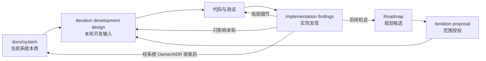

# 文档中心

文档分成两个互相隔离的权威域：

## 日常入口

1. [当前工作上下文](project/current.md)：人和 Agent 开始开发时的唯一入口。
2. [系统文档](system/README.md)：当前接受的产品目标、架构、契约和质量边界。
3. [项目文档](project/README.md)：Roadmap、迭代、发现、决策和结果。
4. [文档重整登记](project/documentation-reorganization/README.md)：本次唯一架构入口恢复及历史材料归位记录。

## 权威层级

| 位置 | 权威 | 可以决定什么 | 不能决定什么 |
|---|---|---|---|
| `system/` | 当前规范 | 系统边界、跨模块契约、不变量、质量下限 | 迭代排期、工作包状态、某次运行结论 |
| `project/current.md` | 当前工作状态导航 | 当前是否有开发授权、应读取的切片 | 改写系统契约 |
| `project/iterations/<id>/` | 本轮开发与证据 | 本轮范围、实现选择、验证和发现处置 | 把临时选择升级为永久系统真相 |
| `project/roadmap/` | 仅规划 | 候选结果、里程碑和进入迭代条件 | 直接授权编码或宣称能力已存在 |
| `_generated/` | 派生 | 加速检索和追溯 | 成为人工编辑的规范来源 |
| `archive/` | 历史 | 解释过去状态和迁移依据 | 指引当前开发 |

## 基线原则

仓库 Git 提交固定代码与文档的一致状态。系统架构的完整语义只在 `system/architecture/architecture-baseline.md` 维护；迭代 Manifest 记录本轮采用的系统文档、外部对象和验证输入，不得用人工摘要替代基线。外部模型、Provider、Oracle、冻结工程和运行证据仍必须用精确身份或 Digest 绑定。

## 修改文档

- 系统语义变化：修改唯一所有者文档；改变架构选择时同时新增或替代 ADR。
- 实现中发现的新事实：先按[实现发现回写规则](project/governance/implementation-feedback-policy.md)登记和分类。
- 局部 DTO、私有状态、算法和错误枚举：优先由代码、Schema 和测试定义。
- 迭代结果不得悄悄改写 `system/`；需要改变时在同一变更中显式回写。
- 修改后运行 `python3 scripts/docs.py check`，并提交重新生成的 `_generated/` 索引。
