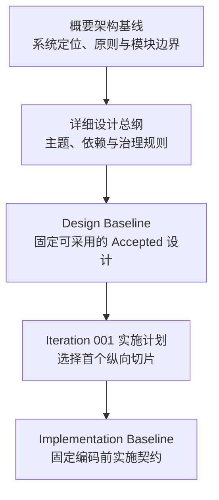

# Software World Model 文档中心

> 本文件是非规范性导航入口。规范边界、状态和摘要以各层当前 Manifest 为准。

## 1. 当前状态

- 概要架构：`SWM-ARCH@1.2`。
- 详细设计：22 个主题 `Accepted`，2 个条件主题 `In Review`。
- 当前设计基线：`SWM-DBM-ITER-001-REV-002`。
- 最近冻结的实施基线：`SWM-IBM-ITER-001-REV-002`（保留为历史闭包）。
- 当前实施状态：`模型接口符合性通过 / 通用能力评估通过 / 六题产品验收通过 / 本机浏览器体验已启用 / 生产启用未执行`。方舟12项接口验证已对当前Endpoint、Adapter、配置指纹、请求别名`glm-5-2-260617`和实际响应身份`glm-5.2`形成可验证资格。直接源码答案和本系统答案均由火山生成，Codex作为独立评审来源重读冻结源码并完成逐问题、逐维度比较。历史失败结果继续保留用于追溯，不适用于当前实现；当前只开放同机、无需登录的人工体验，生产仍按约定保持关闭。
- `demo/` 只用于设计验证；`validation-projects/` 只保存外部验证输入。

## 2. 术语和标识约定

本节是跨文档导航词汇表，不代替各规范对对象和状态的正式定义。局部编号由其所属文档定义；历史文档保持原貌，不为新词汇表回填或改写。

### 2.1 通用缩写

| 缩写或名称 | 英文 | 含义 |
|---|---|---|
| `SWM` | Software World Model | 本项目及其文档标识的统一前缀。 |
| `Iteration NNN` / `ITER-NNN` | Iteration | 一轮有独立范围、基线和验收条件的迭代；三位数字是序号。 |
| `WP-N` | Work Package | 实施工作包；编号表达计划中的依赖顺序，不表示优先级、完成比例或并行度。具体规则见[Iteration 001 实施计划](implementation/iteration-001/Implementation_Plan_Iteration_001.md#5-实现工作包与顺序)。 |
| `Gate` | Gate | 进入下一状态前必须满足的门禁；缺失、失败或未运行都不能按通过处理。 |
| `D-NN` | Development Gate | 离线开发准入门禁；通过只允许开发，不代表真实集成或生产可用。 |
| `L-NN` | Live Integration Gate | 真实Provider联调或模型能力验证门禁；需要对应真实执行证据。 |
| `P-NN` | Production Activation Gate | 生产激活/发布门禁；只有开发和Live门禁都满足后才可能通过。 |
| `Hold` / `Held` | Hold | 显式暂停或禁止进入后续阶段，不等同于任务排队或低优先级。 |
| `Baseline` | Baseline | 经治理决定固定、可供下游引用的一组规范或实施选择。 |
| `Manifest` | Manifest | 固定文件、版本、摘要、依赖和状态的闭包清单；清单冻结不表示运行验证已经通过。 |
| `CC` | Contract Conformance | 契约符合性验证，证明实现或适配器符合已定义的机械接口约束。 |
| `CE` | Capability Evaluation | 能力评测，证明exact Model / Prompt / Tool / Strategy是否达到业务Capability门槛；不能用CC结果替代。 |
| `ARK` | Volcengine Ark | 火山方舟模型服务；代码中的`VOLCENGINE_ARK`是Provider Type，不是密钥。 |
| `OAI-compatible` | OpenAI-compatible | 兼容某个OpenAI API接口族的Envelope；必须继续区分Chat Completions与Responses，且不表示请求由OpenAI运营。 |
| `ACV` | Architecture Capability Validation | 架构能力验证，证明正式路径能否承载目标能力。 |
| `JWT` | JSON Web Token | 本计划H-04 Commit影响分析的验证题目名称，不是工作包或代码模块。 |
| `DVR` | Design Variance Record | 公共契约无法表达、约束或恢复目标语义时登记的设计分叉记录。 |
| `Candidate` | Candidate | 等待复核、准入或冻结的候选对象；不能按 Accepted、Frozen 或生产可用处理。 |
| `Oracle` | Oracle | 在被测运行之外独立冻结的验收真值或命题集合，不属于系统运行输入。 |
| `Validity` | Evaluation Validity | 已封存CE Result当前是否仍可用于新激活；只能从`VALID`单调进入`STALE/REVOKED`。 |
| `OUTCOME_PENDING` | Outcome Pending | 已分派外部调用的结果尚不能证明；不得推测为失败、零Usage或PASS。 |
| `ccrun_*` | Conformance Run ID | 一次CC真实运行的不可变身份；后缀是随机运行标识，不表示Case数量或成功次数。 |
| `oracle_*` | Oracle ID | 一份经过独立复核并密封的Direct Oracle身份；Oracle正文不能作为World运行输入。 |
| `jwtrun_*` | JWT Run ID | JWT Run Configuration或World Model执行的运行身份；配置与执行分别有独立ID和Digest。 |
| `jwtcmp_*` | Comparison ID | 一次不可变跨模型逐Obligation比较身份；比较按`obligation_id`对齐，不要求两侧`semantic_key`或Claim分组相同。 |
| `evaluation_run_*` | Evaluation Run ID | CE Authority中的一次评测运行身份；PASS、FAIL和历史迭代都分别保留。 |
| `failed_model_calls` | Rejected Known-outcome Calls | Provider已明确返回、但因closed Schema或语义不一致而被本地拒绝的调用摘要；不等于网络Outcome未知，也不保存被拒绝的正文。 |

### 2.2 文档标识与状态

| 形式 | 含义 | 示例 |
|---|---|---|
| `SWM-ARCH` | 概要架构文档或基线 | `SWM-ARCH@1.2` |
| `SWM-DD` / `SWM-DBM` | 详细设计 / Design Baseline Manifest | `SWM-DBM-ITER-001-REV-002` |
| `SWM-IMP` / `SWM-IBM` | 实施计划 / Implementation Baseline Manifest | `SWM-IMP-ITER-001` |
| `SWM-ACV` | 架构能力验证切片或记录 | `SWM-ACV-SLICE-JWT-002` |
| `@x.y.z` | 规范语义版本 | `SWM-DD-GUIDE@0.1.0` |
| `REV-NNN` | 同一基线或清单的修订序号 | `REV-002`；不能自动解释为新的语义版本或测试结果。 |

常见状态按字面区分：`Accepted` 表示设计已接受，`Frozen` 表示内容闭包已固定，`Candidate` 表示仍待复核，`Held` 表示后续工作被暂停，`Not Run / Not Executed` 表示没有真实执行证据。状态不得相互推导。

`exact` 表示运行对象必须精确绑定到完整版本、摘要、Commit 或 Context；`Live` 表示经过真实 Provider / Runtime 边界执行；`offline` 表示不调用真实外部边界的可重复机械测试；`validation-only` 表示只允许用于验证且不得进入生产状态。

## 3. 推荐阅读顺序



1. [概要架构基线](architecture/Software_World_Model_Architecture_Baseline.md)
2. [详细设计总纲](detailed-design/Software_World_Model_Detailed_Design.md)
3. [Design Baseline Manifest — Revision 002](detailed-design/governance/Design_Baseline_Manifest_Iteration_001_Revision_002.md)
4. [Iteration 001 实施计划](implementation/iteration-001/Implementation_Plan_Iteration_001.md)
5. [实施准备暂停记录 001](implementation/iteration-001/Implementation_Readiness_Hold_001.md)
6. [离线开发再准入记录 001](implementation/iteration-001/Implementation_Development_Reentry_001.md)
7. [离线实现结果 001](implementation/iteration-001/Offline_Implementation_Result_001.md)
8. [配置前功能验收 001](implementation/iteration-001/Preconfiguration_Functional_Acceptance_001.md)
9. [真实模型Provider配置记录 001](implementation/iteration-001/Live_Provider_Configuration_001.md)
10. [方舟Chat Conformance Fixture](implementation/iteration-001/conformance/CC-ARK-CHAT-NO-TOOLS-001.md)
11. [Capability Evaluation Runtime 001](implementation/iteration-001/Capability_Evaluation_Runtime_001.md)
12. [JWT Capability Run Harness 001](implementation/iteration-001/JWT_Capability_Run_Harness_001.md)
13. [JWT Capability Run Result 001](implementation/iteration-001/JWT_Capability_Run_Result_001.md)
14. [通用模型任务运行链路实施记录 001](implementation/iteration-001/General_Model_Task_Runtime_001.md)
15. [本机浏览器聊天体验说明 001](implementation/iteration-001/Browser_Chat_Experience_001.md)

## 4. 目录结构

```text
docs/
├── README.md
├── architecture/                 # 当前概要架构与架构决策
├── detailed-design/              # 阶段无关的详细设计、主题与设计治理
│   ├── topics/
│   └── governance/
├── implementation/               # 按迭代组织的实施计划、契约与 Conformance
│   └── iteration-001/
│       ├── contracts/
│       └── conformance/
├── validation/                   # 架构验证与产品价值验证证据
│   ├── architecture/
│   └── product-value/
└── history/                      # 被替代文档、迁移记录与不可变快照
```

| 目录 | 职责 | 不能承担的职责 |
|---|---|---|
| [architecture/](architecture/README.md) | 稳定的系统级定位、原则、模块边界和决策依据 | 迭代实施选择与测试结论 |
| [detailed-design/](detailed-design/README.md) | 跨迭代复用的详细设计契约及其接受治理 | 某轮技术栈和交付范围 |
| [implementation/](implementation/README.md) | 某次迭代的实施计划、Schema、Provider、Adapter 和门禁 | 反向改写一般架构 |
| [validation/](validation/README.md) | 实验条件、运行记录、失败和产品价值证据 | 覆盖正式规范或伪装成生产实现 |
| [history/](history/README.md) | 被替代文档、目录迁移审计和历史快照 | 作为当前设计入口 |

## 5. 当前权威文档

| 层级 | 文档 | 当前状态 | 作用 |
|---|---|---|---|
| 概要架构 | [Software World Model Architecture Baseline](architecture/Software_World_Model_Architecture_Baseline.md) | `SWM-ARCH@1.2 / Baseline` | 定义系统级稳定职责、边界和原则 |
| 详细设计治理 | [Software World Model Detailed Design](detailed-design/Software_World_Model_Detailed_Design.md) | `SWM-DD-GUIDE@0.1.0 / Accepted` | 定义主题划分、依赖、状态和变更规则 |
| 设计版本闭包 | [Design Baseline Manifest](detailed-design/governance/Design_Baseline_Manifest_Iteration_001_Revision_002.md) | `SWM-DBM-ITER-001-REV-002 / Frozen` | 固定架构、总纲及 22 个 Accepted 主题摘要 |
| 迭代选择 | [Implementation Plan](implementation/iteration-001/Implementation_Plan_Iteration_001.md) | `JWT CE PASS / Product Holdout and Activation Held` | 选择首个纵向实现切片和工作包顺序 |
| 原实施暂停 | [Readiness Hold 001](implementation/iteration-001/Implementation_Readiness_Hold_001.md) | `AMENDED` | 保存暂停原因和原始边界 |
| 离线开发再准入 | [Development Reentry 001](implementation/iteration-001/Implementation_Development_Reentry_001.md) | `ACTIVE` | 允许离线生产开发；继续禁止真实联调和生产激活 |
| 离线实现结果 | [Offline Implementation Result 001](implementation/iteration-001/Offline_Implementation_Result_001.md) | `OFFLINE COMPLETE / LIVE PENDING` | 记录WP-1至WP-7离线交付与测试证据，不替代产品验收 |
| 配置前功能验收 | [Preconfiguration Functional Acceptance 001](implementation/iteration-001/Preconfiguration_Functional_Acceptance_001.md) | `PASS / READY FOR CONFIGURATION` | 证明本地入口和离线Provider边界已具备进入真实配置阶段的条件 |
| 真实模型Provider配置 | [Live Provider Configuration 001](implementation/iteration-001/Live_Provider_Configuration_001.md) | `TRANSPORT PROBE PASS / LIVE CC PASS` | 固定方舟Chat Completions配置并记录已验证的Live CC与后续门禁 |
| 方舟Adapter Conformance | [CC-ARK-CHAT-NO-TOOLS-001](implementation/iteration-001/conformance/CC-ARK-CHAT-NO-TOOLS-001.md) | `LIVE PASS / CURRENT` | 定义两次真实调用、12项Oracle、安全Result和资格加载 |
| Capability Evaluation Runtime | [CE Runtime 001](implementation/iteration-001/Capability_Evaluation_Runtime_001.md) | `MECHANISM IMPLEMENTED / JWT CE PASS` | 实现Definition、Run、Case、Result、Validity和Activation证据链 |
| JWT Capability Run Harness | [JWT Harness 001](implementation/iteration-001/JWT_Capability_Run_Harness_001.md) | `CC、WORLD、COMPARISON、CE PASS / ACTIVATION NOT RUN` | 实现Direct Oracle、七角色、Snapshot、跨模型比较、CE桥接和完整运行手册 |
| JWT Capability Run Result | [JWT Run Result 001](implementation/iteration-001/JWT_Capability_Run_Result_001.md) | `JWT CE PASS / VALID AT REGISTRATION / ACTIVATION NOT RUN` | 固定当前真实运行、独立比较、失败迭代和剩余门禁证据 |
| 最近冻结的实施契约闭包 | [Implementation Baseline Manifest](implementation/iteration-001/Implementation_Baseline_Manifest_Iteration_001_Revision_002.md) | `SWM-IBM-ITER-001-REV-002 / Frozen Historical` | 保留审计前 Schema、Provider、Adapter、错误和 Fixture 契约闭包；不再授权开工 |

权威顺序是“上游一般约束优先于下游实施选择”。Demo、验证记录和历史稿都不能覆盖当前基线。

## 6. 设计治理与验证入口

| 类别 | 文档 |
|---|---|
| 架构决策 | [Architecture Decision Log](architecture/Architecture_Decision_Log.md) |
| 详细设计评审 | [Review Record 001](detailed-design/governance/Detailed_Design_Review_Record_001.md) |
| 详细设计接受 | [Acceptance Record 001](detailed-design/governance/Detailed_Design_Acceptance_Record_001.md) |
| 架构验证 | [验证基线](validation/architecture/Architecture_Validation_Baseline.md)、[验证记录](validation/architecture/Architecture_Validation_Log.md) |
| 产品价值验证 | [验证记录](validation/product-value/Product_Value_Validation_Log.md)、[Holdout Run 001](validation/product-value/Product_Value_Holdout_Run_001.md) |
| JWT 可行性复核 | [Architecture Feasibility Review JWT 002](validation/architecture/Architecture_Feasibility_Review_JWT_002.md) |

## 7. 仓库内其他内容

| 目录 | 说明 |
|---|---|
| [demo/](../demo/README.md) | 历史架构验证 Demo，不是生产实现或当前技术栈决定 |
| [validation-projects/](../validation-projects/README.md) | 外部项目快照，只作为验证输入，不纳入平台文档治理 |

## 8. 历史与迁移

- [文档结构迁移记录 001](history/Documentation_Structure_Migration_Record_001.md)说明当前目录、基线 Revision 与迁移前快照的关系。
- [历史文档索引](history/README.md)列出已被替代的架构输入稿和兼容入口。
- 历史材料用于追溯，不与当前权威文档并列。

## 9. 文档维护规则

1. 每份当前规范只保留一个 canonical 文件；不得为了兼容旧路径复制出第二份权威正文。
2. 一般架构、详细设计、实施选择、验证证据和历史材料必须进入各自职责目录。
3. 规范语义变化必须升级相应文档版本、评估依赖并创建新的 Manifest。
4. 仅目录或导航包装变化时，Document ID 与语义版本可以保持不变，但必须建立新的 Manifest Revision，并记录迁移前后路径与摘要。
5. 某次迭代的选择只能进入 `implementation/iteration-NNN/`，不能反向改变 Accepted 设计。
6. Conformance Fixture 与真实执行 Result 分离；文档冻结不能表述为测试已经通过。
7. Demo 只回答已登记的设计问题，验证记录只保存证据，二者都不能成为规范权威。
