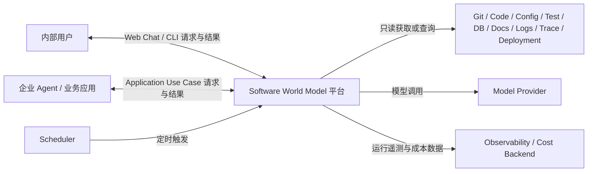
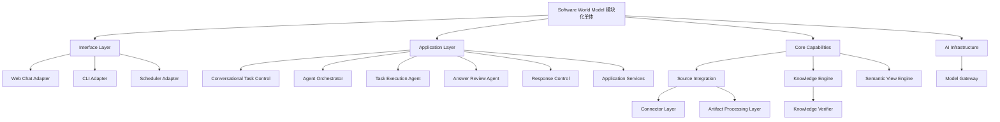
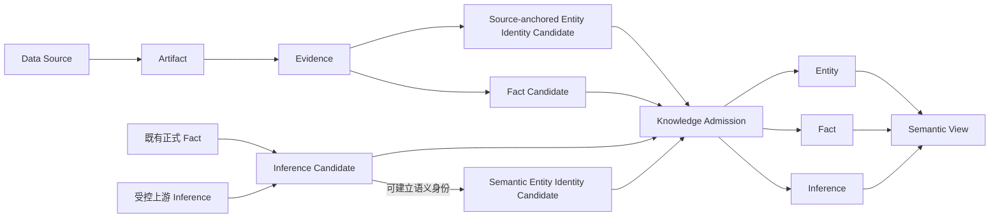
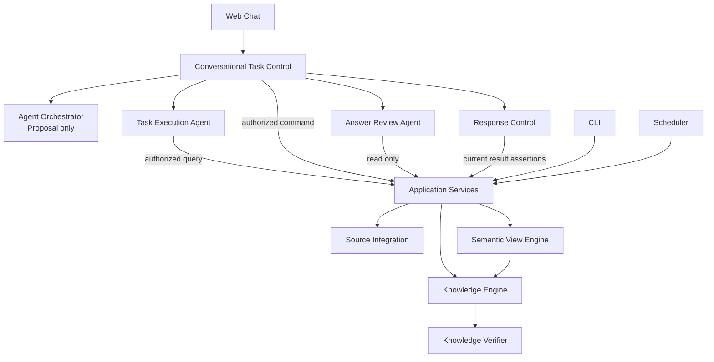
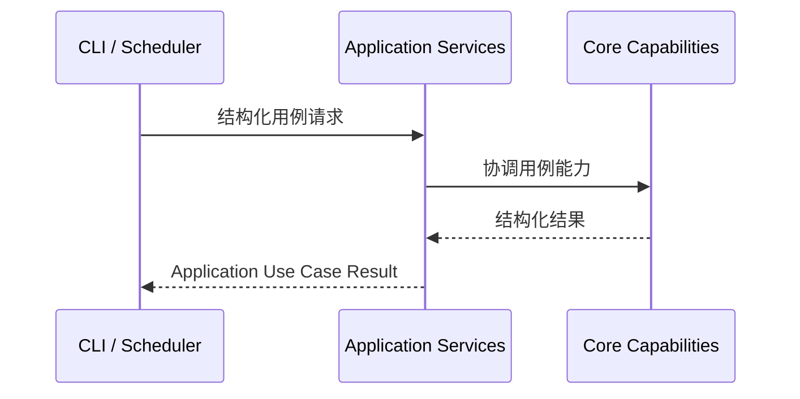
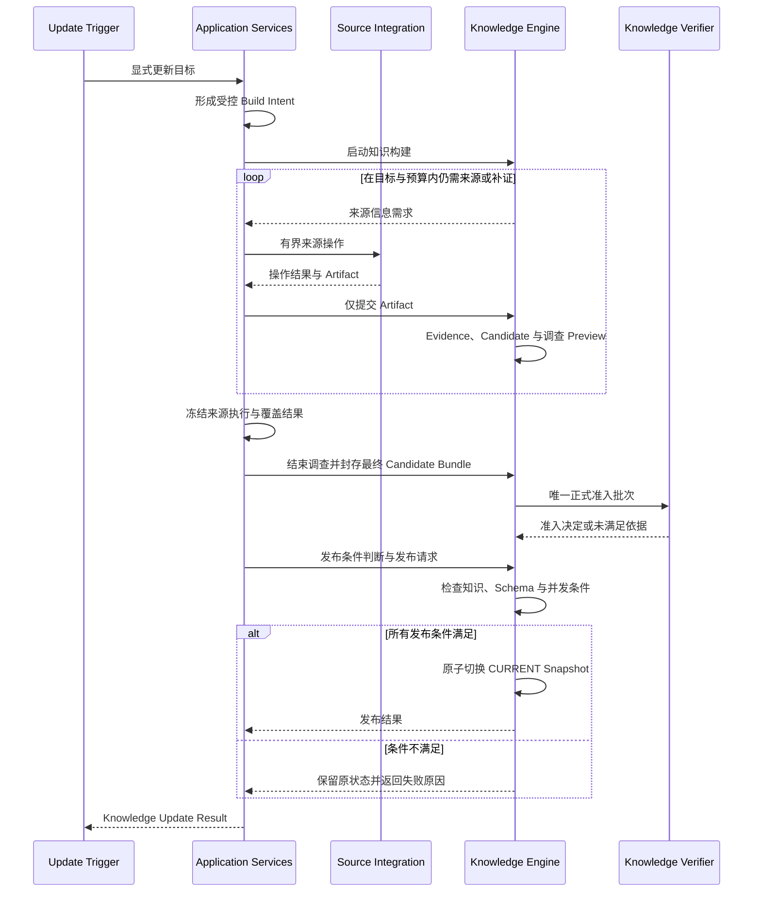
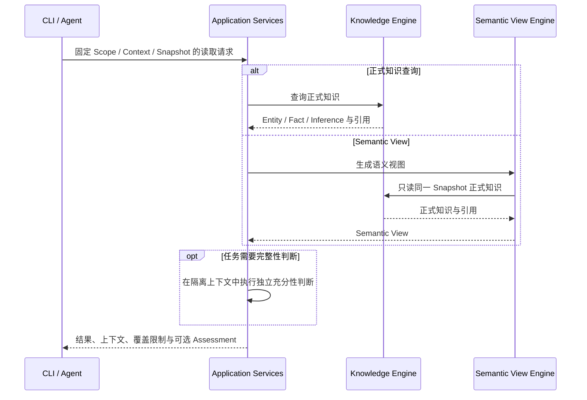
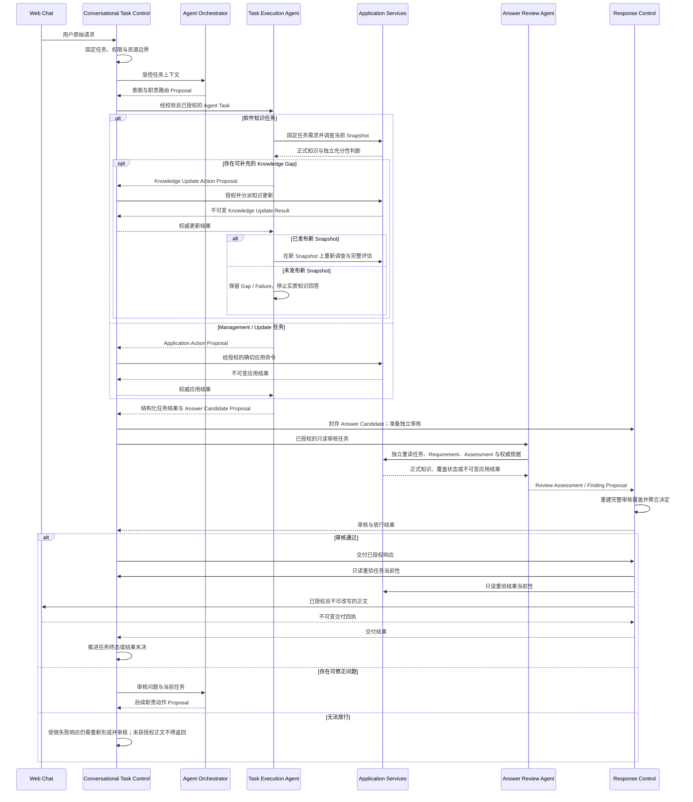
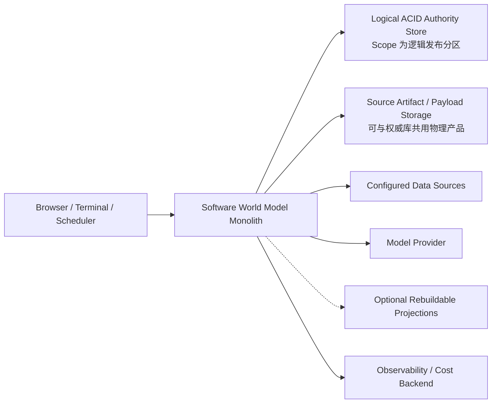

# Software World Model 平台概要架构设计

**版本：V1.2**  
**文档状态：概要架构基线**  
**架构形态：模块化单体**

> Software World Model 平台面向企业软件构建共享认知基础设施：将代码、配置、数据、文档、版本历史和运行记录等可观察信息，转化为带上下文、可追溯、可验证、可更新的统一语义模型，供人员、Agent 和自动化任务共同使用。

## 1. 文档说明

### 1.1 文档目的

本文定义 Software World Model 平台的概要架构，包括：

- 建设背景、系统定位和价值目标。
- 系统边界和外部参与者。
- 总体解决方案、逻辑组件及依赖方向。
- 核心领域概念和知识形成机制。
- 关键运行流程、可信边界和一致性边界。
- 数据所有权、部署形态、扩展方式和演进路线。

本文是详细设计、研发拆解和架构符合性检查的上游依据。

### 1.2 适用读者

- 产品负责人和业务领域专家。
- 架构师、研发人员和测试人员。
- AI 工程、数据工程和平台工程人员。
- 平台 Agent、Connector 和 Semantic View 开发者。

### 1.3 设计层级与边界

本文属于概要架构设计，只定义稳定的职责、概念、关系和约束，不规定：

- API 字段、类、表、状态枚举和错误码。
- Prompt、模型参数、Tool Schema 和评测阈值。
- Entity Resolution、Fact 归并、冲突处理等具体算法。
- 数据库、Graph、Vector、Search 或对象存储选型。
- 部署参数、容量指标和企业级安全实现。

这些内容分别进入详细设计、验证基线和实施方案。

### 1.4 文档权威关系

- 本文定义当前生效的概要架构。
- [Architecture_Decision_Log.md](Architecture_Decision_Log.md) 记录决策原因、历史方案和被替代结论。
- [Software_World_Model_Detailed_Design.md](../detailed-design/Software_World_Model_Detailed_Design.md) 管理下游主题详细设计；各主题负责细化应用契约和实现语义，并必须符合本文定义的架构边界。
- 验证项目、模型、参数、分数和运行轨迹只记录在验证文档中。

当其他设计或验证文档与本文冲突时，以当前版本的本文为准。架构决策只有在纳入新版概要架构基线后，才能改变架构符合性要求。

### 1.5 核心术语

| 术语 | 定义 |
|---|---|
| Software World Model | 对一个或多个软件系统在明确上下文中的结构、行为、业务语义和演化过程的统一语义表示 |
| Software World Model 平台 | 负责软件世界模型接入、构建、验证、发布、使用和更新的软件系统 |
| 正式知识 | 经过知识准入并由 Knowledge Engine 管理的 Entity、Fact 和 Inference |
| Candidate | Entity、Fact 或 Inference 在知识准入前的不可信候选状态 |
| Claim | 对外响应准备陈述的一项可核验判断，不是新的正式知识类型 |
| KnowledgeScope | 知识归属、稳定身份、发布、并发控制和逻辑分片边界 |
| KnowledgeContext | 知识成立或适用的 Environment、Version、Time 等条件 |
| Knowledge Schema | 定义正式 Entity、Fact、Inference、依赖及其解释规则的版本化语义契约 |
| Snapshot | 某个 KnowledgeScope 一次原子发布、可一致读取的正式知识状态 |
| Conflict Inference | 表达多个可比较正式 Fact 之间不兼容关系的 Inference 语义类型，不是独立正式知识类型 |
| Semantic View | 面向任务组织正式知识的语义视图，不是新的知识来源 |
| Knowledge Requirement Revision | 在原始任务边界内形成且不可原地修改的一版知识需求及充分条件 |
| Snapshot Read Session | 将一次知识调查固定到 Scope、Snapshot、KnowledgeContext、Schema 和覆盖边界的读取上下文 |
| Knowledge Sufficiency Assessment | 独立判断固定 Snapshot 中的正式知识是否逐项满足某版 Knowledge Requirement 的结果 |
| Build Intent | 平台根据更新目标、输入绑定、可用能力和发布条件规范化并冻结的知识构建契约 |
| Capability Strategy | 某项能力的确定性、模型主导或混合实现方式 |
| Platform Telemetry & Cost Governance | 关联平台运行轨迹、用量、成本和预算的横切能力，不是业务模块或正式知识来源 |

## 2. 建设背景、系统定位与架构驱动

### 2.1 问题背景

企业软件的实际状态和业务含义并不存在于单一载体中：

- 源代码描述可能的实现逻辑。
- 配置、制品和部署信息决定特定环境实际使用的版本。
- 数据库结构与数据反映持久化模型和业务状态。
- 日志、Trace 和 Metric 记录特定时间与环境下发生的行为。
- 测试、需求和文档表达约束、意图和背景。
- Git 与发布记录描述软件如何演化。

这些来源独立演进，具有不同的系统归属、版本、环境和时间范围，彼此可能互补、滞后或冲突。任何单一来源都不能独立代表完整的软件世界。

当前软件认知通常分散在个人经验、临时调查结果、设计文档和一次性模型会话中，由此产生以下系统性问题：

- 跨系统业务流程和技术实现缺少统一表达。
- 文档与实际实现逐渐偏离，知识可信度难以判断。
- 同类问题被不同人员或 Agent 反复从原始来源重新调查。
- 结论缺少适用版本、环境和时间，容易被错误复用。
- 软件变化后，已有认知难以被识别、重验证和更新。
- 大模型虽能完成开放式调查，但认知通常停留在单次执行上下文中，无法自然形成企业共享记忆。

企业需要的不是另一个代码问答入口，而是一套公共认知底座，使不同人员、Agent 和自动化任务能够跨任务、跨时间和跨系统，持续建立、验证、共享和更新对同一软件世界的理解。

### 2.2 系统定位

> **Software World Model 平台是面向企业软件的认知基础设施；Software World Model 是该基础设施在明确 Scope、Context 和 Snapshot 下管理的统一语义表示。**

它面向一个或多个软件系统及其业务范围，在明确上下文中构建并维护对软件结构、行为、业务语义和演化过程的统一语义表示，为人员、Agent 和自动化任务提供共享、可追溯、可更新的认知底座。

软件世界模型由正式 Entity、Fact 和 Inference 构成，并保留相关 Evidence、推导依赖和 KnowledgeContext。它表达某个 Snapshot 中已经建立并通过准入的认知，不是对整个软件世界的完整复制，也不把未知内容伪装成已知事实。

> **Software World Model 平台负责该认知底座的完整生命周期。**

平台覆盖来源接入、信息调查、知识构建、知识验证、Snapshot 发布、知识使用、受控更新和能力评测。Web Chat、CLI 和 Scheduler 是使用平台能力的入口；正式知识及其生命周期是平台的核心资产。

### 2.3 价值目标

| 价值方向 | 目标 |
|---|---|
| 共享认知 | 人员、Agent 和自动化任务基于同一 Snapshot 和稳定知识引用协作，减少认知只存在于个人或单次会话中的问题 |
| 跨来源理解 | 在保留各来源上下文的前提下，联合代码、配置、数据、文档和运行记录形成单一来源无法提供的语义 |
| 跨系统业务认知 | 在独立系统模型之上关联 Business Domain、Business Entity、业务能力和技术实现 |
| 可信使用 | 区分来源观察、客观事实和语义推断，使结论能够追溯到依据、依赖和适用上下文 |
| 受控演化 | 软件来源、环境或模型变化后，通过重建、重验证和 Snapshot 发布更新共享认知 |
| 认知复用 | 将具有复用价值的任务认知沉淀为正式知识，降低重复调查成本 |
| AI 能力演进 | 允许更强模型逐步承担更多认知任务，同时保持稳定知识契约和质量责任 |
| 通用能力生长 | 围绕开放任务动态调查和形成知识，避免针对少量固定问题预制答案或固化流程 |

典型使用场景包括系统理解、跨系统业务追踪、变更影响分析、故障调查准备、知识传承、架构治理和 AI 辅助研发。

### 2.4 与相关能力的关系

| 对象 | 与平台的关系 | 边界 |
|---|---|---|
| 直接代码或来源调查 Agent | 提供任务级认知能力，并作为独立能力评测参照 | 独立评测时位于平台之外；平台运行时若使用同类来源调查能力，只能通过 Knowledge Update，任何支持生产软件知识 Claim 的结论都必须经过正式知识生命周期并发布到 Snapshot |
| 知识库与 RAG | 可用于来源发现、Artifact 检索、正式知识检索或查询优化 | 相关片段检索不能替代身份、Fact / Inference、上下文、支持链、Snapshot 和更新生命周期 |
| Knowledge Graph | 与 Entity、Fact、Inference 的图式语义表示部分重叠 | 若采用，仍由 Knowledge Engine 管理同一逻辑权威，不能形成平行知识体系 |
| Graph Database | 可以作为 Knowledge Engine 权威主存的物理实现，也可以作为额外查询 Projection | 角色由逻辑所有权决定；作为主存时必须满足最低持久化责任并由 Knowledge Engine 独占写入，作为 Projection 时必须可重建 |
| Vector Index、Search Index 与 Cache | 提供附加检索和查询优化 | 只承担可重建 Projection，不保存唯一权威状态 |
| 数字孪生 | 可以消费软件世界模型，也可以提供运行状态来源 | 平台定位不包含实时仿真、预测和控制，主要承担软件语义与认知层 |
| Git、源码、日志、数据库、文档及可观测平台 | 是软件世界的外部信息来源 | 平台不替代源系统；原始记录仍由源系统拥有 |
| 基础模型与 Model Provider | 是可替换的认知执行能力 | 模型输出不是正式知识，模型参数也不是平台知识存储 |

平台的意义不是替代强大模型读取软件来源的能力，而是把这种能力转化为具有共享记忆、明确边界、证据依据、更新机制和质量门禁的企业能力。

### 2.5 建设目标

平台的架构目标是：

1. 建立能够容纳异构软件来源的统一接入和来源追溯机制。
2. 构建 Entity、Fact 和 Inference 分层的正式知识模型。
3. 保留知识归属、版本、环境、时间及跨来源组合条件。
4. 提供 Structure、Behavior、Business、History 等可扩展语义视图。
5. 支持结构化用例、自然语言任务和计划任务使用同一核心能力。
6. 通过知识准入、答案审核和 Snapshot 发布保证正式状态可信。
7. 通过 Capability Contract 隔离具体模型、Prompt、Provider 和执行 Strategy。
8. 支持软件变化后的知识重建、重验证和受控演化。
9. 在重复任务、多用户、多 Agent、跨来源和版本变化场景中形成可度量的认知复用价值。

### 2.6 非目标

平台不负责：

- 替代 Git、数据库、文档、发布或可观测平台。
- 将检索结果或模型回答直接作为正式知识。
- 用理想化 Target Architecture 覆盖软件实际状态。
- 建设通用多 Agent 平台或通用工作流引擎。
- 承担实时仿真、预测控制或对外部生产系统的自动控制职责。
- 在没有真实需求前建设微服务体系、分布式事务和多套专用存储。
- 预设与实际部署规模、隔离强度和治理要求无关的多租户、合规、高可用或容灾方案。

### 2.7 架构驱动因素

| 驱动因素 | 对架构的影响 |
|---|---|
| 软件世界多源且持续变化 | 来源、上下文、知识状态和发布状态必须分离 |
| 不同来源可能互补或冲突 | 保留各自可复核事实，并显式表达冲突与不确定性 |
| 知识类型和关系持续演进 | Knowledge Schema 随 Snapshot 版本化，并通过受控迁移或重建演进 |
| 结论需要被人员和 AI 共同使用 | 正式知识需要稳定身份、明确语义和可追溯引用 |
| 开放问题不能完全预编码 | 模型必须能够参与调查、关联、归纳、组织和审核 |
| 模型能力快速演进且存在波动 | 核心契约不能绑定特定模型，能力需要评测、切换和回退 |
| 错误知识会被持续复用 | 生成方不能拥有准入权，知识与答案需要独立审核 |
| 全量语义构建成本高 | 知识按复用价值逐步结晶，而不是预先物化整个软件世界 |
| 多 Scope 需要独立演化 | 以 KnowledgeScope 作为逻辑分片与发布边界，跨 Scope 通过固定依赖受控收敛 |
| Agent、模型和 Tool 运行成本显著 | 建立端到端运行关联、预算、用量和成本观测 |
| 需要控制分布式复杂度 | 采用模块化单体，以明确边界支持按真实扩缩容和隔离需求拆分 |

## 3. 系统范围与上下文

### 3.1 参与者与主要使用方式

| 参与者 | 主要使用方式 |
|---|---|
| 开发人员与架构师 | 理解系统结构、行为、依赖、业务映射和演化历史 |
| 业务与领域专家 | 查询跨系统业务概念、规则和技术实现关系 |
| 运维与支持人员 | 在接入运行来源后获取故障调查所需的软件上下文 |
| AI Agent 与业务应用 | 使用稳定正式知识完成分析、生成、审核和自动化决策准备 |
| 平台管理员 | 管理 KnowledgeScope、Data Source、更新任务和 Capability Strategy |
| Scheduler | 触发预先配置的 Knowledge Update |

### 3.2 System Context

源系统继续拥有原始记录；Model Provider 只提供认知执行能力；Observability / Cost Backend 接收平台运行遥测；平台拥有正式知识及其生命周期。

### 3.3 系统边界

平台内部负责：

- KnowledgeScope 和 Data Source Binding 管理。
- Connector、Artifact 获取与加工。
- Evidence、Entity、Fact、Inference 构建与验证。
- Snapshot 发布和正式知识查询。
- Semantic View 生成。
- Web Chat Agent 编排与响应审核。
- 模型访问、能力版本和评测记录。
- 平台运行关联、用量、预算、成本与审计事件。

平台外部负责：

- 原始软件数据和源系统访问控制。
- 基础模型训练、托管和 Provider 服务。
- 企业观测、告警、成本分析和长期遥测存储设施。
- 对平台输出采取实际业务或生产变更动作。

外部修改代码、配置或生产系统的 Action Capability 不属于 Source Integration 的读取职责，必须采用独立授权、确认和副作用边界。

## 4. 总体解决方案策略

### 4.1 AI Native

AI Native 是系统级原则，而不是某个模块的实现方式：

- 模型负责开放式目标理解、调查规划、非结构化理解、跨来源关联、Candidate 提议、推断、语义组织和审核。
- 确定性工具负责稳定、明确、可重放的读取、解析、身份约束、引用重建、Schema 校验和状态变更。
- 同一能力可以使用确定性、模型主导或混合 Strategy。
- Strategy 可以随模型能力变化，但稳定 Capability Contract 和正式知识语义不能随模型厂商变化。
- AI Native 的目标是提升通用性和认知能力，不以减少工程责任或牺牲准确性为代价。

### 4.2 Source-Grounded 与知识分层

- Artifact 表达可独立解释的信息载体。
- Evidence 表达来源呈现了什么。
- Fact 表达平台在明确上下文下接受的客观命题。
- Inference 表达基于正式知识形成的语义结论。
- Semantic View 只组织正式知识。

来源、观察、事实、推断和视图必须保持分离，任何一层都不能通过命名或模型自报越过下一层的准入边界。

### 4.3 As-Is 优先

平台首先表达软件当前实际存在的技术结构和行为，不要求源系统采用 DDD，也不为获得整洁模型而强制合并混乱边界。业务语义和目标架构可以作为 Inference、建议或独立视图存在，但不能覆盖 As-Is 正式知识。

### 4.4 Scope、Context 与 View 正交

- KnowledgeScope 回答知识归属于哪个系统、共享组件或业务域。
- KnowledgeContext 回答知识在什么环境、版本和时间条件下成立。
- Entity、Fact、Inference 回答知识对象的认知性质。
- Semantic View 回答如何面向任务组织知识。

四者是独立维度，不能相互代替。

### 4.5 单一逻辑权威

正式 Entity、Fact、Inference 及其来源和依赖只有一个逻辑权威来源。单一逻辑权威表示统一的语义与写入所有权，不表示单一物理数据库、全局事务或全局发布锁。Knowledge Engine 的权威主存可以采用关系、文档或图存储，并按 KnowledgeScope 分片；额外构建的 Graph、Vector、Search、Cache 和物化视图只能作为可重建的查询 Projection。

### 4.6 冲突不静默消解

来源之间的不一致首先按各自 Evidence、来源语义和 KnowledgeContext 保留为可复核 Fact。平台只有在命题目标和上下文可比较、且冲突关系完成知识准入后，才形成 Conflict Inference；任何组件都不能通过覆盖、丢弃或模型偏好静默选择一方。

### 4.7 Schema 与知识受控演进

Knowledge Schema 与 Snapshot 一同版本化。Schema 变化只能通过受控迁移或基于来源的重建生成新候选 Snapshot，并在依赖、准入和兼容性验证通过后原子发布；不能原地改写 CURRENT 或只修改 Projection 来伪装知识已经升级。

### 4.8 按复用价值结晶知识

平台不以使用前完整理解整个软件世界为目标。低成本、稳定且广泛复用的基础知识可以初始化或全量构建；高成本的 Behavior、Business、History 和跨来源语义优先由真实任务触发，并根据可信度、复用价值和维护成本决定是否进入正式知识。

一次性计划、搜索线索、模型思考状态和回答文本不进入软件世界模型。

### 4.9 正式知识单路径

生产软件知识答案只使用已发布的正式知识。知识不足时可以触发 Knowledge Update，但来源调查结果必须完成 Evidence、Candidate、知识验证和 Snapshot 发布后才能被正式使用。直接来源 Agent 只用于独立能力评测，不构成运行时回退路径。

### 4.10 模块化单体优先

平台采用一个代码库、一个逻辑部署单元和清晰的内部模块边界。只有出现独立扩缩容、团队所有权、隔离强度或发布节奏需求时，才沿既有边界进行服务拆分。

### 4.11 最小充分与迭代扩展

架构只为已经纳入系统的能力和明确不变量增加对象、状态与协调机制，不为假设中的未来规模预建模块、表、状态机、分布式协议或空服务。当前条件下优先采用模块化单体内的局部事务、幂等、失败关闭和直接权威读取。

可扩展性通过稳定 Contract、Provider / Strategy SPI、版本化引用和清晰所有权获得，而不是通过提前实现全部可能能力获得。未来能力只在本架构中保留启用条件和不得突破的不变量；条件出现后先完成相应详细设计或 ADR，再以新 Strategy 或新模块扩展，不能把占位实现解释成已经完成设计。

## 5. 总体架构概览

### 5.1 逻辑分区与组件归属

上图只表达组件归属，不表达调用关系。

| 逻辑分区 | 职责 |
|---|---|
| Interface Layer | 将 Web、CLI、Scheduler 协议转换为应用调用 |
| Application Layer | 管理任务和授权状态、编排 Agent、协调用例，并控制审核、放行和响应交付 |
| Core Capabilities | 接入来源、构建正式知识、维护 Snapshot、生成语义视图 |
| AI Infrastructure | 统一模型访问、执行约束和调用追溯 |

Platform Telemetry & Cost Governance 以中立埋点和单向运行事件贯穿 Interface、Application、Core Capabilities 与 AI Infrastructure。它不构成新的业务模块，不参与正式知识、Snapshot 或响应决策，也不成为平行数据权威。

## 6. 领域与信息架构

### 6.1 知识形成主干

该图表达支持与准入关系，不表示固定处理时序。Evidence 可以同时支持来源锚定的 Entity 身份识别和 Fact Candidate 构建；推断型 Business Entity 与证明其身份的 Inference Candidate 作为依赖闭包原子准入。图中的“既有正式 Fact / 受控上游 Inference”均指已发布知识；Candidate 间的局部引用只服务身份替换和原子提交，不能使未准入 Fact Candidate 成为正式 Inference 的语义前提。

### 6.2 来源与观察

#### Data Source 与 Data Source Binding

Data Source 表示一个可访问的软件信息源。Data Source Binding 将数据源实例及其采集边界归属到 KnowledgeScope。共享数据源可以通过 Selector 限定单个来源内部的采集范围；Selector 不负责跨来源语义映射。

#### Artifact

- Source Artifact 直接来自外部 Data Source。
- Derived Artifact 由 Artifact Processing 加工形成，并保留到 Source Artifact 的 Lineage。
- 不同来源可以使用不同 Payload 和粒度，但对外遵循中立 Artifact 边界契约。
- Lineage 只证明加工来源，不证明语义正确。
- 模型摘要、解释等语义变换不能直接证明 Fact，也不能成为正式 Inference 的前提。

Artifact 是 Source Integration 面向 Knowledge Engine 的唯一信息载体。来源调用状态属于应用执行信息，不进入正式知识主干。

#### Evidence

- Evidence 从一个 Artifact 中取得，并具有可复核定位。
- 一个 Evidence 只绑定一个 Artifact，并保存足以独立复核该次观察的最小精确内容快照；Artifact Payload 后续按 Source Integration 本地策略退出时，已经封存的 Evidence 仍保持可解释。
- Evidence 表达“来源呈现了什么”，不表达平台最终相信什么。
- Evidence 可以支持或反驳 Fact Candidate，也可以触发正式 Fact 重验证；数量本身不能证明结论成立。
- 当 Evidence 能够直接支持与现有命题不兼容的替代命题时，应形成独立、带 KnowledgeContext 的 Fact Candidate，不能只作为原 Fact 的负面附件。
- Evidence 中存在但正式命题未声明的内容，不会自动成为正式知识。

### 6.3 正式知识

#### Entity

- Entity 表达可被稳定引用的身份，不承载未经验证的属性和关系。
- 技术 Entity 优先由来源稳定标识锚定。
- 同名、跨 Scope 或推断型身份需要更严格的身份解析和审核。
- 推断型 Business Entity 与证明其身份的 Inference 作为依赖闭包原子准入。
- 每个 Entity 只有一个 owning KnowledgeScope。

#### Fact

- Fact 是在明确 KnowledgeContext 下可由直接 Evidence 复核的客观命题。
- 在同一 owning KnowledgeScope 内，同一规范化命题使用稳定身份。
- 上下文条件实质改变命题语义时，形成不同 Fact。
- 一个 Fact 可以关联多个 Evidence。
- 不同来源提供互不兼容的直接观察时，各观察按照自身 Evidence、来源语义和 KnowledgeContext 分别形成 Fact，不强制归并、覆盖或选择一个“全局真相”。
- 等价命题可以由多个 Evidence 共同支持；互不兼容的替代命题形成不同 Fact，不能从来源局部观察扩张为跨来源、跨版本或跨环境的绝对结论。
- 图三元组和检索字段只是 Projection，不能成为 Fact 的语义表达上限。

#### Inference

- Inference 是基于正式 Fact，以及必要时受控上游 Inference 得出的语义结论。
- Inference 必须保留正式前提、适用上下文和完整依赖链。
- 依赖必须有界、无环，并能随上游知识失效而重新验证。
- 当多个正式 Fact 在可比较的目标、维度和上下文中互不兼容时，可以形成经过独立验证的 Conflict Inference。
- Conflict Inference 必须引用被判断为互不兼容的正式 Fact、比较依据和 KnowledgeContext；它遵循普通 Inference 的 Scope、准入、Snapshot 和失效规则，不创建特殊 Entity、平行存储或新的知识层。
- Conflict Inference 不覆盖或删除其引用的原始 Fact。
- 最大推理深度属于可评测 Strategy，不是概要架构固定常量。

Fact 与 Inference 的区别取决于认知性质和支持关系，不取决于它由代码还是模型提出。

准入后的 Fact 和 Inference 作为不可变正式断言进入 Snapshot。后续出现新来源、上下文变化或支持不足时，不回写已发布对象，也不发明“不可用事实”作为第二种正式知识；平台产生影响或重验证信号，并在新的 Snapshot 构建中重新验证、替换或不再选择该对象。若软件自身的弃用、停用或失效具有业务语义，应按普通 Fact 或 Inference 重新形成并准入。

### 6.4 Candidate 与知识准入

模型或确定性 Strategy 对知识内容的输出首先是 Candidate Proposal。Knowledge Engine 根据冻结的来源、身份和上下文构造成 Candidate；Candidate 在知识准入前始终不可信。

只有完成准入的 Entity、Fact 和 Inference 才能进入 Snapshot、Semantic View 和正常 Knowledge Use。生成方不能同时拥有正式身份分配、准入和发布权。

知识准入的严格性表示每个正式命题都必须有合法支持和明确上下文，不表示 Snapshot 必须不存在分歧。来自存在分歧来源、可分别复核的独立 Fact 可以共同准入；它们的共存不构成正式冲突结论，只有完成准入的 Conflict Inference 才能表达冲突。

### 6.5 KnowledgeScope

平台支持三类 KnowledgeScope：

| Scope 类型 | 归属对象 |
|---|---|
| System Scope | 一个独立软件系统及其本地技术实体和知识 |
| Shared Component Scope | 公共 Jar、SDK、共享工程等独立组件定义 |
| Business Domain Scope | 跨系统 Business Entity 和业务语义关系 |

共享组件定义属于 Shared Component Scope；共享组件在宿主系统产生的运行记录属于宿主 System Scope。Business Domain Scope 通过跨 Scope Fact 或 Inference 关联多个系统，不吸收或复制系统技术知识。

每个 Fact 和 Inference 也只有一个 owning KnowledgeScope；跨 Scope 引用不改变其发布归属。

KnowledgeScope 同时是 Snapshot 发布、并发控制和逻辑分片边界。逻辑分片不等于物理数据库分片、服务拆分、租户或安全边界，也不引入独立 Knowledge Partition 模块。

### 6.6 KnowledgeContext

KnowledgeContext 表达知识成立或适用的 Environment、Version、Time 及相关组合条件：

- Artifact 和 Evidence 保留来源自身的上下文。
- Fact 和 Inference 在保留各来源条件的基础上形成结论上下文。
- 不同来源上下文可以组合、比较或形成 Inference，但不能静默覆盖。
- Snapshot 的发布上下文不能改写来源上下文。
- 来源不同或上下文不同本身不等于冲突；只有正式命题在相同或经过验证可比较的目标与上下文维度中互不兼容时，才能形成 Conflict Inference。无法确认可比性时保留独立 Fact 和未决关联。

跨来源没有明确硬映射时，平台通过带不确定性的语义关联表达，而不是要求所有来源预先配置全局版本对应关系。

### 6.7 Snapshot

- KnowledgeScope 在首次成功发布前没有 CURRENT Snapshot，发布后恰有一个 CURRENT。
- Snapshot 表示某个 Scope 一次原子发布、可一致读取的正式 Entity、Fact 和 Inference 状态。
- 单个 KnowledgeScope 是 Snapshot 原子发布单位；不同 Scope 拥有独立 CURRENT，并可并发构建和发布。
- Artifact 和 Evidence 是追溯依赖，不是 Snapshot 中的正式知识成员。
- 未发布 Candidate 和半成品知识不能被正常查询。
- 多 Scope 使用必须绑定明确且兼容的 Snapshot 集合。
- 跨 Scope Snapshot 必须保留确切上游 Snapshot 依赖，不能随上游 CURRENT 变化而静默重绑定。
- 每个 Snapshot 固定绑定一个 Knowledge Schema 版本；正式知识、依赖和 Projection 均按该版本解释。
- 查询默认读取 CURRENT Snapshot；已发布 Snapshot 不可变。未启用经过验证的物理清理能力时，权威历史采用追加保留；是否提供通用历史查询是独立条件能力，不能用“默认不查询”推导可以删除依赖闭包。

### 6.8 Knowledge Schema 与条件演进

Knowledge Schema 由 Knowledge Engine 管理。Schema Definition、注册、构建目标选择和最终目标校验是所有构建都使用的基础能力；只有已有 Scope 从一个 Schema 采用另一个 Schema 时，才启用 Evolution 语义，并仍通过正常 Knowledge Update 产生新 Snapshot：

- 已发布 Snapshot 及其正式知识不可原地改写；每次 Schema 变化都生成绑定目标 Schema 的候选 Snapshot。
- 语义保持型变化可以使用可回放的迁移 Strategy 提出迁移 Candidate；不能证明语义等价时，来源锚定知识必须从保留的 Evidence 或外部来源重新构建，Inference 必须从重验证后的正式前提重新构建。迁移和重建都只能产生目标 Schema 下的 Candidate，并由 Knowledge Verifier 独立验证，Strategy 不能自证语义保持。
- 无法安全迁移或重建的对象不得进入新 Snapshot；只有目标 Schema 明确定义弃用语义、且相应新 Candidate 完成准入时，才能以弃用表示保留。
- 只有 Schema、迁移或重建结果、正式知识依赖、上游 Snapshot、并发基线和发布条件全部验证通过后，Knowledge Engine 才能原子切换 CURRENT；失败时原 CURRENT 保持不变。
- 只有命题语义未变化且身份复用条件通过独立审核时，才能保留 Entity、Fact 或 Inference 的稳定身份；语义变化必须生成新 Candidate、分配新的稳定身份并重新准入，不能用字段映射或重新准入动作授权复用旧 ID。
- 上游 Scope 发布新 Schema Snapshot 后，下游 Scope 继续绑定原确切 Snapshot，直至完成兼容性验证、重验证或重建并发布新的下游 Snapshot。
- Projection 同时绑定 Snapshot 与 Knowledge Schema；旧 Projection 不能服务新 Schema Snapshot，必须从新的权威状态重建和验证。

已激活的新 Schema Snapshot 退出 CURRENT 时，只能原子切换到仍被保留且兼容的 Snapshot，或发布新的修正 Snapshot，不能回写任何已发布状态。

Schema Evolution 是 Knowledge Engine 内的条件能力，不要求预建独立 Evolution Orchestrator。基础知识对象只依赖 Schema Core 提供的稳定解释与兼容性证明边界；迁移计划、成员处置和采用闭包只在真实跨 Schema 采用时形成，不能使普通同 Schema 更新反向依赖演进流程。具体证明结构和迁移对象属于详细设计。

### 6.9 Semantic View

Structure、Behavior、Business 和 History 是内置语义视图：

| View | 核心问题 | 边界 |
|---|---|---|
| Structure | 系统由什么组成，实体如何组织和静态关联 | 不依赖某次具体执行 |
| Behavior | 系统在特定条件下如何执行 | 区分可复用行为、预期行为和单次运行记录 |
| Business | 技术实现表达什么业务概念、规则和能力 | 支持跨系统、多对多业务映射 |
| History | 系统发生了什么变化、为何变化以及产生何种影响 | 变更记录可以是 Fact，原因与影响可以是 Inference；不等同于保存平台历史 Snapshot |

Semantic View 可以同时组织 Entity、Fact 和 Inference：

- 身份存在与引用项由正式 Entity 及其 Snapshot 状态支持。
- 属性、关系、行为和业务含义由 Fact 或 Inference 支持。
- 模型可以选择、关联、排序和摘要，但不能扩张底层正式知识的语义。
- 只有存在正式 Conflict Inference 时，View 才能以“冲突”语义展示该 Inference 及其引用的全部 Fact；不能通过筛选、摘要或排序静默消除已经确认的冲突，选择某一结论作为适用结论需要额外正式依据。
- View 发现的新语义只能形成知识缺口或 Candidate 需求。

日志、Trace 和 Metric 是 Data Source，不是独立 Runtime Knowledge Model；它们形成的正式知识可以被内置或注册的 Operational View 使用。

## 7. 逻辑组件架构

### 7.1 Interface Layer

- Web Chat Adapter 将自然语言请求和授权对话上下文交给 Application Layer 的 Conversational Task Control。
- CLI Adapter 将结构化命令交给 Application Services。
- Scheduler Adapter 将计划触发转换为应用用例。
- Interface Layer 只做协议、认证上下文和交付适配；不访问 Data Source、不调用模型、不构建知识，也不拥有业务响应放行状态。

### 7.2 Application Services

Application Services 是入口无关的用例协调器集合：

| 用例类别 | 职责 |
|---|---|
| Management | 管理 KnowledgeScope、Data Source、构建任务、配置、Capability Evaluation 和 Strategy Activation |
| Knowledge Update | 协调来源获取、知识构建、准入和 Snapshot 发布 |
| Knowledge Use | 管理固定 Snapshot Read Session，查询正式知识、依赖、上下文和 Semantic View，并执行独立 Knowledge Sufficiency Assessment |

Application Services 负责跨模块编排和应用用例状态，不复制 Core Capabilities 的领域逻辑。所有 Agent 对核心能力的调用必须经过 Application Services。Application Layer 拥有预算、配额、速率和并发政策及其运行状态；目标 Application Service 决定自身用例循环，Web Task 的职责级推进由 Conversational Task Control 根据结构化 Proposal 和权威结果决定。

### 7.3 Conversational Task Control

- 是 Web Chat 的唯一应用入口和 Conversational Task 状态唯一写者。
- 固定原始请求及修订、认证与分类、可用 Agent 能力、资源边界和任务授权。
- 校验 Agent Orchestrator 的意图、路由和下一动作 Proposal，创建并分派具体 Agent Invocation。
- 对有副作用的 Application Command 机械授权并取得单次分派权；Agent 只能提出 Action Proposal。
- 根据不可变 Agent、Review、Application 与 Delivery 结果推进继续、重试、等待、结束或结果未决状态。

Conversational Task Control 是 Application Layer 内的逻辑职责，不要求独立服务或通用工作流引擎。

### 7.4 Agent Orchestrator

- 使用模型或确定性 Strategy 理解用户意图、提出职责级路由和下一动作 Proposal。
- 只从 Task Control 冻结的 Agent Capability Catalog 中选择，不签发权限、资源或 Application 调用授权。
- 不持有权威任务状态，不执行具体领域任务，不调用 Application Services，不生成或审核答案，也不直接交付响应。

### 7.5 Task Execution Agent

- 理解具体任务并制定动态执行计划。
- 对知识任务形成与原始任务边界一致的 Knowledge Requirement Revision，并交由 Application Services 冻结和留痕。
- 通过 Application Services 在固定 Snapshot Read Session 上调查正式知识。
- 请求与调查和答案撰写相隔离的 Knowledge Sufficiency Assessment；不得自行宣告知识完整。
- Assessment 存在 Gap 时，可以提出或在授权为无副作用用例时执行相应调查；Knowledge Update 等有副作用命令必须交由 Conversational Task Control 授权和分派。
- 基于正式知识或不可变应用结果形成 Answer Candidate。
- 不直接调用 Core Capabilities，不直接构造或发布正式知识。

Task Execution Agent 是职责角色，可以由通用 Agent 或按真实任务边界划分的专职 Agent 实现；Agent Orchestrator 不依赖具体 Agent 数量和部署方式。

### 7.6 Response Control 与 Answer Review Agent

Response Control 是 Answer Candidate、审核状态、最终授权和逻辑交付的唯一写者：

- 固定 Answer Candidate 的正文、Claim 和权威依据清单。
- 创建独立审核执行，并根据完整审核覆盖机械聚合最终决定。
- 只有全部必需审核项通过时签发 exact Final Response Authorization；发送前重新验证任务与结果当前性。
- 将已授权的 exact 正文直接交给 Web Chat Adapter，并根据不可变交付回执维护唯一 Logical Delivery。

Answer Review Agent 是独立语义审核角色，只产生 Assessment / Finding Proposal：

- 独立读取用户原始请求、任务边界、Knowledge Requirement Revision、Knowledge Sufficiency Assessment、正式知识或不可变应用结果。
- 检查 Answer Candidate 的 Claim、依据、上下文、完整性、冲突披露和过度推断，并反向检查 Requirement 对原始任务的忠实性。
- 不修改任务、答案或正式知识，不签发放行决定，也不调用 Management 或 Knowledge Update。

知识响应与平台操作响应使用不同权威依据；Gap、失败和无法验证响应同样需要审核。纯协议、认证和传输错误由 Interface Layer 返回，不伪装成业务答案。

### 7.7 Source Integration

Source Integration 负责把外部异构数据转换为 Artifact，内部保持两个逻辑层次：

- Connector Layer：管理数据源配置、凭据、连接、搜索和读取，产生 Source Artifact。
- Artifact Processing Layer：解析和加工 Artifact，必要时通过 Model Gateway 生成 Derived Artifact，并保留 Lineage。

Connector 扩展采用两级契约：

- Connector Provider 面向一种 Data Source 类型，负责配置、连接生命周期和能力发现。
- Connector Tool 表达列举、搜索、读取、比较等有界来源操作。

只有承载知识构建信息的结果才形成 Artifact。来源操作状态只返回 Application Services，用于执行和覆盖判断，不能成为 Evidence 或正式知识。

Source Integration 不生成 Evidence、Entity、Fact 或 Inference，也不判断知识是否充分。

### 7.8 Knowledge Engine

Knowledge Engine 是正式知识的逻辑权威，负责：

- 消费中立 Artifact 契约并提取 Evidence。
- 识别 Entity Mention 和解析 Entity 身份。
- 构建、归并和管理 Fact Candidate 与 Inference Candidate。
- 调用 Knowledge Verifier 执行知识准入。
- 管理正式 Entity、Fact、Inference、KnowledgeContext 和依赖。
- 管理 Knowledge Schema 版本、兼容性和受控演进。
- 保留来自存在分歧来源、可分别复核的独立 Fact，并管理经过准入的 Conflict Inference。
- 处理知识失效、重验证和 Snapshot 候选状态。
- 按 KnowledgeScope 独占 Snapshot 一致性检查和原子发布决定。

Knowledge Construction Strategy 可以判断还需要哪些来源信息，但 Knowledge Engine 不直接访问 Data Source，只通过 Application Services 请求补充 Artifact。

Knowledge Engine 不生成 Semantic View，也不回答用户问题。

### 7.9 Knowledge Verifier

Knowledge Verifier 是 Knowledge Engine 内部、与知识生成职责独立的准入组件：

- 审核 Entity 身份、Fact Candidate 和 Inference Candidate。
- 检查 Evidence、正式前提、上下文、冲突和命题范围。
- 分别审核来自存在分歧来源的各个 Fact Candidate；只有审核 Conflict Inference Candidate 时，才验证所引用正式 Fact 的可比性、不兼容性和支持链。
- 审核 Schema 迁移 Candidate 的目标 Schema 合法性、语义等价性和稳定身份复用条件；迁移 Strategy 的自报结论不具有准入权威。
- 从权威输入重新读取依据，不接受生成方摘要自证。
- 返回准入结果或补充依据问题。

Knowledge Verifier 不访问 Data Source、不编排来源调查、不修改 Candidate，也不审核用户答案。

### 7.10 Semantic View Engine

- 只读已发布正式知识。
- 按任务和 KnowledgeContext 形成 Structure、Behavior、Business、History 等视图。
- 可以使用模型组织和摘要正式知识，但不能创造或扩张正式语义。
- 支持按需生成和可重建物化。
- 不读取 Artifact、不提取 Evidence、不修改正式知识。

### 7.11 Model Gateway

- 隔离 Model Provider、模型版本和调用方式。
- 根据 Capability 要求执行模型调用。
- 强制模型只能获得当前能力授权的输入和工具。
- 隔离不同认知阶段的模型执行上下文。
- 记录影响结果的请求模型、实际模型指纹、调用配置、原始 Provider Usage / Charge / Meter Observation 和延迟，以支持审计与回放；成本估值由 Telemetry 在自身索引中关联，不回写 Gateway 记录。

Model Gateway 不定义任务语义、Strategy 选择、知识准入规则或审核结论。

### 7.12 主要静态依赖

箭头表示调用方依赖被调用方；返回的 Proposal 和 Result 不反转所有权。Response Control 还通过只读接口重验任务和结果当前性，各状态所有者不互写数据。Model Gateway 是横切基础设施：Agent Orchestrator、具体 Agent、Application Services 内的模型能力、Artifact Processing、Knowledge Engine、Knowledge Verifier 和 Semantic View Engine 只能通过 Model Gateway 使用模型，不在图中绘制交叉连线。

### 7.13 静态依赖约束

1. Web Chat 只进入 Conversational Task Control；不能直接调用 Agent Orchestrator 或具体 Agent。
2. CLI 与 Scheduler 直接进入 Application Services，不经过 Agent。
3. Agent Orchestrator 只提出意图、路由和下一职责动作 Proposal，不推进权威 Task 状态，不调用 Application Services 或 Core Capabilities。
4. 具体 Agent 只能通过 Application Services 使用系统能力；只读用例受任务授权限制，副作用命令由 Conversational Task Control 独占授权和分派。
5. Core Capabilities 的公开接口只能由 Application Services 调用；同一 Capability 内部组件可以协作，Semantic View Engine 只读 Knowledge Engine 是唯一跨 Capability 例外。
6. Source Integration 与 Knowledge Engine 不直接依赖，由 Application Services 协调 Artifact 传递。
7. Model Gateway 不拥有领域任务、知识准入或 Strategy 选择。
8. 模块可以共用物理数据库，但不能绕过逻辑所有者访问其他模块的内部 Repository。
9. Answer Review Agent 只产生审核 Proposal；Response Control 独占审核决定、最终授权和逻辑交付，Interface 与 Orchestrator 不能修改已授权正文。

## 8. 关键运行流程

### 8.1 Direct Invocation

CLI 和 Scheduler 使用预先确定的应用用例，不经过 Agent：

### 8.2 Knowledge Update

稳定约束如下：

- 每次更新由显式 Build Objective 触发。Application Services 结合可选 Requirement Binding、规范化 Data Source 目标或明确上游 Snapshot Binding、目标 Knowledge Schema、版本化 Capability Catalog 和 Publication Acceptance Criteria，形成受控 Build Intent；模型只能提出可选且不可信的 Build Target Proposal。
- Application Services 拥有更新编排、调查生命周期和来源执行状态，并判断来源执行与覆盖条件。
- Knowledge Construction Strategy 决定知识侧还需要什么信息。
- Source Integration 只执行来源操作并产生 Artifact。
- 调查循环中的 Preview 不具有准入效力；只有调查结束后封存的最终 Candidate Bundle 进入一次正式知识准入。准入发现依据不足时，本次不发布，后续补证使用新的受控更新尝试，不能回写已封存批次。
- Knowledge Engine 判断知识准入、Knowledge Schema 和并发条件，并在目标 KnowledgeScope 内独占最终发布决定。
- 更新执行完成、Snapshot 发布成功和原用户任务得到解决是三个不同结论；任务只能在发布后的新 Snapshot 上执行独立 Knowledge Sufficiency Assessment。

### 8.3 Knowledge Use 与知识充分性

Knowledge Use 不隐式访问来源。一次读取必须固定 Scope、Snapshot、KnowledgeContext、Knowledge Schema 和覆盖边界；多 Scope 读取还必须验证上游 Snapshot 依赖兼容性。Knowledge Sufficiency Assessment 是 Application Services 内部独立、可版本化的认知能力，需要模型时通过 Model Gateway 执行；它与 Requirement 形成、正式知识调查和答案撰写使用隔离的执行上下文。整体满足只能由 Requirement 的全部 Need 均满足推出，调查方和答案文本都不能自证完整性。

### 8.4 Conversational Task

Knowledge Requirement 的每个 Revision 不可原地修改；若审核发现需求分解不忠实，只能在原始任务边界内形成新 Revision，并重新执行调查与充分性判断。知识任务中的调查状态、Artifact、未准入 Candidate 和模型记忆不能直接进入答案。新 Snapshot 发布后，旧读取状态失效，必须基于同一 Revision 在新 Snapshot 上重新读取并完整评估。Orchestrator 和 Review Agent 都只产生 Proposal；任务状态、Application Command、Review Decision、最终授权和交付各由明确的 Application Owner 管理。审核调用完成不等于响应获准，Response Control 也不能在发送时跳过任务与结果当前性重验。

## 9. AI 与可信架构

### 9.1 模型与平台的责任分工

| 模型适合承担 | 平台不可让渡 |
|---|---|
| 自然语言理解与任务分解 | 用户任务边界、Scope 和权限 |
| 调查规划与 Tool 选择 | Tool 授权、调用预算和执行记录 |
| 非结构化内容理解 | Artifact Lineage、Evidence 定位和内容校验 |
| Entity 消歧和 Candidate 提议 | 稳定身份、上下文和正式对象构造 |
| Fact / Inference 发现 | 知识准入、依赖完整性和失效约束 |
| Semantic View 组织与摘要 | 正式知识引用和语义不扩张 |
| Sufficiency 与答案审核 | Snapshot 一致性、权威输入重建和放行门禁 |

模型可以提出判断，也可以承担独立审核中的语义判断，但不能取得“提出、准入、发布、放行”的完整权限链。

### 9.2 Capability Contract 与 Strategy

每项可演进能力通过稳定 Capability Contract 定义：

- 输入与输出语义。
- 可使用的工具和知识范围。
- 对正式状态的影响。
- 失败语义和验收标准。

提供 Capability 的业务模块拥有 Contract、可选 Strategy、默认项、回退项和评测契约。Application Services 根据已通过门禁的激活记录选择 Strategy；Model Gateway 只执行模型调用。

模型增强时可以减少脆弱的语义硬编码；模型退化时可以回退到已验证 Strategy，而不改变正式知识模型。

生产执行与候选 Strategy 评测必须使用不同资格和数据出口：生产路径只允许已激活且评测依据仍有效的 Strategy；候选 Strategy 可以复用相同 Capability 和 Model Gateway 路径做评测，但其输出只能进入隔离评测记录，不能产生生产 Artifact、Evidence、Candidate、Assessment、Application Result、Answer 或正式状态。

模型调用完成后，Capability Owner 还必须在封存领域输出前校验实际模型、Adapter 与回放分类仍符合本次冻结的执行资格和允许身份范围。请求名称或滚动别名不能替代实际身份；不匹配时本次结果失败关闭，并触发对应评测依据失效，而不能先接纳结果再异步修正。

### 9.3 两类审核

| 审核组件 | 审核对象 | 决策 |
|---|---|---|
| Knowledge Verifier | Entity / Fact / Inference Candidate | 能否成为长期共享的正式知识 |
| Answer Review Agent + Response Control | 当前 Answer Candidate | Review Agent 提出逐项 Assessment；Response Control 重建完整矩阵并拥有 Review Decision、最终授权与交付 |

知识生成与 Knowledge Verifier、答案生成与 Answer Review Agent 在职责、权威输入重建、模型执行上下文、权限和决策链上独立。它们可以使用同一基础模型，但生成方不能自证；模型只提交审核 Proposal，确定性平台 Owner 校验完整性并封存决定，审核失败必须关闭相应准入或响应路径。

### 9.4 响应权威

- Entity 身份存在和引用只能由固定 Snapshot 中的正式 Entity 状态支持。
- 属性、关系、行为和业务含义等软件知识 Claim 必须由正式 Fact 或 Inference 支持。
- 平台配置、更新和管理结果等操作 Claim 必须由 Application Services 产生的不可变结果支持。
- “正式知识之间存在冲突”属于软件知识 Claim，必须由正式 Conflict Inference 支持；仅并列两个不同 Fact 不足以证明它们在语义上冲突。
- Knowledge Gap 或无法建立结论的 Claim 必须绑定当前任务需求、固定 Snapshot 上的知识充分性判断及覆盖或限制状态，并由 Answer Review 独立核验；它只能证明当前任务知识不足，不能证明对象不存在。
- 未调查、未覆盖或没有找到不能自动形成“不存在”的结论。

### 9.5 Capability Evaluation

Capability Evaluation 是平台必备能力，可以由 Application Services 中的评测用例承载，也可以由独立 Evaluation & Learning Engine 承载：

- 模型、Prompt、Tool、Strategy 和关键调用配置必须版本化。
- 固定样例能够回放并比较不同 Strategy。
- 模型主导能力需要与直接来源调查参考能力比较；存在有效确定性参考时同时比较确定性 Strategy。
- Application Layer 保存不可变 Evaluation Result 和 Strategy Activation Record。
- Management 只能激活已通过门禁的 Strategy，并支持受控回退。
- Evaluation Result 形成时必须同时确定其初始有效资格；该资格只能单调失效或撤销，恢复使用必须产生新的评测或激活依据，不能把旧记录原地改回有效。
- 回退必须指向一个确切、已通过同一 Capability Contract 门禁且当前有效的激活依据，不能仅凭 Strategy 名称或“以前通过”启用。

评测结果不能直接修改正式知识；知识修正仍进入正常 Knowledge Update。

## 10. 数据、状态与一致性架构

### 10.1 逻辑数据所有权

| 逻辑所有者 | 数据 |
|---|---|
| Application Layer | 用例与任务状态、任务边界、Agent 执行与委托授权、知识需求与读取会话、充分性判断、构建意图、调查与应用结果、资源分配、答案审核与交付、Capability Evaluation 和 Strategy Activation |
| Source Integration | Data Source、Binding、来源上下文、来源操作结果、Artifact 和 Lineage |
| Knowledge Engine | KnowledgeScope、Knowledge Schema、Candidate、Evidence、正式 Entity / Fact / Inference、准入与迁移决定、KnowledgeContext、依赖和 Snapshot |
| Semantic View Engine | View 定义和可重建物化结果 |
| Model Gateway | 模型配置、路由、调用明细，以及原始模型用量 / Provider Charge Observation |
| 横切 Telemetry 基础设施 | 统一关联记录、规范用量与非控制性成本估值、预算消耗引用和审计索引；只引用各模块权威执行记录，不复制其业务所有权或 Resource Ledger |

逻辑所有权不要求独立数据库，但其他模块不能绕过所有者写入相同数据。

### 10.2 最低持久化责任

平台至少持久化：

- KnowledgeScope 与 Data Source Binding。
- Artifact 身份、来源、上下文、内容引用和必要 Lineage。
- 正式知识可复核所需、与单一 Artifact 绑定的 Evidence 定位和自包含最小精确快照。
- 正式 Entity、Fact、Inference、KnowledgeContext 和依赖。
- 知识准入决定及其依据；启用跨 Schema Adoption 时，另保存相应迁移或重建决定。
- CURRENT Snapshot、全部已提交的不可变知识和 Snapshot，以及其 Knowledge Schema 和正式依赖；只有未来经过批准的物理 Cleanup 设计才能缩减该集合。
- 对外响应所依据的任务边界、Requirement Revision、Sufficiency Assessment、不可变应用结果和审核结果。
- 对正式知识和响应产生实质影响的模型、Capability 和 Strategy 版本。
- 影响预算执行、成本归因和审计的关联、用量、估算成本及策略决策记录。

Artifact 完整 Payload 由 Source Integration 本地保留策略管理；Candidate 与 Agent Working State 只保留恢复、审计或未决结果所需内容，物化 View 可重建。未启用物理 Cleanup 时，不删除已经提交的 Evidence、正式知识和 Snapshot；这不等同于对外提供通用历史查询能力。

### 10.3 Scope 级发布与跨 Scope 一致性

- 来源访问、Artifact 获取和模型调用发生在 Snapshot 发布事务之外。
- Application Services 不拥有跨模块大事务。
- Snapshot 发布事务以单个 KnowledgeScope 为边界；Knowledge Engine 对该 Scope 独占最终一致性检查和原子发布决定。
- 每次发布由 Knowledge Engine 内的单一 Publisher 负责幂等与并发裁决；取消、失败和成功不能由 Application Layer 的第二套门禁或全局锁重新解释。
- 不同 KnowledgeScope 可以独立、并发构建和发布，平台不存在覆盖全部 Scope 的全局 CURRENT 或全局发布锁。
- Scope 之间不建立分布式事务。跨 Scope 正式知识固定引用确切上游 Snapshot，并通过依赖变化检测、显式或计划更新和重验证受控收敛。
- 上游发布新 CURRENT 后，下游在完成重验证或重建前继续绑定原上游 Snapshot，或明确暴露依赖过期状态；禁止静默重绑定。
- 更新失败时已有 CURRENT 保持可读；首次构建失败时继续保持无 CURRENT。
- 完整 replacement 与上下文兼容 enrichment 是两种发布语义。
- replacement 和 enrichment 都必须检测陈旧发布基线，不能覆盖更晚的 CURRENT。
- 新增不同 Version、Time 或 Environment 的 Artifact / Evidence 不自动阻止 enrichment；只有可能使被继承正式知识的成立条件失效时，才要求逐项重验证、重建或在新 Snapshot 中不再选择该 State。
- 带明确来源和 KnowledgeContext、分别完成准入的独立 Fact 可以共同进入同一 Snapshot；共同存在本身不构成正式冲突结论，也不自动导致发布失败。未经验证的冲突判断不得作为 Conflict Inference 发布，发布过程也不得静默丢弃存在分歧的任一方。

KnowledgeScope 的逻辑分片可以映射到同库分区、独立数据库或独立服务，但物理策略不能改变 Scope 身份、Snapshot 原子性和跨 Scope 固定依赖语义。具体锁、事务隔离、路由和版本冲突实现属于详细设计。

### 10.4 Projection

- Semantic View 负责语义组织，Storage Projection 负责物理查询优化。
- 额外构建的 Graph、Vector、Search、Cache 和物化 View 必须引用正式知识并可重建；Knowledge Engine 权威主存不属于 Projection。
- 每个 Projection 必须绑定 KnowledgeScope、Snapshot 和 Knowledge Schema；旧 Projection 不能服务新的 Schema Snapshot，重建未完成时必须回退到兼容的权威主存读取或明确返回不可用。
- 基础存储能够满足查询要求时不引入独立 Projection Module；只有出现明确的查询、性能或隔离需求时才启用相应 Projection。

## 11. 工程、部署与非功能边界

### 11.1 模块化单体工程边界

- 一个代码库和一个逻辑部署单元。
- Web、CLI 和 Scheduler 进入同一 Application Layer。
- 模块通过公开内部接口和中立契约协作。
- 模块不能导入其他模块的内部实现或直接访问其他模块 Repository。
- 服务化不能改变本文定义的职责、依赖和数据所有权。

### 11.2 部署视图

默认实现使用模块化单体内的单一逻辑 ACID 权威库和直接 Repository 读取；不同逻辑 Owner 仍独占各自写入。图中 Source Payload 单列只表达本地保留责任，不要求独立产品。只有出现经过验证的容量、吞吐或隔离瓶颈后，才专题设计物理分片、Projection 或服务拆分。

### 11.3 质量属性与架构响应

| 质量属性 | 架构响应 |
|---|---|
| 正确性 | 正式知识分层、独立准入、答案审核以及独立能力评测与回归 |
| 可追溯性 | Artifact Lineage、Evidence、推导依赖、模型及审核记录 |
| 一致性 | Scope 内 Snapshot 原子发布、跨 Scope 固定依赖、Schema 和并发门禁 |
| 可扩展性 | Connector、Agent、View、Model 和 Strategy 扩展契约 |
| 可演进性 | Schema Evolution、Capability Evaluation、受控激活、重建和重验证 |
| 可恢复性 | 未发布状态隔离，失败保留原 CURRENT |
| 性能与容量 | 有界调查、按价值构建、可重建 Projection 和按瓶颈拆分 |
| 可观测性与成本可控 | 端到端关联、用量与成本归因、预算执行和外部观测出口 |

### 11.4 安全与治理边界

平台的安全与治理架构必须保持以下责任边界：

- Connector 对目标软件来源默认只读。
- Source Integration 管理来源凭据和访问授权。
- 模型只能使用当前 Capability 明确授予的输入和 Tool。
- 外部修改能力必须使用独立授权、确认和副作用边界。
- Artifact Lineage、知识准入、Snapshot 发布、模型调用和响应依据可审计。
- 多角色授权、租户与 Scope 隔离、合规策略、高可用和灾难恢复通过独立策略与部署设计实现，不能改变核心知识语义和数据所有权。

具体控制和部署参数由非功能详细设计定义，但不得通过绕过模块边界实现功能。

### 11.5 横切运行观测与成本治理

Platform Telemetry & Cost Governance 贯穿平台运行链路，但不参与业务和知识决策：

- 同一入口请求、任务、Agent 执行、Capability、模型调用、Tool / Connector 操作、Knowledge Update、Snapshot 发布和审核共享可追溯的关联上下文。
- 平台记录延迟、成功与失败、重试、模型和工具用量、估算成本、预算分配与消耗，以及配额、速率和并发限制触发情况，并能够按任务、KnowledgeScope、Capability、Strategy、模型和 Connector 聚合。
- Application Layer 拥有预算、配额、速率、并发政策及 Resource Allocation 状态。直接用例由目标 Application Service 控制循环；Web Task 由 Conversational Task Control 根据 Orchestrator / Agent Proposal、权威结果和资源状态决定职责级继续、重试、审核与结束。Model Gateway、Source Integration、Knowledge Engine 和具体能力只在各自边界执行资源检查并报告真实消耗。
- 各执行边界拥有原始用量观察，横切 Telemetry 形成非控制性的规范估值，Resource Ledger 按 Application-owned 的冻结预算换算规则控制运行；后算估值不能回写或替代预算结算。
- 各模块通过中立、单向的 Telemetry 契约产生运行事件；观测设施不能反向调用业务模块，也不能决定知识准入、Snapshot 发布、Sufficiency Assessment 或答案放行。
- 必需审计事件由权威对象 Owner 通过与状态提交一致的可靠发出机制产生；Telemetry 不通过扫描其他模块 Repository 补造事件。
- Telemetry、成本记录和审计索引不是 Artifact、Evidence 或正式知识，不进入 Snapshot。若需要对平台自身进行软件世界建模，仍必须重新经过 Data Source、Connector、Artifact 和正式知识主干。
- 遥测内容遵循最小必要原则；凭据、受限来源内容和未经授权的模型输入不得因观测而扩大暴露范围。

## 12. 扩展与演进

### 12.1 稳定扩展点

| 扩展方向 | 扩展方式 |
|---|---|
| Data Source | Connector Provider 与 Connector Tool |
| Agent | Agent Capability Contract |
| Semantic View | View 定义、正式知识引用和注册机制 |
| Knowledge Schema | 版本化 Schema 契约，以及经验证的迁移或重建 Strategy |
| Model | Model Gateway Provider Adapter |
| Capability 执行 | Deterministic、Model-Primary 或 Hybrid Strategy |
| 查询能力 | 可重建的 Graph、Vector、Search 和 Cache Projection |
| Telemetry Backend | 中立运行事件与 Metrics、Trace、Cost Exporter Adapter |

扩展不得创建独立的 Evidence、Fact、Inference 或正式知识权威。

### 12.2 条件能力及启用边界

| 条件能力 | 启用条件 |
|---|---|
| Initialization Module | 首次构建出现独立生命周期、恢复或性能需求 |
| Evolution Orchestrator | 出现持续变化监听、多级影响传播和自动重建需求 |
| Evaluation & Learning Engine | 需要系统化问题生成、失败归因和自动化能力晋升 |
| Governance | 出现多角色、合规、策略和租户治理需求 |
| Projection Module | 基础存储无法满足已验证查询与性能需求 |
| Physical Retention / Cleanup | 已提交知识的容量、成本或合规删除压力达到明确阈值，并能证明引用与并发保护闭包 |
| Operational View | 运行来源接入并形成稳定的当前状态或故障用例 |
| Historical Snapshot | 需要查询、比较、审计或恢复旧知识状态 |

这些能力必须依赖核心架构并遵守同一正式知识权威，不能反向改变核心知识模型来适配局部实现流程。

条件能力指独立职责或部署形态，不表示其基础责任可以缺失：Capability Evaluation 始终存在；依赖固定和 Schema 受控退出所需的 Snapshot 必须保留；只有通用历史查询、比较或任意业务恢复能力才属于独立 Historical Snapshot 能力。

## 13. 架构符合性约束

任何详细设计和实现必须满足：

1. 软件世界模型与构建平台保持概念和数据职责分离。
2. Agent 通过 Application Services 使用 Core Capabilities，不能形成旁路依赖。
3. Source Integration 只向 Knowledge Engine 提供中立 Artifact，不生成正式知识；Knowledge Engine 不访问外部来源。
4. Entity、Fact、Inference 只有在知识准入后才成为正式知识；Candidate 和模型输出始终不可信。
5. Fact 保留直接 Evidence 与 KnowledgeContext；Inference 只以正式 Fact 和受控上游 Inference 作为语义前提，并保留完整推导链与 KnowledgeContext。Evidence、Artifact 或 Entity 状态不能直接成为正式 Inference 的语义前提。
6. Semantic View 只组织正式知识，不创造或扩张正式语义。
7. Knowledge Verifier 与 Answer Review Agent 保持职责、权威输入和决策链独立。
8. 生产软件知识响应只使用固定 Snapshot 中的正式知识，不使用直接来源调查旁路。
9. Snapshot 以单个 KnowledgeScope 为原子发布和逻辑分片边界；Scope 之间不使用分布式发布事务，多 Scope 读取必须绑定兼容的确切 Snapshot 集合并通过显式依赖受控收敛。
10. Model Gateway 只提供受控模型访问；模型不能取得权限、准入、发布和放行的完整控制链。
11. Capability Strategy 可以演进，但正式知识语义、来源追溯、上下文、准入、发布和评测责任不能迁移给模型。
12. 额外 Projection、缓存和物化视图可丢弃、可重建，不能成为新的逻辑权威；Knowledge Engine 权威主存不受此约束。
13. As-Is 正式知识不能被目标架构、改进建议或模型偏好覆盖。
14. 软件知识任务必须绑定不可原地修改的 Knowledge Requirement Revision 和固定 Snapshot Read Session，并通过独立 Sufficiency Assessment 判断完整性；Snapshot 更新后必须对同一 Revision 重新调查和完整评估。
15. 生产 Strategy 必须具有可追溯版本和评测依据，只能受控激活并能够回退。
16. Knowledge Schema 变化不得原地修改已发布 Snapshot 或仅修改 Projection；不兼容变化必须经过迁移或重建、知识准入、依赖验证和新 Snapshot 原子发布。
17. 存在分歧的来源观察分别形成带 Evidence 和 KnowledgeContext 的独立 Fact；这些 Fact 的共存不构成正式冲突，冲突关系只能由经准入的 Conflict Inference 表达，不新增特殊 Entity，也不能覆盖或静默丢弃原始 Fact。
18. Agent、模型、Tool、Connector 和 Knowledge Update 必须传播统一关联与资源政策上下文并产生可审计用量记录；横切观测能力不得成为正式知识来源或越权作出领域决定。
19. 新对象、状态、模块和协调协议必须保护当前能力的明确不变量；条件能力在启用前只保留触发条件和兼容边界，不预建空实现。
20. Web Chat 只进入 Conversational Task Control；Orchestrator 和 Review Agent 只产生 Proposal，Application Layer 的状态 Owner 分别控制任务、命令授权、审核决定、最终放行和交付。
21. 未激活 Strategy 只能在隔离评测路径运行；生产领域结果封存前必须验证实际模型身份仍被有效评测依据覆盖。
