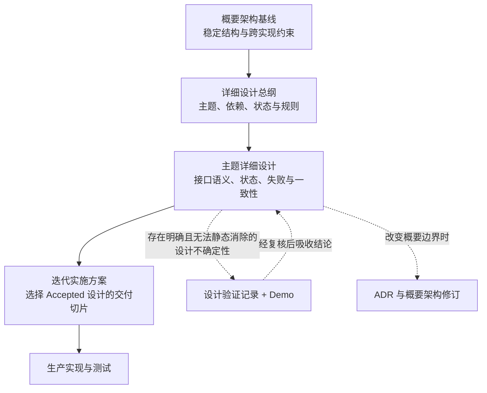
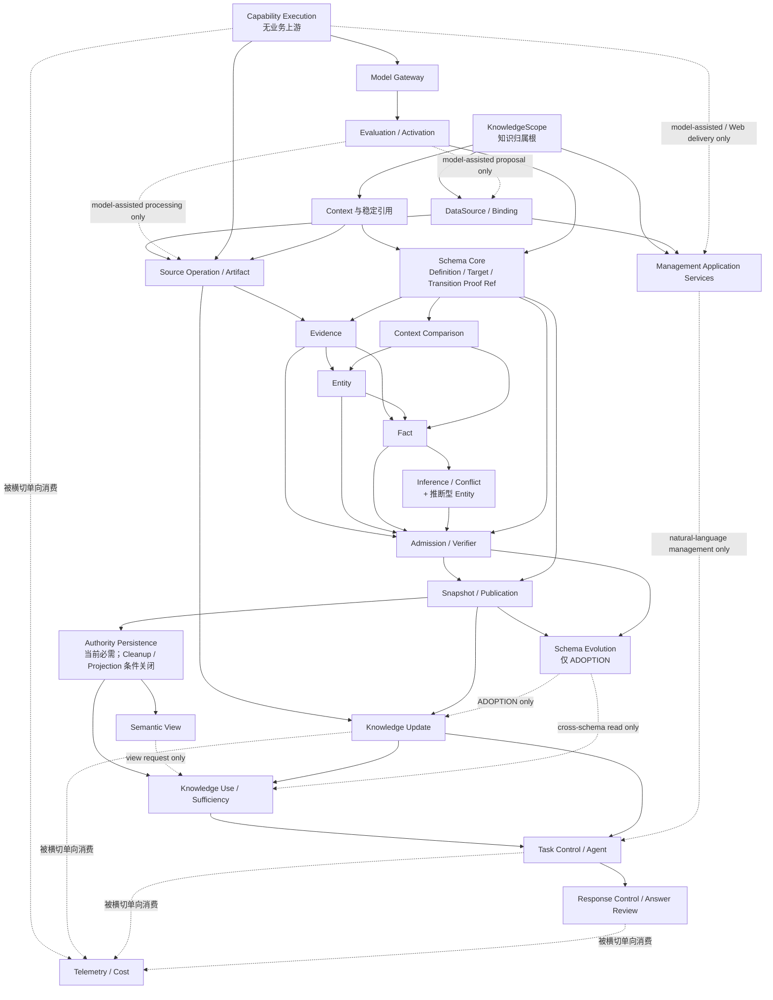

# Software World Model 平台详细设计总纲

| 元数据 | 值 |
|---|---|
| Document ID | SWM-DD-GUIDE |
| Version | 0.1.0 |
| Status | Accepted |
| Owner | Architecture Steward |
| Architecture Baseline | [SWM-ARCH@1.2](../architecture/Software_World_Model_Architecture_Baseline.md) |
| Supersedes | `Software_World_Model_MVP_Detailed_Design.md` 的总纲部分 |
| Latest Static Review | [SWM-DD-REVIEW-001](governance/Detailed_Design_Review_Record_001.md) |
| Latest Design Acceptance | [SWM-DD-ACCEPT-001](governance/Detailed_Design_Acceptance_Record_001.md) |
| Active Design Baseline | [SWM-DBM-ITER-001-REV-002](governance/Design_Baseline_Manifest_Iteration_001_Revision_002.md) |
| Active Implementation Plan | [SWM-IMP-ITER-001](../implementation/iteration-001/Implementation_Plan_Iteration_001.md) |

> 本文管理详细设计的范围、依赖、状态和验证方式。各主题的正式设计位于本目录的 `topics/`，本文不重复其领域内容。

## 1. 文档目的

详细设计用于把概要架构中的稳定职责和约束转化为可以实现、测试和演进的工程契约，重点回答：

- 一个用例由谁接收、协调和完成。
- 模块之间传递什么语义，谁拥有相应状态。
- 对象如何创建、变化、失效和退出。
- 失败、重试、并发和一致性如何处理。
- 模型能力如何接入、评测、激活和回退。
- 哪些结论已经冻结，哪些问题仍须验证。

详细设计不承担以下职责：

- 重新定义概要架构的系统定位、模块边界和核心知识语义。
- 记录某次讨论过程、项目排期或当前开发进度。
- 把某个验证 Demo 的类型、代码结构或技术选型直接规定为生产实现。
- 在没有真实约束时预先细化条件能力。

## 2. 文档体系与权威关系

权威顺序如下：

1. 概要架构定义系统级稳定约束。
2. 已 `Accepted` 的主题详细设计定义实现必须遵守的契约。
3. ADR 说明重要选择的理由和被替代方案，不单独覆盖当前基线。
4. 设计验证记录说明某项不确定性的实验依据，不直接成为生产规范。
5. 实施方案选择本次交付哪些 `Accepted` 设计，不改变一般系统语义。
6. Demo 和生产代码都不能反向成为未记录的设计权威。

当详细设计发现必须改变概要架构时，应先更新 ADR 和概要架构基线，再批准依赖该变化的详细设计。

## 3. 详细设计原则

### 3.1 先稳定契约，再选择实现

每个主题先拟定并评审职责、输入输出、所有权、状态和失败语义，再决定类、表、框架、Prompt、模型或存储产品。技术实现可以变化，已经 `Accepted` 的外部语义不能被实现细节隐式改变。

### 3.2 按依赖方向推进

详细设计遵循“树干—树枝—树叶”的顺序。下游主题可以引用上游契约，但不能为了方便自身实现而重新定义上游对象。

### 3.3 设计与交付范围分离

详细设计是一套持续累积的系统设计，不按 MVP、版本或迭代重新复制。每次实施前由独立实施方案选择一组已经 `Accepted` 的设计主题或纵向用例；后续迭代先补齐或修订相关详细设计，再进入编码。

因此：

- 不要求在第一次编码前完成全部主题设计。
- 不允许生产实现先于其所依赖的详细设计进入 `Accepted`。
- 验证 Demo 可以在设计批准前编写，但只能用于回答已登记的设计问题。

### 3.4 AI Native 但不让渡平台责任

凡是依赖语义理解、歧义消解、调查规划或非结构化内容理解的能力，都应允许模型 Strategy 承担；凡是涉及权限、稳定身份、Lineage、上下文、准入、发布、审核放行和可回放状态的责任，都由平台契约控制。

每个包含模型能力的主题必须同时说明：

- 稳定的 Capability Contract。
- 可替换的 Strategy 及其版本。
- 模型可见输入、工具和预算。
- 确定性校验与独立审核边界。
- 评测、激活、回退和模型升级后的重评条件。

### 3.5 不为未来条件能力预制内部结构

Initialization、Evolution Orchestrator、Evaluation & Learning Engine、Governance、Projection Module、Operational View 和 Historical Snapshot 仅在概要架构规定的启用条件出现后建立独立详细设计。在此之前，只冻结核心模块必须提供的兼容边界。

### 3.6 最小充分设计与渐进增强

详细设计追求“足以保证当前能力正确、足以支持下一步实现”，不追求一次穷尽所有未来场景。新增对象、状态或协调协议必须同时满足：

1. 它保护的是已经纳入设计的能力及明确不变量，而不是纯假设需求。
2. 删除它会产生可复现的职责歧义、数据错误或不可恢复状态。
3. 不能用现有对象、局部事务、幂等或更简单的失败关闭语义表达。

可扩展性优先通过稳定接口、版本化 Contract、Provider / Strategy SPI、不可变引用和模块所有权实现，不通过空模块、预留表、占位状态机或提前拆分服务实现。复杂机制必须写明启用条件与最简单合规 Strategy：

- 当前条件未出现时，采用局部、单体内的简单实现或明确关闭该可选能力。
- 条件出现后，在不改变上层语义的前提下替换 Strategy 或补充专题详细设计。
- 若扩展会改变现有公共契约或知识语义，先修订详细设计 / ADR，再实施，不能依靠预留代码暗中改变。

因此，“文档描述了完整系统语义”不等于“首轮实现全部机制”。每次迭代只实现实施方案选中的纵向切片；后续切片在编码前补齐对应设计。

## 4. 主题目录与依赖关系

主题 ID 表达设计域和责任，不表达开发阶段或实施顺序。只有已经包含实质设计的主题才创建文档，避免空文档制造已经完成设计的错觉。

### 4.1 主题划分原则

详细设计主题是一个可独立评审的稳定设计责任边界。它用于定义该边界内的职责所有者、权威状态、公共契约、生命周期和不变量，不等同于运行时模块、代码包、数据库表、Agent 步骤、用户功能、团队分工或开发迭代。

主题按以下原则划分：

1. **责任与权威边界**：当两组能力对不同权威状态负责，或最终决策权属于不同职责所有者时，应拆分主题。
2. **生命周期与一致性边界**：当对象的创建、验证、发布、失效或恢复规则能够独立变化，或需要不同事务与一致性语义时，应拆分主题。
3. **公共契约与变化原因**：当一组契约能够被独立引用、独立评审，并因不同业务原因演进时，可以形成独立主题。
4. **适用条件**：始终适用的核心语义与满足条件后才启用的扩展机制应明确分开；条件能力只有形成独立契约、所有者和不变量时才单独建主题。
5. **最小充分粒度**：不同类、表、接口、工具或处理步骤本身不构成拆分依据。若多个对象共享同一所有者、生命周期、一致性规则和变化原因，应保留在同一主题中。
6. **避免重复所有权**：跨主题流程可以引用多个主题，但不能复制其权威契约。流程视图、调用视图和数据流视图本身不自动成为新的设计主题。

主题前缀只用于表达主要设计责任，不规定物理部署方式：

| 前缀 | 责任范围 |
|---|---|
| `DD-MGT-*` | 管理与控制面中独立于具体业务对象的评测、激活和能力控制决策 |
| `DD-SRC-*` | 外部信息源访问、受控操作、Artifact 与来源沿袭 |
| `DD-KNW-*` | 正式知识的语义、身份、准入、发布与权威持久化 |
| `DD-SEM-*` | 正式知识的只读语义组织与可重建 View，不持有正式知识权威 |
| `DD-APP-*` | 与入口无关的用例协调、任务状态及知识更新或使用流程 |
| `DD-AI-*` | 模型访问与隔离基础设施，不持有业务决策权 |
| `DD-X-*` | 被多主题使用的执行或遥测契约，不接管上游业务权威 |

一次用户任务通常会跨越多个主题；主题目录不是按用户旅程纵向切分的功能清单。下文的 `Depends On` 和依赖图表达的是“一个主题要成立必须先引用哪些语义契约”，不等同于运行时调用方向、数据流顺序或开发顺序。

新增主题前必须同时证明：它具有现有主题无法承载的唯一责任边界，拥有自己的公共契约或权威状态，具有独立生命周期或变化原因，并满足明确的适用条件。否则应修订既有主题，而不是新增文档。拆分或合并会改变公共契约及所有权时，必须先修订总纲和 ADR；仅调整主题内部实现时，不改变主题划分。

### 4.2 已创建主题文档

| Document ID | 主题 | Document Steward | Version | Status | Applicability | Depends On |
|---|---|---|---|---|---|---|
| DD-X-CAPABILITY-EXECUTION | [Capability Execution Contract](topics/DD-X-CAPABILITY-EXECUTION.md) | Application Layer / Shared Execution Contract | 0.1.0 | Accepted | 使用 Capability Strategy、受控资源或 Web 结果交付的执行 | None |
| DD-KNW-KNOWLEDGE-SCOPE | [KnowledgeScope](topics/DD-KNW-KNOWLEDGE-SCOPE.md) | Knowledge Engine | 0.1.0 | Accepted | 所有正式知识归属与 Scope 生命周期 | None |
| DD-KNW-REFERENCE-CONTEXT | [KnowledgeContext 与稳定知识引用](topics/DD-KNW-REFERENCE-CONTEXT.md) | Knowledge Engine | 0.1.0 | Accepted | 所有正式知识 | KnowledgeScope |
| DD-AI-MODEL-GATEWAY | [Model Gateway](topics/DD-AI-MODEL-GATEWAY.md) | Model Gateway | 0.1.0 | Accepted | 任一 Strategy 使用模型时 | Capability Execution |
| DD-MGT-CAPABILITY-EVALUATION | [Capability Evaluation 与 Strategy Activation](topics/DD-MGT-CAPABILITY-EVALUATION.md) | Application Services / Management | 0.1.0 | Accepted | Strategy 进入生产或需要回退时 | Capability Execution、Model Gateway |
| DD-KNW-SCHEMA-CORE | [Knowledge Schema Core](topics/DD-KNW-SCHEMA-CORE.md) | Knowledge Engine / Schema Registry | 0.1.0 | Accepted | 所有正式知识构建 | KnowledgeScope、Reference / Context 及公共模型执行契约 |
| DD-KNW-CONTEXT-COMPARISON | [KnowledgeContext Comparison](topics/DD-KNW-CONTEXT-COMPARISON.md) | Knowledge Engine | 0.1.0 | Accepted | 比较或组合多个 Context 时 | Reference / Context、Schema Core 及公共模型执行契约 |
| DD-SRC-DATA-SOURCE | [DataSource 与 DataSourceBinding](topics/DD-SRC-DATA-SOURCE.md) | Source Integration / Connector Configuration | 0.1.0 | Accepted | 管理任一来源配置或 Scope Binding | KnowledgeScope；模型辅助 Proposal 为条件依赖 |
| DD-SRC-SOURCE-ARTIFACT | [Source Integration 与 Artifact](topics/DD-SRC-SOURCE-ARTIFACT.md) | Source Integration | 0.1.0 | Accepted | 执行来源访问或生成 Artifact | DataSource / Binding、Reference / Context、Capability Execution；模型辅助处理为条件依赖 |
| DD-APP-MANAGEMENT | [Management Application Services](topics/DD-APP-MANAGEMENT.md) | Application Services / Management | 0.1.0 | Accepted | 管理 Scope、Source、Binding 或其他平台对象 | KnowledgeScope、DataSource / Binding；模型辅助与 Web 交付为条件扩展 |
| DD-KNW-EVIDENCE | [Evidence](topics/DD-KNW-EVIDENCE.md) | Knowledge Engine | 0.1.0 | Accepted | 来源观察进入正式知识路径时 | Source / Artifact、Reference / Context、Schema Core 及公共模型执行契约 |
| DD-KNW-ENTITY | [Entity Identity](topics/DD-KNW-ENTITY.md) | Knowledge Engine | 0.1.0 | Accepted | 正式 Entity 构建 | Evidence、Reference / Context、Context Comparison、Schema Core 及公共模型执行契约 |
| DD-KNW-FACT | [Fact](topics/DD-KNW-FACT.md) | Knowledge Engine | 0.1.0 | Accepted | 正式 Fact 构建 | Evidence、Entity、Context Comparison、Schema Core 及公共模型执行契约 |
| DD-KNW-INFERENCE-CONFLICT | [Inference、Conflict 与推断型 Entity](topics/DD-KNW-INFERENCE-CONFLICT.md) | Knowledge Engine | 0.1.0 | Accepted | 正式 Inference 或推断型 Entity 构建 | Fact、Entity、Context Comparison、Schema Core 及公共模型执行契约 |
| DD-KNW-ADMISSION | [Knowledge Admission 与 Knowledge Verifier](topics/DD-KNW-ADMISSION.md) | Knowledge Engine | 0.1.0 | Accepted | Candidate 成为正式知识 | Evidence、Entity、Fact、Inference、Context Comparison、Schema Core 及公共模型执行契约 |
| DD-KNW-SNAPSHOT-PUBLICATION | [Snapshot、跨 Scope 依赖与 Publication](topics/DD-KNW-SNAPSHOT-PUBLICATION.md) | Knowledge Engine | 0.1.0 | Accepted | 正式知识对外可读 | Reference / Context、Schema Core、Entity、Fact、Inference、Admission |
| DD-KNW-SCHEMA-EVOLUTION | [Knowledge Schema Evolution](topics/DD-KNW-SCHEMA-EVOLUTION.md) | Knowledge Engine | 0.1.0 | In Review | 仅已有 Scope 发生跨 Schema Adoption | Schema Core、基础知识对象、Admission、Snapshot / Publication 及公共模型执行契约 |
| DD-KNW-PERSISTENCE | [Knowledge Authority Persistence](topics/DD-KNW-PERSISTENCE.md) | Knowledge Engine | 0.1.0 | Accepted | 权威持久化始终适用；Cleanup / Projection / 非连续恢复仅保留条件边界 | Reference / Context、Source / Artifact、Evidence、Admission、Snapshot / Publication |
| DD-APP-KNOWLEDGE-UPDATE | [Knowledge Update](topics/DD-APP-KNOWLEDGE-UPDATE.md) | Application Services / Knowledge Update | 0.1.0 | Accepted | 构建或更新知识 | Source / Artifact、知识对象、Admission、Snapshot / Publication、Schema Core；Schema Adoption 条件依赖 Evolution |
| DD-SEM-SEMANTIC-VIEW | [Semantic View](topics/DD-SEM-SEMANTIC-VIEW.md) | Semantic View Engine | 0.1.0 | In Review | 请求 Structure、Behavior、Business、History 或扩展 View | Reference / Context、Schema Core、Context Comparison、Snapshot / Publication、Persistence 及公共模型执行契约 |
| DD-APP-KNOWLEDGE-USE | [Knowledge Use 与 Sufficiency](topics/DD-APP-KNOWLEDGE-USE.md) | Application Services / Knowledge Use | 0.1.0 | Accepted | 查询或判断任务知识充分性 | Schema Core、Context Comparison、Snapshot / Publication、Persistence、Knowledge Update；View 与跨 Schema 联合解释为条件依赖 |
| DD-APP-AGENTIC-TASK | [Agent 任务编排](topics/DD-APP-AGENTIC-TASK.md) | Application Services / Conversational Task Control 与 Agent Roles | 0.1.0 | Accepted | Web Chat 任务理解、Agent 分派与执行 | Knowledge Use、Knowledge Update 及公共模型执行契约；自然语言 Management 条件依赖 Management Application Services |
| DD-APP-RESPONSE-CONTROL | [Response Control、Answer Candidate 与 Answer Review](topics/DD-APP-RESPONSE-CONTROL.md) | Application Services / Response Control | 0.1.0 | Accepted | Web Chat 业务响应审核、授权与交付 | Agentic Task、Knowledge Use 及公共模型执行契约 |
| DD-X-TELEMETRY-COST | [Platform Telemetry 与 Cost Governance](topics/DD-X-TELEMETRY-COST.md) | Cross-cutting Telemetry Infrastructure | 0.1.0 | Accepted | 所有受观测运行流程 | Capability Execution、Model Gateway；其余业务结果通过 opaque Authority Reference 接入 |

### 4.3 规划主题

当前没有仅登记名称而尚未形成实质设计的规划主题。新的主题必须同时满足 3.5、3.6 与 4.1 的启用和划分条件，不能为了目录完整预建空文档。

以后若出现 `Planned` 主题，它只表示已纳入总体设计，不表示其中存在可供实现依赖的隐含契约。

### 4.4 依赖关系

该图表示详细设计的语义依赖，不表示生产模块调用关系或开发排期。实线是基础依赖，虚线是仅在 Applicability 条件满足时生效的依赖；条件未启用时不阻塞上游主题进入 Accepted。KnowledgeScope 与 Capability Execution 分别作为知识归属和执行元契约的树根；DataSource / Binding 配置不依赖模型即可成立，Source Operation / Artifact 在其上增加受控执行，跨所有者管理步骤归 Management Application Services。Schema Core 只向基础对象提供最小过渡证明引用，完整 Evolution 是下游条件能力。Semantic View 与 Knowledge Use、Conversational Task 与 Response Control 分别拥有自己的状态和契约。Telemetry 单向消费权威 Result，不进入任何业务决定链。

### 4.5 关键跨主题可信闭环

以下闭环同时成立，才能证明一次模型辅助知识任务没有通过旁路、近似目标、相关但不充分的知识或答案文本获得假通过：

| 闭环 | 权威链 | 失败关闭点 |
|---|---|---|
| 冻结输入与 no-tools 模型执行 | Capability Owner 冻结 Authorized Input Manifest → Model Gateway 在分派前验证 Adapter 并签发 Isolation Receipt → Provider 以 `NO_EXTERNAL_ACCESS` 执行 → Capability Owner 在封存领域结果前校验 actual Model Fingerprint、Manifest / Request Digest 和 Receipt | 隔离不成立、Receipt 失配或实际模型不合格时，不产生 Proposal、Candidate、Assessment、Application Result、Answer 或生产缓存 |
| Canonical Build Target | Build Objective / Requirement Gap → Source Target Resolution Receipt → Canonical Build Target / descendant discovery boundary → Build Intent → Target Coverage Map → Candidate Disposition / Publication Manifest Member | 歧义、越界、目标弱化、无关同类型知识或 Coverage 未闭合时，不冻结 Intent或不满足发布条件 |
| 有界 Source Tool Loop | Knowledge Engine Source Information Need → 模型或确定性 Tool Proposal → Application Services 授权与预算门禁 → Source Integration 执行 → Artifact / Observation → 下一次冻结 Manifest | 模型不直接执行 Tool；预算耗尽、重复无进展、权限失败、空选择或截断显式停止，不能扩大为全源读取或宣称完整 |
| 逐 Need 语义充分性 | 不可变 Requirement Revision / Need / Joint Constraint → exact Snapshot Read Session → 权威正式知识 Read Set → Need Support Proof → 机械完整性检查与集合聚合 → Response Control 独立重读与 Answer Review | 任一 Need / Joint 未覆盖、引用越界、Conflict / Unknown / Limitation 未披露或语义审核失败时，不产生 `SUFFICIENT`；Answer Text 不能补齐 Gap |

这四条链分别由 DD-X-CAPABILITY-EXECUTION、DD-AI-MODEL-GATEWAY、DD-SRC-SOURCE-ARTIFACT、DD-APP-KNOWLEDGE-UPDATE、DD-APP-KNOWLEDGE-USE 和 DD-APP-RESPONSE-CONTROL 共同定义。表中箭头表达证明关系，不增加集中式可信链模块或跨所有者事务。

## 5. 设计状态生命周期

| 状态 | 含义 | 允许的活动 |
|---|---|---|
| Draft | 已形成可讨论契约，但尚不能作为生产实现基线 | 静态评审、原型推演、登记验证问题 |
| In Review | 规范性内容完整，设计问题已关闭或明确后置 | 架构、领域、研发和测试复核 |
| Accepted | 与声明的上游版本一致，已经正式生效 | 实现、测试、迭代选取 |
| Superseded | 已由明确版本替代 | 只供历史追溯 |
| Retired | 已停止生效且没有直接继任者 | 只供历史追溯 |
| Withdrawn | 草案在生效前被撤回 | 只供决策追溯 |

状态按主题独立管理。文档完整性、阻塞依赖、实现进度和验证结果都使用独立字段，不能通过发明 `Draft Skeleton` 等混合状态表达。验证状态使用 `Not Run / Pass / Fail / Inconclusive / Stale`。`Accepted` 只表示设计可实施，不表示功能已开发；实现与验收状态由实施方案管理。

进入 `Accepted` 至少满足：

1. 所有上游依赖已经 Accepted，或当前主题只引用概要架构中已冻结的语义。
2. 职责、输入输出、状态、失败、并发、一致性和安全边界不存在未标注空白。
3. 所有会改变契约选择的不确定性已经通过静态论证或设计验证关闭。
4. 设计不依赖某个 Demo、样例项目、模型版本或供应商的偶然行为。
5. 与概要架构、ADR 和其他已批准详细设计完成追溯检查。

对于“模型按任务补充来源知识，并据此形成正式答案”的纵向路径，还必须同时关闭以下适用契约，不能用某个组件单独通过代替整体闭环：

1. Model Gateway 以 Authorized Input Manifest 和执行前 Isolation Receipt 证明模型没有来源旁路或隐藏运行时上下文；隔离不成立时任何生产领域 Sink 都拒绝结果。
2. Knowledge Update 使用带 Resolution Receipt 的 Canonical Build Target、受控发现边界和 Target Coverage Map，证明调查与发布没有偏离目标。
3. Source Investigation 采用平台授权和执行的有界 Tool Loop；模型只提出 Proposal，每一步调用、预算、观察和停止均可回放。
4. Knowledge Use 对每个 Need 形成同一 Snapshot 可重建的 Support Proof，全部 Need / Joint Constraint 满足后才允许整体 SUFFICIENT；Answer 不能补齐 Gap。

四项分别由 DD-AI-MODEL-GATEWAY / DD-X-CAPABILITY-EXECUTION、DD-SRC-SOURCE-ARTIFACT / DD-APP-KNOWLEDGE-UPDATE 和 DD-APP-KNOWLEDGE-USE 定义。它们是适用纵向路径的设计批准条件，不表示所有详细设计主题必须同时实现，也不把任何交付范围写入一般设计。

## 6. 主题文档规范

每份主题详细设计按适用性包含：

1. 目的、范围与非目标。
2. 上游约束和依赖。
3. 术语与逻辑对象。
4. 组件职责和数据所有权。
5. 应用用例或能力契约。
6. 输入、输出及不可信边界。
7. 状态机和生命周期。
8. 主流程与关键时序。
9. 失败、重试、幂等、并发和一致性。
10. 模型 Strategy、确定性控制和评测要求。
11. 可观测性、资源和敏感信息边界。
12. 上游生效约束与本主题拟议不变量。
13. 尚未关闭的问题及其验证方式。
14. 上游决策与下游主题追溯。
15. 对复杂或条件机制说明启用条件、最简单合规 Strategy 和后续替换边界。

字段、类、表和错误码只有在会影响跨模块契约或一致性时才进入主题设计；局部实现细节留在相应模块的实现说明中。

## 7. 迭代实施衔接

交付范围不写入概要架构，也不通过复制一份“某版本详细设计”维护。每次开发使用独立实施方案，至少列明：

- 本次解决的用户旅程或管理用例。
- 采用的 `Accepted` DD 版本及所需纵向契约切片。
- 明确不在本次实现的能力。
- 验收场景、迁移和发布计划。
- 对后续 DD 的新增或修订需求。

如果后续迭代需要任何尚未 `Accepted` 的主题（包括 `Planned`、`Draft` 或 `In Review`），应先完成该主题设计和评审。这样首次交付不必等待全部设计完成，后续开发也始终具有正式设计依据。

## 8. Demo 设计验证规则

### 8.1 启动条件

只有同时满足以下条件才启动设计验证 Demo：

1. 存在会实质影响正式契约、技术边界或可实现性的设计不确定性。
2. 通过概要约束、领域推理、接口推演和已有证据仍无法可靠关闭。
3. 问题可以被一个有界、可重复、有判定标准的实验验证或证伪。

不使用 Demo 代替需求澄清、概要架构决策、常规编码或生产验收。

### 8.2 三类验证不可混用

| 类型 | 标识 | 目的 | 是否可改变设计 |
|---|---|---|---|
| Design Validation | `DVR-*` | 在设计生效前关闭会影响契约选择的实质不确定性 | 只能通过后续文档修订吸收结论 |
| Contract Conformance | `CC-*` | 判断实现、Provider Adapter 或技术组件是否符合已 Accepted 契约 | 不能；失败通常是实现缺陷或适配不成立 |
| Capability Evaluation | `CE-*` | 比较某个 Capability Strategy 的正确性、覆盖、成本和退化 | 不能直接改变 Contract；可以支持 Strategy 激活或设计修订提案 |

三类记录可以共享运行基础设施，但必须使用不同 Case ID、Oracle、结果和生命周期。Topic 元数据只引用确切 Case ID，不写运行状态或自由文本计划。

### 8.3 Design Validation 记录

Demo 开始前必须建立 `DVR-*` 设计验证记录，至少包含：

- 待决设计问题和受影响的 DD 条款。
- 候选方案、核心假设和预期差异。
- 固定的项目、数据、模型、Prompt、Tool、参数和环境。
- 可观察指标、判定标准和停止条件。
- 防止题目硬编码、来源旁路和样例泄漏的措施。

结束后补充原始结果、失败、限制、可复现命令和结论。单一项目或单一模型的成功只能证明该条件下可行，不能自动证明泛化。

每个 DVR、CC 和 CE 运行都必须固定所验证的 DD 精确版本和实现提交；涉及多个主题时绑定一个按需创建的 Design Baseline Manifest。Manifest 可以服务设计验证或生产实施，不与 MVP、版本阶段或发布日期绑定。

### 8.4 结论吸收

- Demo 代码是可丢弃的验证资产，不是生产组件。
- Demo 中的类型、表、流程和阈值不自动成为详细设计。
- 实验结论必须经复核后写入相应 DD；若改变概要边界，同时更新 ADR 和概要架构。
- 被验证否决的方案及适用条件保留在验证记录，避免后续重复试错。
- 没有被正式文档吸收的 Demo 结论不能作为实现依据。

## 9. 变更与一致性管理

- 每个 DD 独立采用语义版本，并声明所依赖的概要架构、Contract 和 DD 版本。
- 文档引用使用 `DocumentID@SemVer`；默认固定精确版本，只有经过兼容性评审的依赖才允许声明显式版本范围。Design Baseline Manifest 始终固定精确版本。
- 向后兼容的澄清可以增加小版本；改变外部语义、状态或一致性契约必须增加主版本并评估所有下游主题。
- 任何术语只能有一个定义所有者；其他文档引用定义，不复制后改写。
- 被替代设计必须标记替代版本和迁移影响，不能直接删除历史依据。
- 评审同时检查正向可实现性和反向架构符合性。
- 第一个实施或验证消费者出现时，按需创建 Design Baseline Manifest，固定其采用的概要架构和 DD 精确版本；不预先制造没有消费者的空基线。
