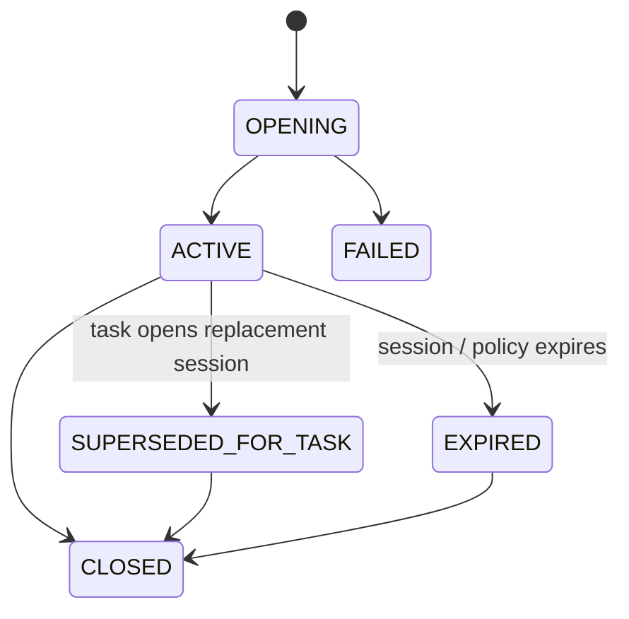
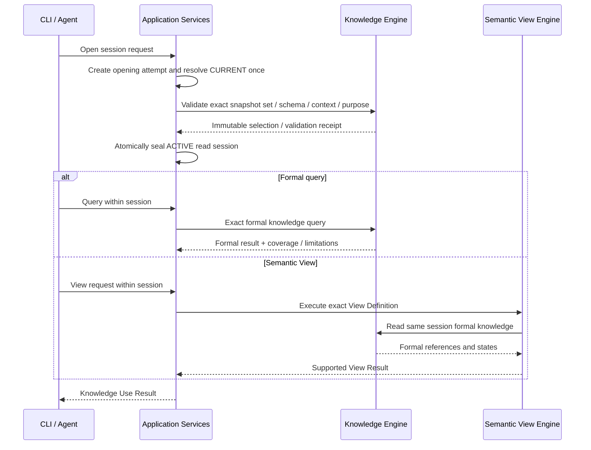

# Knowledge Use 与 Sufficiency 详细设计

| 元数据 | 值 |
|---|---|
| Document ID | DD-APP-KNOWLEDGE-USE |
| Version | 0.1.0 |
| Status | Accepted |
| Document Steward | Application Services / Knowledge Use |
| Architecture Baseline | SWM-ARCH@1.2 |
| Depends On | DD-KNW-REFERENCE-CONTEXT@0.1.0、DD-KNW-SCHEMA-CORE@0.1.0、DD-KNW-CONTEXT-COMPARISON@0.1.0、DD-KNW-SNAPSHOT-PUBLICATION@0.1.0、DD-KNW-PERSISTENCE@0.1.0、DD-APP-KNOWLEDGE-UPDATE@0.1.0、DD-X-CAPABILITY-EXECUTION@0.1.0、DD-AI-MODEL-GATEWAY@0.1.0、DD-MGT-CAPABILITY-EVALUATION@0.1.0 |
| Conditional Depends On | DD-SEM-SEMANTIC-VIEW@0.1.0（仅执行 Semantic View）；DD-KNW-SCHEMA-EVOLUTION@0.1.0（仅跨 Schema 联合解释） |
| Owns Contracts | APP-KNOWLEDGE-REQUIREMENT-01、APP-SNAPSHOT-READ-SESSION-01、APP-FORMAL-KNOWLEDGE-QUERY-01、APP-KNOWLEDGE-SUFFICIENCY-01、APP-NEED-SUPPORT-PROOF-01、APP-KNOWLEDGE-GAP-01、APP-KNOWLEDGE-USE-01、APP-KNOWLEDGE-CONTENT-DELIVERY-ASSERTION-01 |
| Design Coverage | 任务知识需求、固定 Snapshot 读取、通用正式知识查询、独立充分性判断、Gap 与发布后重评 |
| Supersedes | None |
| Rationale ADR | AD-028、AD-031 至 AD-036、AD-062、AD-081、AD-085 至 AD-090、AD-094、AD-097、AD-104、AD-107、AD-112、AD-114、AD-115、AD-117、AD-134 |
| Design Validation | None |
| Conformance Cases | None |
| Capability Evaluation | Requirement Fidelity、Knowledge Sufficiency 使用模型时适用 |

> 本文定义一般 Knowledge Use 契约，不生成用户答案，也不定义 Agent 编排和 Answer Review。模型、Prompt、工具数量和查询 Provider 可以演进，但生产软件知识读取始终只使用已发布正式知识。

## 1. 目的与范围

Knowledge Use 把 Knowledge Engine 中已经发布的正式 Entity、Fact 和 Inference，以固定 Snapshot / Schema / Context 的方式提供给 CLI、Agent 和其他应用用例，并在任务需要完整回答时独立判断当前正式知识是否充分。

本文保证：

- 一次调查不随 CURRENT 变化而漂移，也不混入来源、Candidate 或另一个 Snapshot 的结果。
- 通用查询和 Semantic View 共用正式知识权威，但职责不同：查询返回知识，View 组织知识。
- Structure、Behavior、Business、History 是可扩展 View，不是新的存储层或推理结果类型。
- Knowledge Requirement 不被发布结果或答案文本静默弱化。
- Sufficiency 按 Need 逐项判断；整体成功不能由“查到一些相关知识”或模型自报完成推出。
- 正式知识不足时形成受控 Gap，并可触发正常 Knowledge Update；更新后必须从新读取上下文重新调查。

本文不定义：

- Agent 如何理解 Web Chat、动态选择具体 Agent、撰写 Answer Candidate 或执行 Answer Review。
- Data Source、Artifact、Evidence、Candidate、Knowledge Admission 或 Snapshot Publication。
- 某个产品页面、CLI 命令、固定问题集或交付阶段的查询清单。
- Semantic View 的 UI 布局、图形可视化、导出格式或外部搜索产品。
- 生产答案直接读取源码 / Artifact / Evidence Quote 的旁路。

## 2. 边界与所有权

| 对象 / 决定 | Owner | 边界 |
|---|---|---|
| Task Boundary、Knowledge Requirement Revision、Read Session、Query / Investigation Result、Sufficiency Assessment、Knowledge Gap | Application Layer | 应用状态，不是正式知识 |
| Snapshot、Schema、Entity / Fact / Inference、正式引用与 Member Manifest | Knowledge Engine | 唯一知识权威；只读返回 |
| View Definition、View Execution / Conformance Result | Semantic View Engine | 只组织正式知识；当前不物化 View |
| 未来 Query Projection / Search / Graph / Cache | Persistence / Projection Contract | 当前禁用；启用后也只返回候选正式引用并由 Knowledge Engine 权威回读 |
| Requirement 形成、调查规划、答案使用 | 调用方 Agent 的职责 | 必须通过 Application Services；不能直接访问 Core Capability |
| Capability Strategy、Evaluation / Activation | 能力所属模块与 Application Services | Model Gateway 不判断充分性或 View 正确性 |

Knowledge Engine 不生成 View、不判断用户 Need 是否满足、不回答问题。Semantic View Engine 是唯一允许只读 Knowledge Engine 的跨 Capability 例外；所有外部调用和 Agent 调用仍先进入 Application Services。

Knowledge Use 不隐式访问 Source Integration。它发现的未知语义只能形成 Gap 或 Build Target Proposal，不能读取来源后直接返回，也不能把模型记忆写成 View 结果。

## 3. 术语与核心对象

| 对象 | 含义 |
|---|---|
| Task Boundary Revision | 用户原始目标、范围、约束、Context 和禁止项的不可变应用边界 |
| Knowledge Requirement Revision | 在 Task Boundary 内，对必须知道什么及充分条件的一版不可变分解 |
| Knowledge Need | Requirement 中一个必须逐项评估的问题与 Sufficiency Criterion |
| Joint Knowledge Constraint | 约束多个 Need 必须在同一身份、Context、时间、分支或其他组合条件下共同成立的 Requirement 条件 |
| Active Knowledge Use Binding | 任务当前 Boundary、Requirement、Session 与单调 Use Epoch 的唯一接受门禁 |
| Snapshot Selection Request | exact Snapshot 或一次性 CURRENT 选择，以及 Scope / Context / Schema 约束 |
| Snapshot Read Session | 固定 exact Snapshot Set、Schema、Context、Coverage 和权限边界的应用读取上下文 |
| Formal Knowledge Query | 在 Session 内对正式 Entity / Fact / Inference 执行的有界读取 |
| Knowledge Use Read Set | 一次调查实际读取的正式引用、Query Result、Coverage 和限制的封存集合 |
| Knowledge Sufficiency Assessment | 独立判断 exact Requirement Revision 在 exact Read Session 中是否逐 Need 满足的结果 |
| Knowledge Gap | 某个 Need 在固定 Snapshot / Coverage 下未被充分支持的应用对象，不是现实世界否定事实 |
| Knowledge Use Result | Application Services 向调用方返回的查询 / View / Assessment 与限制信封；不是 Answer Candidate |

Requirement、Read Session 和 Assessment 的关系为：Requirement 不绑定 Snapshot；每个 Assessment 同时绑定一个 exact Requirement Revision 和一个 exact Snapshot Read Session。新 Snapshot 不修改旧 Assessment，只产生新 Session / Assessment。

Semantic View Definition、Read Boundary 与 Result 由 DD-SEM-SEMANTIC-VIEW 定义。Knowledge Use 只负责把当前 Session 编译为受限 View Read Boundary、调用 View 能力，并在接受结果前重验 Session / Use Epoch；不复制或改写 View Contract。

## 4. APP-KNOWLEDGE-REQUIREMENT-01

### 4.1 Task Boundary

需要判断任务完整性时，Application Services 先保存不可变 Task Boundary Revision，至少包含：

- 原始用户请求 / 调用目标的受控引用与 Digest。
- 明确的 in-scope / out-of-scope 内容、系统 / Scope、时间 / 环境 /版本 Context 和输出目标。
- 用户给出的约束、禁止项、容许不确定性和必要的交互澄清引用。
- Parent Boundary Revision、变更原因和发起者；没有用户新增授权时不能扩大边界。

用户后续澄清可以形成新的 Task Boundary Revision。模型、调查结果、知识缺口或预算不能自行扩大、缩小或弱化它。

CLI 的简单固定查询可以没有 Knowledge Requirement；只要调用方请求“任务是否已经完整解决”，就必须使用 Requirement / Sufficiency 主干，不能以查询成功代替。

### 4.2 Requirement Revision

Task Execution Agent 或其他授权调用方可以提出 Knowledge Requirement Proposal。Application Services 严格重建 Revision，至少固定：

- Requirement ID / Revision / Digest、Task Boundary Revision 与 Parent Requirement Revision。
- KnowledgeContext Objective、Scope Boundary 和允许的知识类型。
- 完整 Need Manifest、Joint Knowledge Constraint Manifest、二者顺序无关 Digest，以及形成 Strategy / Capability Provenance。
- Revision Reason：`INITIAL | FIDELITY_CORRECTION | USER_BOUNDARY_REVISION`。
- Requirement Fidelity Assessment / Decision 与创建时间。

一个 Knowledge Need 至少包含：

- Need ID、规范 question、目标对象 / 语义维度和适用 Context。
- `Sufficiency Criterion`：什么正式语义能够回答该 Need，以及需要的 Coverage / Conflict / Limitation 条件。
- 不可变 `Criterion Obligation Manifest / Digest`：把 Criterion 中必须分别核对的目标身份、直接支持、枚举 Coverage、反例、冲突和未知 / 限制披露维度列成双向覆盖集合；它定义审核责任，不预填预期答案。
- 允许的权威支持种类：`ENTITY_IDENTITY_ONLY | FACT | INFERENCE`；实质属性 / 关系 / 行为 / 业务含义不能由 Entity-only 支持。
- 必须区分的替代项、反例、冲突或未知边界，以及与其他 Need 的显式关系。

Need 必须具有可独立裁决的粒度：一个 Need 对应一个实质问题、断言或具有明确 Coverage 语义的枚举目标。如果 Criterion 中包含若干可以分别失败、分别未知或分别冲突的实质断言，必须拆成多个 Need；它们之间必须共同成立的条件再写成 Joint Knowledge Constraint。开放式“有哪些影响区域”可以保留为一个枚举 Need，但 Criterion / Obligation Manifest 必须定义目标身份、范围、Coverage、冲突和未知披露条件，不能用“存在一条影响类型知识”代替枚举充分性。

Need 分解不得根据当前 Snapshot 中已经有什么知识反向裁剪问题，也不得为了容易满足而把目标 Revision、对象身份、关系、因果、影响范围或未知项降为 planning hint。Requirement Fidelity 必须把这种弱化视为 `REVISION_REQUIRED`。

Need 间关系必须分类为：

- `PLANNING_ONLY`：只影响调查顺序，不参与“任务是否充分”的语义。
- `REQUIREMENT_SIGNIFICANT`：原任务要求相关 Need 在同一身份、Context、时间、分支、版本、因果或其他组合条件下共同成立；必须编译为一个规范 `Joint Knowledge Constraint`，固定关联 Need Set、Joint Criterion、Context / Identity Alignment、允许的 Support Kind 和 Digest。

不能把 Requirement-significant 关系降为 planning hint，也不能以“各 Need 分别 SATISFIED”替代联合条件。

Need 不能只用“存在某类型知识”“匹配某关键词”或“模型认为相关”作为充分条件。Criterion 必须与原问题相称：不得遗漏、弱化，也不得把未请求的所有模块、全部异常、部署细节或改进建议扩张为强制条件。

### 4.3 Fidelity 与 Revision 修正

Requirement Fidelity 是独立 Capability。它重读 Task Boundary、用户请求和完整 Proposal，逐项判断：

- 明确目标与约束是否全部覆盖。
- Need 是否重复、互相吞并、无依据扩张或弱化。
- Sufficiency Criterion 是否足以回答原 Need，而不是内部实现门槛。
- Criterion Obligation 是否双向覆盖 Criterion，既没有遗漏实质断言，也没有根据当前 Snapshot 预填答案或增加无关义务。
- Context / Scope 是否忠实且可执行。
- Need 间实质关系是否全部成为独立 Need 或 Joint Knowledge Constraint，没有被降为调查提示。

结果为 `ACCEPT | REVISION_REQUIRED | EXECUTION_FAILED`。生成 Requirement 的 ModelExecutionContext 不能审核自己；Reviewer 不能静默修改 Need。`REVISION_REQUIRED` 由调用方提出完整 replacement Revision，保存 Parent / Diff / Reason，并从知识调查重新执行。

Requirement Proposal 或 Fidelity Assessment 使用模型时，Application Services 在注册 Revision、激活 Requirement Binding 或封存 Fidelity Decision 前必须消费 `X-MODEL-RESULT-ELIGIBILITY-01`，验证 exact Model Call、actual Model / Adapter、Authorized Input Manifest / Provider Request Digest、Isolation Receipt 和冻结 Catalog。任一项不合格时本次 Capability Attempt 为 `EXECUTION_FAILED`，Proposal 不注册、Decision 不封存，也不能以结构化形状有效或确定性重建部分字段为由继续。

每个 Revision 一旦封存不可原地修改。Application Services 维护可变 `Active Requirement Binding` 指向任务当前 Revision；旧 Assessment 永久绑定旧 Revision，不能改写为新版本结果。

### 4.4 任务级活动绑定

需要连续调查或判断任务完成度时，Application Services 还维护唯一的：

`Active Knowledge Use Binding = (Task, Task Boundary Revision, Requirement Revision, Session Reference / Digest, Use Epoch, ACTIVE | REBINDING | REBIND_FAILED | CLOSED, State Revision, optional Publication Receipt)`

- Requirement 尚未完成或新 Session 尚未打开时，Session 可以为空，但同一 Task 只有一个当前 Binding。
- Boundary / Requirement Revision 激活、Session 替换、成功 Publication Receipt 触发重绑定，以及显式关闭任务，都以 CAS 单调推进 Use Epoch；Epoch 不回退、不复用。
- Query、View、Sufficiency、Gap 和 Gap Resolution Continuation 必须固定 `Expected Use Epoch`。请求开始、结果封存以及作为任务当前结果返回前均重验 Binding；旧 Epoch 的成功结果只保留为历史，不加入当前 Read Set、不产生当前 Gap，也不能对外宣告任务 SUFFICIENT。
- Binding 只管理 Application 状态和结果接受资格。它不销毁 Agent 私有消息或 Tool Trace；Application Services 只产生旧 Epoch 已失效的权威信号，由 DD-APP-AGENTIC-TASK 定义新 Agent 执行上下文的建立与旧上下文退出。
- `REBINDING | REBIND_FAILED | CLOSED` 没有 active Session，不接受 Query / View / Assessment /正文交付。REBIND_FAILED 不能恢复旧 Epoch；后续修复或显式重新选择以更高 Epoch 建立新 Binding。

## 5. APP-SNAPSHOT-READ-SESSION-01

### 5.1 Session Request

打开 Session 的请求至少固定：

- Caller / Task / Purpose 和可选 Requirement Revision。
- 一个或多个 Scope Selection：`EXACT(snapshot ref) | RESOLVE_CURRENT_ONCE(scope)`。
- KnowledgeContext Selection、Coverage Boundary、允许的 Schema / Reader Contract，以及 `Schema Combination Policy = KEEP_SEPARATE | INTERPRET_AS(exact target Schema)`。
- 多 Scope 组合目的、权限 / Data Classification、资源政策和 Session Idempotency Key。

通配 Scope、裸 Knowledge ID、动态“始终最新”和 Query 执行中切换 Snapshot 均非法。模型可以提出选择建议，Application Services 必须把它规范为 exact Scope / Context Contract 后再打开 Session。

### 5.2 打开流程

Application Services 拥有 Opening Attempt / Session，并通过 Knowledge Engine 的 KNW-SNAPSHOT-READ-01 取得权威校验回执：

1. 在解析任一 CURRENT 前，以 `(Session Idempotency Key, Request Digest)` 原子创建或读取持久 `Session Opening Attempt`。状态只允许 `OPENING → ACTIVE | FAILED | CLOSED`；同 Key / Digest 只续办原 Attempt，不同 Digest 冲突。
2. Attempt 对每个 `RESOLVE_CURRENT_ONCE` 恰好解析一次，并立即封存 Snapshot Reference、CURRENT Generation 和 Resolution Time；恢复只续办这些 exact References，不能再次解析较新的 CURRENT。选择新 CURRENT 必须使用新 Key。
3. 以 downstream / anchor Snapshot 的权威 Dependency Manifest 展开必需 upstream exact Snapshot；不把各 Scope CURRENT 拼成伪一致集合。
4. Application Services 提交 exact Snapshot Set / Schema / Context / Purpose / Coverage / 权限给 `ValidateSnapshotSelection`；Knowledge Engine 只返回不可变 Snapshot Selection / Validation Receipt，证明每个 Snapshot 已发布、Reader 支持且多 Scope Set 与权威 Dependency 一致。它不创建 Session。
5. Schema Set 只有一个 exact Schema 时不依赖 Evolution。存在多个 Schema 时，`KEEP_SEPARATE` 允许同一 Session 分区读取但禁止跨 Schema 联合解释；`INTERPRET_AS(target)` 必须为每个不同 source Schema 固定方向为 `source → target`、Purpose = `SNAPSHOT_READ` 的 exact Compatibility Decision。当前只接受 `EQUIVALENT`；`MAPPING_REQUIRED | REVALIDATION_REQUIRED | REBUILD_REQUIRED | FORBIDDEN | UNRESOLVED` 均保持分区并失败关闭联合解释，真实出现 Mapping 读取需求后再扩展。
6. Application Services 验证 Receipt 和 Schema Read Compatibility Set 绑定本 Opening Attempt / Request Digest，并在自己的事务中封存 Snapshot Set、Schema Set、Combination Policy、Compatibility Decision Digests、Dependency Compatibility Result、Context、Coverage、权限边界、Receipt 和 Session Digest，原子进入 ACTIVE。Session 的 Context Selection 只是过滤条件，不改写成员自身 KnowledgeContext。

当前 Knowledge Store 采用 `NO_PHYSICAL_CLEANUP`，已提交 Snapshot 字节不删除。Session 因此不创建 Cleanup Lease、Operation Guard、MVCC Pin 或 Protection Mode；每次 Query / View / Sufficiency 仍在普通只读事务中验证 exact Snapshot / Schema、Session 状态、Purpose、权限与 Classification。未来启用物理 Cleanup 时，先由 Retention 专题设计读删线性化，再修订本 Contract，不能预留隐藏字段。

两个彼此无依赖的 Scope CURRENT 可以在不同 Resolution Time 被固定，但 Session 必须如实记录，不能宣称它们代表同一全局时刻。若任务需要明确时间一致性，必须由 Context / Compatibility Criterion 判断；平台不存在全局 CURRENT 事务。

### 5.3 生命周期



- CURRENT 在 Session 打开后前进不会改变其 Snapshot Set；普通只读 Session 可以继续读 exact old Snapshot，直到 Session / Policy 失效。
- 任务驱动 Knowledge Update 成功发布后，Application Services 必须立即以当前 Task / Boundary / Requirement / old Session / Expected Use Epoch 为条件，把 Active Knowledge Use Binding 推进为更高 Epoch 的 `REBINDING`，固定 Publication Receipt 且清空 active Session；该线性化点立即拒绝旧 Epoch 的新操作、结果封存和正文交付。由 Gap Resolution 触发时，本次 Binding 变化与对应 Gap Resolution Attempt 的阶段变化在同一个 Application Store 事务内提交。随后 drain 旧 Session，并按 8.2 使用 Receipt 的 exact Snapshot 构造 replacement Session。成功时在同一 Epoch 激活新 Session；失败进入 `REBIND_FAILED`，不得恢复旧 Epoch。Agent 私有 ModelExecutionContext / Tool Trace 的退出由下游 Agentic Task Contract 响应该 Epoch 变化完成。
- `SUPERSEDED_FOR_TASK` 只阻止同一任务继续混用旧发现，不修改 Snapshot Retention 或其他合法 Session。迟到的旧 Query / View / Assessment 即使内部成功，也在任务返回门禁因 Expected Use Epoch 不匹配而拒绝。
- EXPIRED / 逻辑不可选 / Schema unsupported 时，在返回任何新内容前失败；不自动重绑 CURRENT。
- Session 进入 EXPIRED / SUPERSEDED / CLOSED 后阻止新的 child operation；已经开始的本地只读事务按数据库事务语义完成或取消，不与尚未启用的物理 Cleanup 协调。

## 6. APP-FORMAL-KNOWLEDGE-QUERY-01

### 6.1 通用查询语义

Application Services 暴露少量可组合、Query Contract 版本化的正式知识操作；名称可以按实现调整，但语义至少覆盖：

| 操作语义 | 结果 |
|---|---|
| Resolve / Search Formal Knowledge | 根据规范条件找到 Entity / Fact / Inference 的候选正式引用 |
| Read Formal Knowledge | 批量读取精确 State、正式命题 / 结论、Context 和可用性 |
| Traverse Formal Relations | 在声明 Relation / Dependency / Direction / Depth 下有界遍历 |
| Explain Formal Knowledge | 返回正式 Proposition / Conclusion、Argument / Support、依赖和允许披露的来源定位 |

这些是 Application Use 能力，不是 Provider Runtime Tool 或新架构模块。工具不固定为某个项目、语言、框架或 View；模型可以在 `NO_EXTERNAL_ACCESS + DECLARED_PLATFORM_PROPOSAL_ONLY` 调用中动态提出 Query Proposal，由 Application Services 校验并执行，所有读取仍经过同一 Snapshot Read Session。模型不能直接访问 Knowledge Engine、Repository 或查询 Provider。

正常 Knowledge Use 的 Explain 不返回 Artifact Payload、Evidence Quote、Candidate、Knowledge Verifier Working State 或模型推理过程。允许返回正式 Evidence / Artifact 的稳定来源定位和可复核性状态，供追溯展示；定位中的未正式语义不能支持任务结论。

### 6.2 Query Request

每个 Query 固定：

- Session Reference / Digest、可选 Task / Expected Use Epoch、Query Contract / Version、Purpose 和调用主体。
- exact Scope / Snapshot subset、Context Filter、Knowledge Kind / Type 和规范 target / relation 条件。
- Pagination / Cursor、Depth、Result Limit、Coverage Request、排序 / 近似性边界和资源 Allocation。
- Query Idempotency / Correlation、Capability Strategy（若使用模型查询改写）和权限。

Query 不能扩大 Session Scope / Context / Schema / Classification。空 selector 不能解释为全部；全量必须是显式、获授权且有边界的 Coverage Request。

Query 可以在多 Schema Session 中分别返回各 Schema 的正式知识；若 Query Plan 要比较、聚合或按一个目标 Schema 解释不同 Schema 的成员，必须引用 Session 已封存的方向性 SNAPSHOT_READ Compatibility Decision Set。没有该 Set 或 Outcome 非当前支持的 EQUIVALENT 时拒绝联合 Plan，不能由模型临时转换字段。

### 6.3 Query Execution 与 Cursor

每个 Query 使用不可变输入创建 `Query Execution Record`，定义整个有序结果域并固定原始 Query Digest、经 Query Contract 校验的规范 Query Plan、Snapshot / Schema / Context / Coverage、稳定排序键、Permission-isolation Key，以及 Knowledge Engine 权威路径的 exact Member Manifest / Authority Read Set。

模型查询改写只能在 Record 封存前通过无外部访问的 Model Call 产生一个不可信 Plan Proposal；平台重建规范 Plan 后，同一 Execution 不再切换 Strategy、排序或权限边界。Execution 只表示固定结果域，状态为 `ACTIVE → EXHAUSTED | FAILED | CANCELED`，不把“第一页已返回”和“整个结果域已结束”压成同一个 SEALED 状态。

模型 Plan Proposal 只有在 Query Capability Owner 对其执行 `X-MODEL-RESULT-ELIGIBILITY-01` 并通过领域 Plan Contract 后才能用于封存 Query Execution Record。actual Model / Adapter、Manifest / Request Digest、Isolation Receipt 或 Qualification 失配时，不创建可执行 Plan、不读取 Knowledge Repository，当前 Query Attempt 失败；不合格响应只保留隔离审计引用。

每一页建立幂等 `Query Page Attempt = (Execution ID, Input Cursor Digest, Page Policy Digest)`，状态使用 CAS：`RUNNING → SEALED | FAILED | CANCELED`；只有 SEALED Page Result 可以交付。Cursor 固定 Query Execution ID / Digest、稳定排序 Continuation、Coverage Cursor、Authority Read Set / Candidate Set Digest，以及防篡改 Digest。

- 每页在普通只读事务中读取同一 exact immutable Snapshot / Member Manifest；Cursor 不携带动态 CURRENT。
- 续页不能切换 Query Plan、Snapshot、排序、Permission-isolation Key 或 Candidate Set。新执行使用新 Query Key / Execution ID，并从第一页开始。
- 终态页原子把 Execution 推进为 `EXHAUSTED`；相同 Input Cursor 的重试返回同一 Page Result，不重复或跳过成员。

### 6.4 Query Result

每个 Query Page Result 至少包含：

- exact Session / Snapshot / Schema、Task / Expected Use Epoch（任务查询适用）、Query Digest 和 Result References。
- 每项 Resolved Formal Knowledge Reference、State / proposition digest、Context 与允许的 Source Locator。
- `COMPLETE_WITHIN_DECLARED_COVERAGE | PARTIAL | EMPTY_WITHIN_DECLARED_COVERAGE | UNAVAILABLE`。
- 实际扫描 / 返回范围、Cursor、截断、权限裁剪、Schema / Context 限制和 Result Digest。

Knowledge Engine 必须按目标 Member Manifest 权威读取并计算 Coverage，不能把不足 top-k / coverage 的结果标为完整。当前不存在 Projection / Cache 候选路径。

`EMPTY_WITHIN_DECLARED_COVERAGE` 只说明该固定 Snapshot 与明确查询闭包内无匹配。除非正式知识本身提供适用的否定命题或完备性 Fact / Inference，否则不能转成“现实中不存在”。`PARTIAL`、预算耗尽、分页未完和权限裁剪都必须显式传播。

### 6.5 Investigation Read Set

一次任务调查可以把多个 Query Page Result 追加到 `Knowledge Use Read Set`。Read Set 固定 Query Execution / Page / Result Digest、正式引用、Coverage、限制、读取顺序和 Capability Provenance；封存后不可追加。

Read Set 证明调查实际读取了什么，不证明 Requirement 已充分，也不把模型解释变成正式知识。Sufficiency Assessment 使用独立执行上下文并从权威 Session 重读，不接受调查方摘要自证。

## 7. APP-KNOWLEDGE-SUFFICIENCY-01

### 7.1 Assessment Request

只有需要判断任务完成度时才执行 Sufficiency。请求至少固定：

- Task Boundary Revision、exact Knowledge Requirement Revision / Digest。
- Active Knowledge Use Binding / Expected Use Epoch。
- ACTIVE Snapshot Read Session / Snapshot Set / Schema / Context / Coverage。
- 可选封存 Investigation Read Set Reference；仅供定位，不能自证充分。
- Sufficiency Capability Contract / Strategy、Capability Catalog Snapshot、独立 `NO_EXTERNAL_ACCESS` ModelExecutionContext、Platform Formal Knowledge Proposal Vocabulary、预算和幂等键。

Assessment Context 不复用 Requirement 形成、知识调查、Knowledge Update、答案撰写或 Answer Review 的模型消息 / Tool Trace。即使使用同一个基础模型，也必须使用独立 Capability Attempt、输入清单和结果记录。

Sufficiency Attempt 固定 Task / Expected Use Epoch、Requirement / Session、Capability 与 Attempt Revision，状态只允许：

`PREPARED → RUNNING → VALIDATING → DECIDED | FAILED | CANCELED`

Tool、Model、权限、Session、Schema、Authority Read 或 Provider 执行失败使 Attempt 进入 `FAILED`，并产生明确 Application Limitation；不生成语义 Need Outcome。Need / Joint Assessment 草稿只在 Attempt 内可见。`DECIDED` 必须在一次 CAS / 本地事务中同时封存完整 Need / Joint Manifest 双向覆盖、每项唯一 Assessment、Sufficiency Read Set Digest、机械聚合 Decision 和 Expected Use Epoch；旧 Worker、迟到取消或过期 Epoch 均不能补写部分 Decision。

### 7.2 独立读取

Sufficiency Strategy 可以提出正式知识 Query / Semantic View Proposal，由 Application Services 在同一 Read Session 内执行以发现候选支持；模型调用本身没有 Repository 或 Tool 访问能力。最终依据只能是 Knowledge Engine 权威重读的：

- Entity identity / membership State。
- Fact Canonical Proposition / Context / Modality。
- Inference Conclusion / Argument / formal Premise / Context / Modality。
- Formal Conflict Inference、Coverage Result 和允许披露的限制。

Evidence Quote、Artifact、Candidate、Investigation Hypothesis、模型常识、View Summary 和 Answer Text 都不能成为最终 Support。View Support Map 可以帮助定位，但 Assessment 必须展开到正式引用。

所有读取自动追加到 Attempt-local、append-only `Sufficiency Read Set`；Decision 封存前固定 Read Set Digest。封存后发现新正式知识、Context 或反例时产生新 Assessment Attempt，不修改旧 Decision。

把来自不同 KnowledgeContext 的正式命题组合成一个联合陈述时，必须固定 Comparison Purpose、输入 Context / Knowledge References，以及 exact `KNW-CONTEXT-ASSESSMENT-01 Compatibility Assessment Reference / Digest`。Application Services 必须先调用 `ValidateContextAssessmentReuse` 取得 latest VALID Decision；再验证 Assessment 为 `COMPLETED + COMPATIBLE` 且 Purpose / Input Context / Target Schema 完全匹配，才可以支持组合。已完成的 `UNKNOWN | NOT_COMPARABLE` 保持分离并可形成 Context Relation Gap，`INCOMPATIBLE` 作为明确限制；`FAILED | CANCELLED` 表示本次执行没有 Assessment，`STALE | REVOKED` 只表示既有 Assessment 不再可复用，两者都需形成 Application Limitation 或新 Attempt。分支、部署版本、环境或身份之间的隐藏映射若是结论成立的必要条件，必须先成为正式 Fact / Inference；模型直觉或 Session Context Filter 不能补出该关系。

若联合 Support 来自不同 Knowledge Schema，还必须先通过 Session 中方向匹配、Purpose = SNAPSHOT_READ、Outcome = EQUIVALENT 的 exact Schema Compatibility Decision；Context COMPATIBLE 不能替代 Schema Compatibility。没有安全联合解释时，Support 保持分区并形成 Schema Application Limitation，不生成语义 Knowledge Gap。

### 7.3 Need Assessment

每个 Need 恰好产生一个不可变 Need Assessment：

- Need ID / Question / Criterion / Obligation Manifest Digest。
- `SATISFIED | GAP_MISSING_SUPPORT | GAP_INSUFFICIENT_COVERAGE | GAP_UNRESOLVED_CONFLICT | GAP_CONTEXT_NOT_COMBINABLE`。
- `APP-NEED-SUPPORT-PROOF-01` Reference / Digest。
- 精确 Support / Counterexample References、Proposition or Conclusion Digest，以及 Support Role / Kind。
- Context Alignment、Semantic Entailment、Coverage、Conflict、Limitation 和 Finding。
- Capability / Strategy / Model Call、Read Set、Assessment Digest 和时间。

判断规则：

- Entity State 只可满足身份存在或引用 Criterion；属性、关系、行为和业务含义必须由 Fact / Inference 的正式命题直接蕴含。
- 相关、同类型、关键词命中、Evidence 定位或“看起来可以推断”不等于 SATISFIED。
- 同一正式命题可以支持多个 Need，但每个 Need 都要独立证明其完整 Criterion；不能复用一个全局 `confidence`。
- Need 要求唯一适用结论时，未解决的正式 Conflict 形成 `GAP_UNRESOLVED_CONFLICT`；Need 本身要求识别 / 描述冲突时，符合 Criterion 的 Conflict Inference 可以支持 SATISFIED。
- 空结果不能支持否定性 SATISFIED，除非有适用的正式否定 / 完备性知识。查询仍为 PARTIAL、分页 / 预算未完成或权限裁剪时，Assessment Attempt 尚未取得合法语义输入，必须继续有界读取或以 Application Limitation 失败；不能生成知识 Gap。
- `GAP_INSUFFICIENT_COVERAGE` 只表示在授权读取完整完成后，正式 Snapshot / Knowledge Coverage 本身不足以满足 Criterion；它不能承载查询执行或访问失败。
- 多个 Support 只有在所需 Compatibility Assessment 满足上述完整复用门禁时才能共同满足一个 Need / Joint Constraint；完成态 `UNKNOWN | NOT_COMPARABLE | INCOMPATIBLE` 且 Criterion 要求联合成立时使用 `GAP_CONTEXT_NOT_COMBINABLE`，执行失败 / 取消 / STALE 不生成语义 Gap。

`APP-NEED-SUPPORT-PROOF-01` 是 Need Assessment 的不可变证明清单，至少固定：

- exact Requirement Revision、Need / Criterion Digest、Snapshot Read Session / Snapshot Set / Schema / Context / Coverage 和 Sufficiency Read Set Digest。
- Criterion 中每项可机械枚举的 Obligation，以及 `DIRECT_SUPPORT | ENUMERATION_COVERAGE | COUNTEREXAMPLE_CHECK | CONFLICT_DISCLOSURE | UNKNOWN_OR_LIMITATION_DISCLOSURE` Support Role。
- `DIRECT_SUPPORT` 使用的 Resolved Formal Knowledge Reference、Canonical Proposition / Conclusion Digest、Context / Identity Alignment 和 Authority Read Receipt；Entity-only 只能用于身份类 Obligation。Coverage、Counterexample、Conflict、Unknown / Limitation Role 分别绑定其权威 Query Coverage、正式 Conflict Inference / Counterexample Reference 或 Application Limitation Result，不能伪造一个 Formal Knowledge Reference。
- Semantic Entailment Capability / Strategy / Model Call、独立输入 Manifest、结构化判断、Rationale Digest 和反例 / 冲突检查结果。自然语言 rationale 只用于解释，不能替代正式引用或 Coverage。
- Proof Outcome、全部未满足 Obligation 和 Proof Digest。Outcome 复用 Need Assessment 的 SATISFIED / 各类 Gap 语义，不建立第二个 confidence 或相互竞争的结论。

Support Proof 属于 Application Assessment State，不是 Evidence、Fact、Inference、Semantic View 或新的知识权威。后续 Answer Review 可以用它核对“Assessment 如何成立”，但任何新的软件世界断言仍必须引用其展开后的正式知识，不能把 Proof 文本本身当作命题来源。

Application Services 必须从同一 Session 的 Knowledge Engine 权威读取结果重建 Reference、Proposition / Conclusion Digest、Support Role 和 Coverage，再接受 Strategy 的语义蕴含判断。模型不能自报正式引用、删除未满足 Obligation 或用同主题/同类型知识替换 exact target。独立审核者应能只根据 Requirement、Session、Read Set、Proof Manifest 和版本化 Capability 输入重建“哪些正式命题为何支持或不支持该 Need”；不要求不同模型产生逐字相同的解释文本。

只有 Proof 双向覆盖全部 Criterion Obligation、没有悬空/跨 Snapshot/越权引用、没有未披露 Conflict / Unknown / Limitation，且 Outcome 为 SATISFIED 时，Need Assessment 才能为 `SATISFIED`。Proof Manifest 漏项、引用悬空/越界或语义审核执行失败属于 Assessment 执行无效，使整个 Attempt 失败；完整 Proof 证明正式知识确实缺少支持、Coverage、Context 关系或存在未解决 Conflict 时，才产生对应语义 Gap。两者都不能通过删除坏引用后继续。

每个 `REQUIREMENT_SIGNIFICANT` Joint Knowledge Constraint 还必须恰好产生一个不可变 Joint Constraint Assessment，使用相同 Outcome 集合并固定关联 Need Assessment、Joint Criterion、正式 Support References、Identity / Context / Time / Version Alignment 和 Decision Digest。它不能仅引用各 Need 的单独 Outcome；必须从权威正式知识重读并证明这些 Support 在联合条件下可同时成立。任一关联 Need 未满足时，Joint Constraint 不得 SATISFIED。

### 7.4 聚合与独立决策

平台先执行机械检查：Requirement Need Set 与 Joint Constraint Set 均双向全覆盖、每个 Need 恰好一个完整 Support Proof、引用属于 Session、Support Kind / Role 合法、Criterion Obligation 双向覆盖、Context / Schema / Read Set 一致、没有未知 Outcome。随后按以下规则唯一聚合：

- 全部 Need 和全部必需 Joint Constraint 均为 `SATISFIED` → `SUFFICIENT`。
- 至少一个 Need / Joint Constraint 为 Gap → `INSUFFICIENT`。
- Attempt 执行失败、必需评估未执行或最终集合无法原子封存 → 没有 Sufficiency Decision；Application Result 为 `ASSESSMENT_FAILED`。

Sufficiency Strategy 负责开放语义蕴含判断，但不能漏掉 Need、改变 Criterion、引用集合外知识或输出最终聚合。调查方、View、Knowledge Update Result 和答案文本都不能自证 SUFFICIENT。

模型产生的 Need / Joint Assessment Proposal 在进入 `VALIDATING` 的完整矩阵前，Sufficiency Capability Owner 必须消费 `X-MODEL-RESULT-ELIGIBILITY-01` 并固定 Eligibility Result Reference。只有 `PRODUCTION` Catalog、post-call actual Model / Adapter、Authorized Input Manifest / Provider Request Digest、Isolation Receipt 和 Qualification 全部匹配时，平台才接受其语义蕴含判断；不合格时整个 Attempt 进入 `FAILED`，不封存部分 Need Outcome、Support Proof 或 Sufficiency Decision。

Assessment 是当前 Requirement / Snapshot / Context / Coverage 下的应用判断，不是真值标签、Fact、Inference 或产品质量证明。更强模型或新 Strategy 需要重新评测并形成新 Assessment，不回写历史。

## 8. APP-KNOWLEDGE-GAP-01

### 8.1 Gap 形成

`INSUFFICIENT` 时，Application Services 对每个 Gap Need 或 Joint Constraint 形成不可变 Knowledge Gap：

- Task Boundary / Requirement Revision / Need or Joint Constraint / Assessment / Session Reference / Use Epoch。
- Gap Cause：`KNOWLEDGE_MISSING | KNOWLEDGE_COVERAGE | FORMAL_CONFLICT | CONTEXT_RELATION_MISSING`，以及缺失的正式语义、Context / Coverage / Conflict。
- 已核对 Support / Counterexample References 与 Read Set Digest。
- 可选 Build Target Proposal、建议 Scope / Source Category 和 Capability Provenance。

Gap 只表示“在该固定正式知识上下文中，当前 Criterion 未被充分支持”。它不证明现实中对象不存在、代码没有实现、文档错误或来源没有信息，也不能作为 Fact / Inference 进入 View。

权限裁剪、Tool / Model / Provider 失败、Session / Schema 不可用分别形成 `ACCESS_LIMITATION | EXECUTION_LIMITATION | SESSION_SCHEMA_UNAVAILABLE` Application Limitation，不形成 Knowledge Gap，也不允许触发来源调查或 Snapshot Publication。Application Services 将其交给授权、恢复、资源或管理用例处理；补充知识不能修复访问资格。

### 8.2 触发 Knowledge Update

`ResolveKnowledgeGap` 是 `Effect Class = COMMAND` 的 Application Use Case，因为它会启动 Knowledge Update 并改变任务绑定。Web Task Execution Agent 只能向 Conversational Task Control 提交包含 exact Gap / Task / Session / Use Epoch 的 Action Proposal；Task Control 机械校验授权、创建稳定 Logical Action Occurrence / Application Call Key 并取得 dispatch claim 后，才调用本用例。CLI、Scheduler 或其他入口只有已持有相同 Effect Class 的确切调用授权时才能直接调用，不能因该 API 位于 Knowledge Use 主题而把它当作 QUERY。

收到已授权的 `ResolveKnowledgeGap` 命令后，Application Services 必须：

命令携带入口控制者签发的稳定 Application Call Key 与规范 Request Digest。Application Services 原子 get-or-create 一个持久 `Gap Resolution Attempt`，至少固定 Attempt ID / Revision、Call Key / Digest、exact Gap / Task / Requirement / Session / Expected Use Epoch、目标 Scope、Continuation、从 Attempt 派生且不可更换的 Knowledge Update Idempotency Key、从 Attempt / Publication Receipt 派生的 replacement Session Opening Key，以及已经取得的 Update Attempt / Result / Publication Receipt、Rebind Outcome 和终态 Result Reference。最小阶段为：

`PREPARED → UPDATE_BOUND | STALE | FAILED`

`UPDATE_BOUND → REBINDING | NOT_PUBLISHED | STALE | FAILED`

`REBINDING → COMPLETED | STALE | FAILED`

相同 Call Key / Digest 只恢复原 Attempt；不同 Digest 冲突。`UPDATE_BOUND` 后只能查询或续办原 Knowledge Update Attempt；发布成功后只以原 Receipt 进入 REBINDING，崩溃恢复不得创建第二次更新、重新解析 CURRENT 或更换 Use Epoch。`COMPLETED` 只表示新 Session 已按原 Continuation 激活，不表示任务已经 SUFFICIENT。

1. 验证它是上述可由正式知识更新处理的 Gap Cause，并仍绑定当前 Task Boundary / Requirement / Session / Use Epoch；创建固定这些值、目标 Scope 与“独立 root 保持 exact 或显式重选”的 `Gap Resolution Continuation`。Application Limitation 不进入本流程。
2. 把模型 Build Target Proposal 作为不可信建议，按 DD-APP-KNOWLEDGE-UPDATE 形成独立 Build Intent；Update 绑定该 Continuation 与 Expected Use Epoch。
3. 执行正常 Artifact → Evidence → Candidate → Admission → Snapshot Publication；不得把 Gap 或调查文本直接写成正式知识。
4. Publication 未成功时保留原 Session / Assessment 作为历史结果，并返回真实 Update Outcome；`OUTCOME_UNKNOWN` 必须先解析同一 Publication Attempt。
5. `PUBLISHED` 后立即在同一个 Application Store 事务中，以 Continuation 固定的 Task / Boundary / Requirement / old Session / Expected Use Epoch 和 Attempt `UPDATE_BOUND` 为条件，同时把 Binding 推进为 `REBINDING(new Epoch, exact Publication Receipt, no active Session)`、把 Attempt 推进为 `REBINDING` 并固定 Rebind Outcome / new Epoch。若恢复时 Binding 已是同一 Attempt / Continuation / Receipt / new Epoch 的 REBINDING，按原 Attempt 幂等续办；只有绑定属于不同任务修订、Receipt 或 Epoch 时才把 Attempt 记为 STALE。成功后拒绝 / drain 旧 Epoch 操作并发出旧 Agent Execution Context 失效信号。
6. 只使用 Receipt / Outcome 中的 exact target Snapshot Reference，绝不重新解析该 Scope 的 CURRENT。按原 Session 的 root role 用新 Snapshot 替换目标 root，并从其权威 Dependency Manifest 重新展开闭包；不受该更新影响的独立 root 默认保持原 exact Snapshot，只有 Continuation 预先显式声明时才可重新选择一次。
7. 若更新的是旧 downstream 的 upstream、但 downstream 尚未正式重绑定新 upstream，或新 root closure 与其他独立 root / Context / Schema 不兼容，在同一个 Application Store 事务中把 Binding 推进为同一 Epoch 的 `REBIND_FAILED(POST_UPDATE_SESSION_INCOMPATIBLE)`，并把 Attempt 推进为 FAILED、固定 Rebind Outcome；不能把新 upstream 塞入仍绑定旧 upstream 的 Session、恢复旧 Epoch 或退回动态 CURRENT。
8. 使用 Attempt 派生的稳定 Opening Key 完整打开 replacement Session；恢复只能续办同一 Session Opening Attempt。随后在同一个 Application Store 事务中，以 Binding `REBINDING(new Epoch, Receipt)` 和 Gap Resolution Attempt `REBINDING` 为条件，同时推进为 `ACTIVE(new Epoch, new Session)` 与 `COMPLETED`。若恢复时 Binding 已是同一 Receipt / Session / Epoch 的 ACTIVE，则返回原 COMPLETED 结果；不同绑定才进入 STALE。打开或激活失败时，同一事务把 Binding 推进为 `REBIND_FAILED` 并把 Attempt 推进为 FAILED，由显式后续修复使用更高 Epoch。

只重新评估原 Gap Need 会遗漏新 Snapshot 对其他 Need 的影响，因此完整任务 Assessment 必须覆盖全部 Need 与 Joint Constraint。新 Assessment SUFFICIENT 之前，Update 成功不等于任务解决。

## 9. APP-KNOWLEDGE-USE-01 主流程

### 9.1 直接读取 / View



CLI 固定工作流和 Agent 动态调查复用同一 Application Service。调用方式不改变 Session、正式知识或 View Contract。

### 9.2 任务充分性与更新循环

```mermaid
sequenceDiagram
    participant T as Authorized Task Controller / Caller
    participant A as Application Services
    participant K as Knowledge Engine
    participant U as Knowledge Update

    T->>A: Register task boundary and requirement revision
    A->>A: Resolve exact snapshots once
    A->>K: Validate exact snapshot set
    K-->>A: Selection / validation receipt
    A->>A: Seal ACTIVE Session
    T->>A: Investigate through formal knowledge tools
    A-->>T: Formal results only
    T->>A: Request independent sufficiency assessment
    A->>K: Independently reread formal support in same session
    K-->>A: Formal references / coverage
    alt SUFFICIENT
        A-->>T: Assessment + supported knowledge result
    else INSUFFICIENT and update requested
        T->>A: Authorized ResolveKnowledgeGap COMMAND + stable action / call key
        A->>U: Resolve exact Gap through normal update
        U-->>A: Publication Outcome / Receipt
        alt PUBLISHED
            A->>A: CAS binding to REBINDING / advance use epoch
            A->>K: Validate receipt exact snapshot / dependencies
            K-->>A: New selection / validation receipt
            A->>A: Seal and activate new session in same use epoch
            A->>K: Query authoritative formal support in new session
            K-->>A: New formal references / coverage
            A->>A: Independently reassess every Need / Joint Constraint
            A-->>T: New independent Assessment
        else Not published
            A-->>T: Gap + truthful update outcome
        end
    else ASSESSMENT_FAILED
        A-->>T: Failure and limitations; no completion claim
    end
```

Application Services 负责该用例内部的继续、停止和有界重试；它不修改 Need / Assessment，也不把资源失败解释为知识 Gap。Web Agent 只能提出是否更新的 Proposal，Conversational Task Control 依据授权、当前任务与资源状态决定是否分派 COMMAND；任何入口都不能扩大冻结 Task Boundary。

## 10. AI Native 与能力演进

### 10.1 模型适合承担

- 在原始任务边界内提出 Knowledge Requirement / Need 分解。
- 围绕 Requirement 动态规划正式知识 Query、反例搜索和 View 选择。
- 在 Semantic View 中对正式知识进行选择、组织、分组和有依据摘要。
- 独立判断正式命题是否语义蕴含 Need Criterion，以及发现遗漏 / 冲突 / 限制。

### 10.2 平台不可让渡

- Task Boundary / Requirement Revision 不可变性、Need 唯一性和双向覆盖。
- exact Snapshot / Schema / Context / Scope、权限和多 Scope 兼容。
- Tool Schema、参数边界、分页、Coverage、重复动作 / 预算和正式引用重建。
- 模型只产生 Formal Knowledge Query / View / Assessment Proposal；Application Services 执行查询并把受控结果作为下一次 Authorized Input Manifest，不能把 Provider Tool 能力当作正式知识读取路径。
- View Support Map、Context / Conflict / Coverage Conformance 和非权威边界。
- Sufficiency Read Set、逐 Need Outcome、机械聚合、幂等和阶段隔离。
- Gap 到 Knowledge Update 的单一正式知识路径。

对 Requirement Proposal / Fidelity、模型 Query Plan、View Proposal 和 Sufficiency Assessment，拥有该输出的 Application Capability Owner 必须在相应 Revision、Execution、Assessment 或 Result 封存前执行 `X-MODEL-RESULT-ELIGIBILITY-01`。每个生产对象记录 exact Model Call、Eligibility Result、Catalog / Qualification Proof、Manifest / Request Digest 和 Isolation Receipt Reference；Gateway 调用完成或输出形状通过均不能替代该门禁。Semantic View Engine 只对自己拥有的 View 输出负责，Knowledge Use 不复制其内部判断，但必须验证所消费 Result 带有合格生产资格。

随着模型增强，可以减少固定 View 选择器、项目专用查询编排和脆弱的关键词规则，让模型更动态地组合通用正式知识能力；不能退化掉 Session 固定、正式知识唯一依据、Support Map、Requirement / Assessment 独立和发布后重评。

随着模型退化，只能为新 Attempt 采用已通过同一 Capability Contract 的回退 Strategy。Requirement Proposal、View Organization、View Conformance 和 Sufficiency Assessment 分别评测 / 激活，不在已冻结 Attempt 内更换模型以追求 PASS。

直接来源调查 Agent 是 Capability Evaluation 的外部正确性 / 完成率基线，不是 Knowledge Use 生产旁路。若平台正式知识不足，必须更新世界模型后再用，不允许直接来源结果绕过 Admission 支持答案。

## 11. 持久化、并发与幂等

Application Layer 至少持久化：

- Task Boundary / Active Requirement Binding / Active Knowledge Use Binding / Use Epoch、Requirement Revision / Fidelity Decision。
- Session Opening Attempt / exact CURRENT Resolution、Snapshot Selection / Validation Receipt、Application-owned Read Session Binding、Schema / Context / Coverage / Dependency Compatibility。
- Query Execution / Cursor / Result Digest、封存 Read Set、Sufficiency Attempt / Need / Joint Assessment / Decision、Knowledge Content Delivery Assertion 和 Knowledge Gap。
- Gap Resolution Attempt / Continuation、稳定 Application Call / Update Idempotency Key / replacement Session Opening Key、Update Attempt / Result / Publication Receipt、Rebind Outcome 与终态 Result。
- 对最终响应有实质影响的 Capability / Strategy / Model Call 引用和资源结果。

Semantic View Engine 保存 View Definition / Registration 和必要 Execution / Conformance Result；当前不保存 View Materialization。Knowledge Engine 仍拥有正式知识和 Snapshot。

幂等规则：

- 相同 Session Request Key / Digest 只恢复同一 Opening Attempt 和首次解析的 exact Snapshot Set，返回同一 Session 或相同终态；不同 Digest 复用 Key 失败。
- Query / View Key 固定 Session Digest、Contract / Definition、规范执行计划、参数、权限隔离与资源边界；结果重放不切换 Snapshot 或排序。
- Sufficiency Key 固定 Requirement Revision、Session、Capability / Strategy、Read Policy 和预算；已经 DECIDED 的 Assessment 不为得到不同答案而重采样。
- Gap Resolution Call Key 永久绑定一个 Request Digest、Continuation 和 Knowledge Update Idempotency Key；PUBLISHED 后只续办原 Receipt 的 rebind，不再次启动更新。
- Requirement / View Definition / Assessment 的任何实质输入变化创建新 Revision / Attempt，不修改旧对象。

并发与 CURRENT：

- Session 打开后的 CURRENT 变化不影响其内容；新任务可以选择新 CURRENT，旧任务不自动漂移。
- 一个任务的 active Session 被更新循环替换后，只允许新 Session 继续调查 / Assessment；延迟的旧 Query Result 不能加入新 Read Set。
- 当前正式知识不做物理 Cleanup；Query 只需普通只读事务和 exact Snapshot / Session 校验，不创建 Retention Lease / Pin。
- Projection 未启用；所有 Query / View 从 Knowledge Engine Authority Repository 读取。

### 11.1 APP-KNOWLEDGE-CONTENT-DELIVERY-ASSERTION-01

不可变 Result 与“本次哪些内容允许交付”是两个决定。每次首次返回、幂等重放，或 Response Control 引用 Query / View / Assessment / Knowledge Use Result 前，Application Services 都必须执行 `ValidateKnowledgeContentDelivery`，并形成符合 `X-RESULT-DELIVERY-ASSERTION-01` 的不可变 Knowledge Content Delivery Assertion。

请求必须列出 exact Result / Read Set、准备交付的每个 Formal Knowledge Reference / Proposition Digest、Knowledge Gap、Application Limitation、Caller / Request / Purpose / Classification、Task Revision、Session 和 Expected Use Epoch。Application Services 重新验证 Session 仍允许读取、当前权限 / Classification、exact Snapshot / Schema 仍可由 Authority Repository 读取，以及适用的 View Definition：

- 交付前从 Knowledge Engine 重读 Candidate / View 中的全部正式引用并重算 Context / Coverage / Limitation；不读取历史 View Result 正文作为权威。
- Assertion 逐项返回 `ALLOW | DENY`，并固定 exact Formal Authority Read Set、Gap / Limitation References、Session / Use Epoch 与依赖 Revision；任一请求内容未被 Assertion 覆盖即视为 DENY。
- 当前门禁失败只返回 Result Reference / Digest 与 `DELIVERY_DENIED | SESSION_STALE | CONTENT_UNAVAILABLE`，不返回旧正文，也不改写历史 Result。
- 原 Result 曾为 SEALED / READY / DECIDED、同一 Idempotency Key 或缓存仍存在，都不能绕过本次门禁。

## 12. 失败、取消与恢复语义

| 失败类别 | 处理 |
|---|---|
| TASK_BOUNDARY_MISMATCH | 不注册 Requirement；请求用户澄清或创建有授权的新 Boundary Revision |
| REQUIREMENT_FIDELITY_REVISION_REQUIRED | 不开始最终调查 / Assessment；提交完整 replacement Revision |
| REQUIREMENT_ASSESSMENT_EXECUTION_FAILED | 不激活 Proposal；不把未审核 Requirement 当作完整 |
| NO_CURRENT_SNAPSHOT | 返回明确无 CURRENT；如需构建由上层显式启动 Knowledge Update |
| SESSION_OPENING_CONFLICT | 同一 Key 的 Request Digest 不同，或首次 CURRENT Resolution 无法恢复；不重新解析为新 CURRENT |
| SNAPSHOT_SELECTION_UNAVAILABLE / SESSION_STALE | 权限、用途、Schema 或 Session 当前性不再允许读取时，在返回新内容前失败；不切换到相近 / CURRENT Snapshot |
| SCHEMA_UNSUPPORTED | 不按数据库字段或模型临时转换；使用兼容 Reader / View 或受控 Schema Adoption |
| MULTI_SCOPE_INCOMPATIBLE | 不执行跨 Scope Query / View；返回 exact 冲突 Binding |
| QUERY_PARTIAL / TRUNCATED | 返回 Cursor / Coverage / 限制；不能宣称完整或不存在 |
| CURSOR_STALE | 无法恢复同一 Query Execution / Authority Read Set；新执行从第一页开始 |
| PROJECTION_NOT_ENABLED | 使用权威 Repository；若查询超出资源边界则返回明确限制 |
| VIEW_INCOMPATIBLE | 不执行 Definition；选择确实支持的 View 或普通 Query |
| VIEW_SUPPORT_INVALID / SEMANTIC_EXPANSION | 丢弃不受支持 Item 或整个 Result 失败；不由模型自报覆盖 |
| VIEW_EXECUTION_FAILED | 不产生 READY；可返回独立正式 Query 路径，不返回未验 Draft |
| CONTEXT_NOT_COMBINABLE | 保持正式命题分离并返回 Context Comparison 限制；不能隐藏映射 |
| SUFFICIENCY_REFERENCE_INVALID | Assessment Attempt 失败；不删除坏引用后继续聚合 |
| SUFFICIENCY_PROOF_INCOMPLETE | Need / Criterion Obligation、Support Role 或 Counterexample / Conflict / Coverage Proof 未双向覆盖；不允许 SATISFIED |
| SUFFICIENCY_EXECUTION_FAILED | Attempt 为 FAILED、没有语义 Decision；返回 Application Limitation，不伪装为知识 Gap |
| MODEL_RESULT_NOT_ELIGIBLE | Requirement / Fidelity、Query Plan、View 或 Sufficiency 模型输出的 actual Model / Adapter、Manifest / Request Digest、Isolation Receipt 或 Qualification 不匹配 | 对应 Capability Attempt 失败；不注册 Requirement、不封存 Query Plan / View Result / Need Assessment / Decision，也不推进 Active Binding |
| ACCESS_LIMITATION | 不产生 Knowledge Gap / Update；进入授权或管理处理 |
| ASSESSMENT_SESSION_SUPERSEDED | 旧 Attempt 停止；在新 Session 从零执行全部 Need |
| RESULT_DELIVERY_DENIED | 只返回 Result Reference / Digest 与限制，不返回历史正文、不改写 Result |
| KNOWLEDGE_UPDATE_NOT_PUBLISHED | 原 Gap 保留，返回真实失败；不把 Candidate / Artifact 用于回答 |
| KNOWLEDGE_UPDATE_OUTCOME_UNKNOWN | 先解析 Publication Outcome；不打开猜测的新 Session |
| POST_UPDATE_SESSION_INCOMPATIBLE | 保留 Publication 与旧 Session 历史；不混入不兼容 Snapshot、不宣称任务完成 |
| STALE_GAP_CONTINUATION | Expected Use Epoch / Requirement / Session 已变化；Update 结果不能替换当前任务状态 |
| GAP_RESOLUTION_IDEMPOTENCY_CONFLICT | 同一 Application Call Key 对应不同 Request Digest / Continuation；拒绝，不创建新 Update Attempt |

取消首先停止新的 Query / View / Model 调用。已封存 Requirement、Session、Query Result 和 Assessment Decision 保持不可变；取消不会伪造 SUFFICIENT / INSUFFICIENT。Sufficiency 正在决策时使用 CAS 只允许 `DECIDED | CANCELED | FAILED` 一个终态。

进程恢复只从持久 Active Knowledge Use Binding、Session Opening Attempt / 首次 Resolution、Query Execution / Cursor、View / Assessment Attempt 和 Gap Resolution Attempt 继续。Gap Resolution 若已绑定 Update Attempt 就只查询同一 Idempotency Key；若已有 PUBLISHED Receipt 就只续办原 REBINDING，绝不再次触发 Update。Binding 与 Attempt 的 REBINDING / ACTIVE 线性化点在同一 Application Store 事务内；恢复遇到同一 Attempt / Continuation / Receipt / Epoch 的 REBINDING，或同一 Receipt / Session / Epoch 的 ACTIVE，只续办或返回原结果，不误判为 STALE。replacement Session 只使用 Attempt 派生的稳定 Opening Key。Schema、权限、Session 或 exact Snapshot 可读性无法证明时关闭旧 Attempt；不会重新解析 CURRENT，也不会从模型对话、历史 View Result 或缓存猜测 Result / Decision。Knowledge Store 非连续恢复属于上游 `RECOVERY_UNSUPPORTED`，本流程不在新持久历史上续办旧 Session。

## 13. 可观测性、资源与敏感信息

传播 Task / Boundary / Requirement、Session / Snapshot / Schema / Context、Query / View / Assessment / Gap、Capability / Strategy / Model Call 和 Correlation Reference。

至少记录：

- Session Opening / 关闭、Use Epoch、Snapshot Set、Schema / multi-Scope 失败。
- Query Execution、扫描 / 返回量、分页、Coverage、Cursor Stale 和 Delivery Decision。
- View Definition、Item / Support 数、READY / PARTIAL、Conformance Finding、时延与模型成本。
- Need / Joint Constraint 数、SATISFIED / 各 Gap、Assessment Failed / Application Limitation、重评次数、Update 触发和最终聚合。

Telemetry 只记录引用、Digest、类型、数量、时延和资源；不复制正式命题全文、Artifact / Evidence、模型输入或受限 Source Locator。权限和 Classification 在 Query、View、Assessment 每次权威读取时执行，不能因先前缓存或 Assessment 引用绕过。

## 14. 拟议不变量与验证义务

### 14.1 拟议不变量

1. Knowledge Use 只读取已发布正式知识，不隐式访问 Source、Artifact、Evidence Quote、Candidate 或模型记忆。
2. Requirement Revision 不绑定 Snapshot 且不可原地修改；新 Revision 必须保持 Task Boundary 并重新调查 / Assessment。
3. Session Opening Attempt 在解析 CURRENT 前建立；Snapshot Read Session 固定 exact Snapshot / Schema / Context / Coverage，CURRENT 最多解析一次，重试与 Session 都不漂移。
4. 多 Scope Session 使用 exact dependency-compatible Snapshot Set，不把各 Scope CURRENT 拼成全局一致状态。
5. Query 的空、部分、截断和权限裁剪不能形成未被正式知识支持的否定结论。
6. 调用 Semantic View 时，Knowledge Use 只接受绑定 exact View Read Boundary / Result Digest 的结果，并在接受和交付前重验 Session / Use Epoch；View READY 不等于任务 SUFFICIENT。View 内部语义由 DD-SEM-SEMANTIC-VIEW 独占定义。
7. Sufficiency 与 Requirement 形成、调查、更新、答案和 Answer Review 上下文隔离；调查方不能自证完整。
8. 每个 Need 与 Requirement-significant Joint Constraint 恰好一个 Assessment；每个 SATISFIED Need 必须具有同一 Session 可重建的完整 Support Proof；只有全部 SATISFIED 才机械聚合 SUFFICIENT，执行 / 访问失败不能当作 Gap 或满足。
9. Entity 只支持身份存在 / 引用；软件属性、关系、行为和业务 Claim 必须由 Fact / Inference 命题支持。
10. Gap 是 Requirement / Snapshot 限定的知识不足判断，不是现实不存在 Fact；Access / Execution / Session Limitation 不是 Gap，补充知识只走正常 Knowledge Update。
11. Update 发布成功后只使用 Publication Receipt 的 exact Snapshot，在 Task Use Epoch CAS 成功后切换 Session，并在新 Session 上重新调查全部 Need / Joint Constraint；陈旧 Update 不能覆盖当前任务。
12. 模型可以增强调查、View 请求和语义判断，但不能让渡正式知识权威、Session、一致性、Coverage 和机械聚合。
13. Query / View / Assessment 的历史 Result 与每次交付授权分离；幂等或历史结果不绕过当前权限、Session 和权威回读。
14. 跨 Context 联合语义只由完成、COMPATIBLE、Purpose / 输入 / Schema 匹配且非 STALE 的正式 Compatibility Assessment 支持；Session Filter 和模型不能创建隐藏映射。
15. 多 Schema Session 默认分区读取；跨 Schema 联合解释必须具有方向匹配的 SNAPSHOT_READ EQUIVALENT Decision，与 Context Comparison 分别过门禁。
16. Requirement、Query Plan、View 和 Sufficiency 的模型输出只有在领域 Contract 与 `X-MODEL-RESULT-ELIGIBILITY-01` 同时通过后才能进入生产 Revision / Result / Assessment；不合格输出不能通过删除字段、确定性补全或重试旧 Model Call 获得资格。

### 14.2 Conformance / 故障注入

进入实现前至少验证：

- CURRENT 在 Session Opening Attempt 创建前、解析中、解析后和恢复重试时变化，结果仍固定首次 exact Snapshot 或明确失败，不混读。
- 多 Scope exact dependency、独立 roots resolution time、Context / Schema 不兼容和上游 CURRENT 前进。
- Session / Policy 在 child operation 前后失效时，结果封存与交付门禁拒绝迟到内容；当前没有 Cleanup Lease / Pin 路径。
- Query 空结果、分页未完成、预算耗尽和权限裁剪不被解释为完整 / 不存在；Page Attempt 幂等且 Cursor 不能跨 Query Plan / Authority Read Set 续页。
- Explain 不泄漏 Evidence Quote / Artifact Payload，Source Locator 中的新语义不能支持 Assessment。
- View Result 的 Read Boundary / Session / Use Epoch 绑定、权限重验和历史结果拒绝；View 内部 Support Map、摘要与 Conflict Conformance 由 DD-SEM-SEMANTIC-VIEW 验证。
- Requirement 漏项、重复、弱化、无关扩张、Need 实质关系被降为 planning hint，以及 Revision 修正后的重新调查。
- Need / Joint Set 的缺失 / 重复、Entity-only 越权支持、相关但不蕴含、未解决 Conflict、Context 不可组合和正式 Coverage 不足。
- exact Commit / Revision / 方法等目标错误、同类型但无关 Fact / Inference、跨 Snapshot 或悬空引用、枚举 Need 只有单项支持、未披露未知项，以及 Answer Text 试图补齐 Gap 时均不能产生或维持 SATISFIED。
- Sufficiency 执行失败不产生部分 Need Decision；模型输出与机械引用重建冲突、Decision / Cancel / 旧 Use Epoch 竞态均失败关闭；Context Assessment 的错误 Purpose、STALE 或非 COMPLETED 结果不能支持组合。
- PUBLISHED Receipt 使 Binding 先进入 REBINDING 并立即拒绝旧 Epoch；Receipt 后 CURRENT 再前进、upstream 新 Snapshot 与旧 downstream 依赖不匹配、replacement Session 失败后恢复旧 Epoch，以及只重评 Gap Need 的实现均被拒绝。
- Result 首次交付和幂等重放期间发生权限撤销、Session 失效、Schema / View Definition 变化时，只返回受限状态，不泄露旧正文。
- 相同模型用于不同 Capability 时上下文 / Attempt /权限隔离，Strategy 升级或回退不改写旧结果。
- Requirement、Query Plan、View 与 Sufficiency 的 actual Model / Adapter、Manifest、Isolation Receipt 或 Qualification 在 post-call 门禁失配时，相应生产对象均不封存，且已有部分 Assessment 不能聚合为 Decision。
- Idempotency 重放、取消 / Decision 竞态和恢复不从 View / 模型缓存猜测终态。

当前无需 Design Validation Demo 决定正式知识单路径、固定 Session、View 非权威、逐 Need Sufficiency 或发布后重评；这些是概要架构的稳定约束。只有某个查询 / View / Sufficiency Capability 的公共输出边界或可行性无法由 Contract 推演，并会实质改变设计时，才登记有界 `DVR-*`；正常正确率、覆盖率、成本和模型升级影响由 Capability Evaluation 验证。

下游详细设计必须复用：

- DD-APP-AGENTIC-TASK：Agent 只通过本用例的 Requirement / Query / Assessment / Gap API 工作，Answer Candidate 不能引用工作记忆。
- DD-X-TELEMETRY-COST：记录中立运行与费用，不成为 Sufficiency 或 View 权威。
