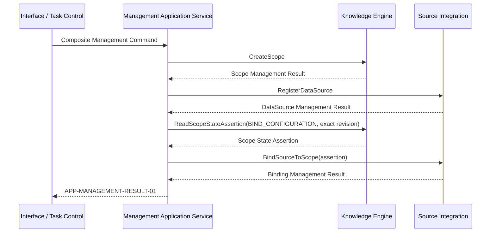

# Management Application Services 详细设计

| 元数据 | 值 |
|---|---|
| Document ID | DD-APP-MANAGEMENT |
| Version | 0.1.0 |
| Status | Accepted |
| Document Steward | Application Services / Management |
| Architecture Baseline | SWM-ARCH@1.2 |
| Depends On | DD-KNW-KNOWLEDGE-SCOPE@0.1.0、DD-SRC-DATA-SOURCE@0.1.0 |
| Conditional Depends On | DD-X-CAPABILITY-EXECUTION@0.1.0（仅模型辅助配置 Proposal 或 Web Result Delivery）；DD-AI-MODEL-GATEWAY@0.1.0、DD-MGT-CAPABILITY-EVALUATION@0.1.0（仅模型辅助配置 Proposal） |
| Owns Contracts | APP-MANAGEMENT-COMMAND-01、APP-MANAGEMENT-ATTEMPT-01、APP-MANAGEMENT-RESULT-01 |
| Supersedes | `DD-MGT-SCOPE-BINDING@0.1.0` 中跨所有者管理用例、组合结果和应用幂等语义 |
| Rationale ADR | AD-079、AD-112、AD-125、AD-127、AD-135 |
| Design Validation | None |
| Conformance Cases | None |
| Capability Evaluation | 仅自然语言配置理解或配置 Proposal 使用模型时适用 |

> 本主题只拥有入口无关的 Management 用例状态和组合结果。KnowledgeScope、DataSource 与 DataSourceBinding 的身份、状态和领域校验仍由各自 Core Capability 拥有。

## 1. 目的与范围

本文定义 CLI、Scheduler 或获授权 Web Task 如何通过同一 Application Services 管理 Scope、Data Source、Binding 和本主题内的平台配置，并在跨逻辑所有者时返回真实、可恢复的组合结果。Capability Evaluation、Strategy Activation 与 Resolution 由 `DD-MGT-CAPABILITY-EVALUATION` 自身的 Management 用例拥有；它们使用相同入口原则，但不经本主题再包装一层组合状态。

本文不复制任何被管理对象的领域契约，不建立 Knowledge Engine 与 Source Integration 的跨模块事务，也不规定 HTTP、CLI 参数或后台管理界面。

## 2. 边界与所有权

| 对象或决定 | Owner |
|---|---|
| KnowledgeScope 身份、类型与状态 | Knowledge Engine |
| DataSource、Binding、Selector、执行资格 | Source Integration |
| Management Command、Attempt、步骤状态、幂等与组合 Result | Application Services / Management |
| Web Task 的自然语言理解、授权与 Action Dispatch | Conversational Task Control 与具体 Agent |
| Secret 值 | 外部 Secret Facility；平台对象只保存 Reference |

Application Services 只能调用各 Owner 的公开契约并保存 exact Result Reference / Digest。模块化单体允许进程内调用，但不能绕过 Owner 直接写表。

## 3. APP-MANAGEMENT-COMMAND-01

每个不可变 Management Command 至少固定：

- Command ID / Type、Application Idempotency Key、Caller、Purpose、Classification 和最小 Request Context；使用 Capability Execution、模型辅助或 Web Task 时附加 exact Execution Envelope Reference。
- 目标稳定 Reference、Expected Definition Revision 及结构化参数。
- 允许调用的 Owner Contract 与最大副作用边界。
- 对组合命令明确的步骤集合和停止条件；不得用自由文本隐含额外管理动作。

CLI 和 Scheduler 可以直接提交结构化命令。Web Chat 必须先由 Conversational Task Control 固定原始任务和写授权；Agent 只能提出 Action Proposal，Task Control 取得 dispatch claim 后才提交同一 Management Command。

模型辅助配置只能产生 Proposal。Proposal 不能分配稳定身份、扩大 Selector 或权限、绕过 Provider / Owner 校验或直接写入正式对象。

## 4. APP-MANAGEMENT-ATTEMPT-01

Application Services 为每个 Command 创建或恢复唯一 Attempt：

`PREPARED → RUNNING → SUCCEEDED | PARTIALLY_SUCCEEDED | FAILED | CANCELED | OUTCOME_PENDING`

`PREPARED → CANCELED`

`OUTCOME_PENDING → RUNNING | SUCCEEDED | PARTIALLY_SUCCEEDED | FAILED`

每个 Owner 调用形成稳定 Step Root 和 append-only Step Revision，固定目标 Contract、Request Digest、Owner Idempotency Key、Dispatch Attempt 与 Result Reference。Step 状态统一为 `NOT_STARTED | DISPATCHED | SUCCEEDED | FAILED | CANCELED_BEFORE_DISPATCH | OUTCOME_PENDING`，并允许同一 Step 的 `OUTCOME_PENDING → SUCCEEDED | FAILED`；`OUTCOME_PENDING` 只表示已经 dispatch 但权威 Outcome 暂不可证明。Application Services 以 Expected Step Revision CAS 追加 Revision，不修改旧记录或创建替代 Owner 调用。跨 Owner 的组合命令不建立共同事务：

- 已成功创建 Scope、后续 DataSource 注册失败时，保留 Scope 并报告未完成步骤。
- DataSource 已存在、Binding 创建失败时，保留原对象，不创建半成品 Binding。
- 重试只恢复失败或 Outcome Pending 的同一逻辑步骤，不补偿删除已经可观察的成功对象。
- 一个步骤的失败不能被另一个 Owner 的近似成功结果覆盖。

Attempt 的组合状态只描述应用执行结果，不改变各 Owner 的领域 Outcome。

## 5. 典型组合用例

### 5.1 配置一个系统及其来源

Application Services 在 Binding 步骤真正 dispatch 前取得 `KNW-SCOPE-STATE-ASSERTION-01`，并把 exact Assertion / Digest 与 Scope Definition Revision 原样传给 Source Integration；它不自行推断 Scope 资格，也不把 Assertion 缓存为长期租约。Assertion 无效、Purpose 不匹配或 Revision 已陈旧时，该步骤失败并保留已经成功的 Scope / DataSource。该用例只建立知识构建前置条件，不自动触发初始化或 Knowledge Update。需要初始化时由未来独立用例基于已经 Accepted 的模型架构设计，不反向改变本主题。

### 5.2 单对象管理

创建、修订、禁用、挂起或退休单个对象时，Application Services 仍创建 Attempt 和 Result，但只调用一个 Owner。是否允许状态迁移由 Owner 决定，Application Services 不自行解释。

## 6. APP-MANAGEMENT-RESULT-01

每次返回的 Result Revision 不可变。`OUTCOME_PENDING` 是同一逻辑 Result 的临时 Revision；原 Owner Outcome 后续可证明时，Application Services 在一个本地事务中追加 Step Revision、推进 Attempt Revision、追加显式 Supersedes 前一版本的新 Result Revision，并以 CAS 更新唯一 effective Result Pointer。不能原地修改或让两个 Revision 同时作为 effective Result。Result 至少固定：

- Result ID / Revision / Supersedes、Command / Attempt、请求 Digest、Caller 与目标引用。
- 每个步骤的 `NOT_STARTED | DISPATCHED | SUCCEEDED | FAILED | CANCELED_BEFORE_DISPATCH | OUTCOME_PENDING`、exact Owner Result Reference / Digest。
- 整体 `SUCCEEDED | PARTIALLY_SUCCEEDED | FAILED | CANCELED | OUTCOME_PENDING`。
- 已创建或修订对象的稳定 Reference 和 Definition Revision；不复制其全部当前状态。
- 失败类别、可重试性，以及适用时的资源结算和 Telemetry Reference。

Result 只证明对应管理命令的历史 Outcome，不证明对象当前仍 ACTIVE、来源可达、知识已经构建或 Snapshot 已发布。首次交付、幂等重放或 Web Response 引用前，Result Owner 必须按 `X-RESULT-DELIVERY-ASSERTION-01` 重读当前权限、Classification 和对象 Revision，并同时披露历史 Outcome 与当前可用性。

## 7. 幂等、并发、取消与恢复

- 相同 Use Case、Idempotency Key 和 Request Digest 返回同一 Attempt；不同请求复用 Key 返回 `IDEMPOTENCY_MISMATCH`。
- Owner 的 Definition Revision 冲突原样返回；Application Services 不静默覆盖或把陈旧参数改写为当前值。
- 取消只阻止尚未 dispatch 的步骤并将其记为 `CANCELED_BEFORE_DISPATCH`。没有任何步骤 dispatch 时整体为 `CANCELED`；已有成功步骤且其余步骤因取消停止时，在全部已 dispatch 步骤收口后整体为 `PARTIALLY_SUCCEEDED` 并记录 Cancellation Reason。已经 dispatch 的步骤必须解析真实 Outcome，不能把“停止后续步骤”表述为“已撤销外部效果”。
- 调用结果未知时进入 `OUTCOME_PENDING`，只按原 Owner Idempotency Key 查询或恢复，不创建替代步骤。
- 组合 Result 只在全部已 dispatch 步骤收口后进入稳定终态。
- `OUTCOME_PENDING` 恢复只按原 Owner Idempotency Key / Dispatch Attempt 查询真实 Outcome；证明后按同一 Attempt 原子追加终态 Step Revision、相应 Attempt Revision 和 Result Revision。若仍有未开始步骤且未取消，Attempt 回到 `RUNNING`；否则按完整步骤集合聚合为 `SUCCEEDED | PARTIALLY_SUCCEEDED | FAILED`。相同 Idempotency Key 的读取返回唯一 effective Revision，历史 Revision 只供审计，不能重复交付。

## 8. 失败语义

Result 保留 Owner 返回的领域失败，并在应用层补充：

| 类别 | 含义 |
|---|---|
| `COMMAND_INVALID` | 命令结构、目标组合或副作用边界非法 |
| `ACCESS_DENIED` | 调用方无管理权限或授权已失效 |
| `OWNER_RESULT_CONFLICT` | 返回结果与请求、目标或 Revision 不匹配 |
| `PARTIAL_COMPLETION` | 组合命令已有成功步骤，后续步骤失败 |
| `OUTCOME_PENDING` | 已 dispatch 调用的最终结果暂不可证明；只恢复原 Owner 调用 |
| `IDEMPOTENCY_MISMATCH` | 同一 Key 被用于不同请求 |

Application Result 不把 Scope 退休、Selector 非法、Provider 不可用等领域失败重新命名为通用模型错误。

## 9. 可观测性、资源与敏感信息

- 记录 Command、Attempt、Step、Owner Result、Correlation / Causation、用量、延迟和失败分类。
- 日志、模型输入、Telemetry 和 Result 不包含凭据值；Secret Reference 也按最小披露返回。
- 模型辅助 Proposal 记录 Capability、Strategy、Authorized Input Manifest 和 Model Call Reference，但不因此获得正式配置权威。
- Management Telemetry 不是 Artifact、Evidence 或正式知识。

## 10. 拟议不变量与验证义务

1. Application Services 只拥有 Management 用例状态，不拥有被管理对象。
2. 跨 Owner 组合命令不建立大事务，也不删除已经可观察的成功步骤以伪造原子性。
3. Agent 和模型只能提出 Proposal；稳定身份、状态迁移和副作用分派由平台 Owner 控制。
4. Management Result 必须逐步披露真实 Outcome，不能把部分成功写成整体未执行。
5. Result 的历史成功不等于对象当前可用，也不等于知识或 Snapshot 已建立。
6. `OUTCOME_PENDING` 是唯一的未知执行状态；`CANCELED` 只表示没有 Owner 调用越过 dispatch 边界，不能覆盖已经发生或未知的 Outcome。
7. Capability Evaluation / Activation 的 Run、Validity 和 Activation Revision 由其专属主题管理，本主题不复制或重新解释。

这些语义通过应用契约测试、故障注入和幂等恢复测试验证；当前不存在需要设计 Demo 决策的不确定性。
