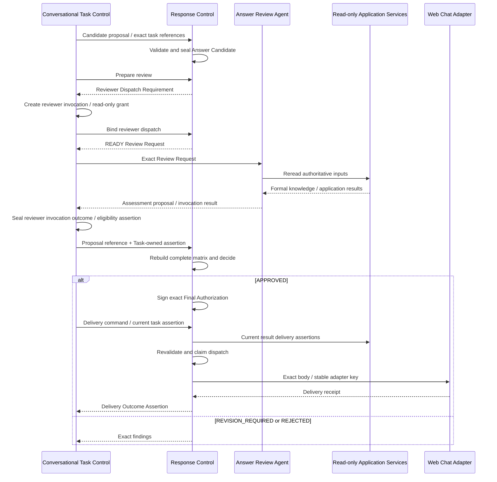

# Response Control、Answer Candidate 与 Answer Review 详细设计

| 元数据 | 值 |
|---|---|
| Document ID | DD-APP-RESPONSE-CONTROL |
| Version | 0.1.0 |
| Status | Accepted |
| Document Steward | Application Services / Response Control |
| Architecture Baseline | SWM-ARCH@1.2 |
| Depends On | DD-APP-AGENTIC-TASK@0.1.0、DD-APP-KNOWLEDGE-USE@0.1.0、DD-X-CAPABILITY-EXECUTION@0.1.0、DD-AI-MODEL-GATEWAY@0.1.0、DD-MGT-CAPABILITY-EVALUATION@0.1.0 |
| Owns Contracts | APP-ANSWER-CANDIDATE-01、APP-ANSWER-REVIEW-01、APP-FINAL-RESPONSE-01 |
| Supersedes | `DD-APP-AGENTIC-TASK@0.1.0` 中 Answer Candidate、Answer Review、Final Authorization 与 Delivery 语义 |
| Rationale ADR | AD-085 至 AD-090、AD-112、AD-114、AD-115、AD-127、AD-132、AD-134、AD-135 |
| Design Validation | None |
| Conformance Cases | None |
| Capability Evaluation | Answer Drafting 与 Answer Review 使用模型时分别适用 |

> Response Control 是 Answer Candidate、Review Attempt / Decision、Final Response Authorization 和 Logical Delivery 的唯一状态写者。Answer Review Agent 只产生不可信 Assessment / Finding Proposal。

## 1. 目的与范围

本文定义所有 Web Chat 业务响应从 Candidate 封存、独立审核、确定性放行到幂等交付的完整可信边界。Gap、失败、部分答案和平台操作结果与知识答案一样接受审核。

本文不定义任务理解、Agent 路由、Application Use Case、正式知识构建或 Interface 协议编码。纯认证、协议和传输错误可以由 Interface Layer 返回标准错误信封，但不得伪装成业务结论。

## 2. 边界与所有权

| 对象或决定 | Owner |
|---|---|
| Conversational Task、Agent Invocation、Delegated Grant、Reviewer Invocation Outcome / Validation Assertion、Task Validation Assertion | Conversational Task Control |
| Task Execution Result 与 Candidate Proposal | Task Execution Agent 提议；Task Control 封存 Result |
| Answer Candidate / Claim / Coverage Manifest | Response Control |
| Review Assessment / Finding Proposal | Answer Review Agent |
| Review Attempt / Matrix / Decision、Final Authorization | Response Control |
| Logical Delivery、Send Revision、Dispatch Claim 与 Delivery Status | Response Control |
| Adapter Delivery Receipt | Interface Adapter；Response Control 验证后推进状态 |
| Requirement、Session、Sufficiency、Gap、Application Result | 各 Application Result Owner |

Task Control 与 Response Control 通过不可变 Reference / Revision 和公开只读 Assertion 协作，不互写状态、不建立跨 Owner CAS。Response Control 不调用 Management 或 Knowledge Update；Reviewer 只使用审核所需的只读 Application Services。

## 3. APP-ANSWER-CANDIDATE-01

### 3.1 Candidate 身份与类型

Answer Candidate 是由 Task Execution Agent 提议、Application Response Control 校验并封存的临时应用对象，不是模块、Evidence、Fact、Inference、Semantic View 或 Final Response。每个不可变 Revision 至少固定：

- Candidate ID / Revision / Digest、Conversational Task / Orchestration Revision、Agent Task / Invocation。
- 原始 Request Digest、Task Boundary；知识类响应还必须固定 Requirement、Active Knowledge Use Binding、Session、Expected Use Epoch、Sufficiency Assessment 及其中每个 Need / Joint Constraint 的 Support Proof / Gap Reference。
- Response Kind：`KNOWLEDGE_COMPLETE | KNOWLEDGE_PARTIAL | APPLICATION_RESULT | GAP | FAILURE | UNSUPPORTED`。
- 待交付正文、结构化 Answer Claim Manifest、Requirement Coverage Map，以及披露的 Context / Coverage / Conflict / Gap / Limitation。
- Drafting Capability / Strategy / Model Call 和生成输入清单 Digest。
- 对所有影响正文、Claim 或 Coverage 的模型步骤，固定 `X-MODEL-RESULT-ELIGIBILITY-01` Result、actual Model / Adapter、Authorized Input Manifest / Provider Request Digest、Isolation Receipt 与 Qualification Proof Reference；确定性步骤显式标记不适用。

`KNOWLEDGE_COMPLETE | KNOWLEDGE_PARTIAL | GAP` 必须绑定同一 Task Boundary、Requirement、Session、Use Epoch 的当前 `DECIDED` Assessment。`KNOWLEDGE_COMPLETE` 只绑定 `SUFFICIENT`；`KNOWLEDGE_PARTIAL` 只绑定 `INSUFFICIENT`，且 Task Boundary / Response Policy 明确允许部分交付。`ASSESSMENT_FAILED` 只能形成 `FAILURE` 或明确 Limitation，不能形成 Partial。Application / 执行失败不能伪装为知识不足。

### 3.2 Answer Claim

`Answer Claim` 是答案审核单元，不是 Knowledge Engine Claim 类型。每个实质陈述必须映射到一个或多个 Claim；问候、排版和不承载语义的过渡文本可以没有 Claim。每项固定：

- Claim ID、Text Span / Canonical Claim、Claim Kind 和 Context。
- `FORMAL_KNOWLEDGE`：exact Entity / Fact / Inference State Reference、Proposition / Conclusion Digest、Snapshot Read Session；Entity 只支持身份存在。
- `PARTIAL_FORMAL_SUPPORT`：仅用于 `KNOWLEDGE_PARTIAL` 中 outcome 仍为 Gap 的枚举 Need，绑定该 Need 同一 Snapshot / Session 的 Support Proof 中已经成立的 exact Fact / Inference、对应已满足 Obligation 子集和 Proposition / Conclusion Digest；它只披露已证明部分，不能表示 Need 已满足、Coverage 已完整或未知项不存在。
- `APPLICATION_RESULT`：不可变 Use Case Result、Outcome / Field Path / Digest；Agent 运行日志不能替代。
- `KNOWLEDGE_GAP`：Requirement Need / Joint Constraint、Sufficiency Decision、Knowledge Gap 与 Coverage。
- `APPLICATION_LIMITATION`：Access / Execution / Session / Schema Limitation 或不可变 Failure Result。
- Claim 到正文 Span、Citation / Source Locator 和披露项的双向映射。

来源定位用于追溯展示，不能把 Artifact / Evidence Quote 中未成为正式命题的内容补进 Claim。Candidate 不携带模型隐藏推理、Artifact Payload、Evidence Quote、未准入 Candidate、调查对话或 Knowledge Update 临时摘要。

### 3.3 Requirement Coverage Map

知识类 Candidate 必须对 Requirement 的每个 Need 和适用 Joint Knowledge Constraint 建立 exact 双向映射：

- 已满足项映射到直接回答它的 `FORMAL_KNOWLEDGE` Claim。
- 未满足项映射到同一 Assessment 的 Knowledge Gap 或 Application Limitation Claim 与正文披露。
- `KNOWLEDGE_PARTIAL` 中未满足的枚举 Need 可以同时映射一个或多个 `PARTIAL_FORMAL_SUPPORT` Claim，但每个 Claim 必须位于该 Need 的同一 Support Proof / Snapshot 中，并精确列出已满足 Obligation；该 Need 仍必须映射 Gap、未知范围和全部未满足 Obligation，且 Coverage Decision 保持未满足。`GAP` Response 不借该类型夹带部分知识正文。
- `KNOWLEDGE_COMPLETE` 的所有项都必须由正式知识 Claim 覆盖；`KNOWLEDGE_PARTIAL` 必须同时完整列出已满足和未满足项；`GAP` 不能遗漏仍未满足的项。

Map 固定 Requirement / Assessment Revision、Need / Joint ID、Claim / Gap / Limitation ID、Claim Coverage Role = `FULL_NEED_SUPPORT | PARTIAL_FORMAL_SUPPORT | GAP_OR_LIMITATION_DISCLOSURE`、已满足 / 未满足 Obligation Set 和 Coverage Decision。Candidate 不得通过删除 Need、把 Joint Constraint 降为普通提示、把 partial support 当作 Need 满足或只披露“已发现的部分 Gap”获得 Partial / Complete。`PARTIAL_FORMAL_SUPPORT` 只适用于 Criterion 明确定义 Coverage 的枚举 Need；普通原子断言不能借部分措辞绕过 SATISFIED 门禁。

### 3.4 Candidate 机械预检

送审前平台至少检查：

- 每个实质正文 Span 被 Claim 覆盖，每个 Claim 在正文中有确切表达。
- Claim 引用位于绑定 Session / Result，Context、Classification 和 Use Epoch 一致。
- 知识响应具有当前 DECIDED Assessment；Complete 为 SUFFICIENT，Partial 为允许部分交付的 INSUFFICIENT，Gap / Partial 不删除限制。
- 每个已满足 Need 的 Support Proof 在同一 Session 中完整可重建；Candidate Claim 不能引用 Proof 之外的新语义，也不能用正文补齐未满足 Obligation。
- 每个 `PARTIAL_FORMAL_SUPPORT` Claim 都逐项属于同一未满足枚举 Need 的 Support Proof、只覆盖其中已成立 Obligation，并与该 Need 的 Gap /未知 /未满足 Obligation 披露同时存在；它不能改变 Assessment Outcome 或整体 Sufficiency。
- Requirement Coverage Map 与当前 Requirement / Assessment 成员集合 exact 相等；每个 Need / Joint、Claim 和 Gap / Limitation 都双向覆盖一次或按 Contract 明确允许多重支持。
- 不存在未知 Claim Kind、悬空 Reference、Candidate 自引用或 Evidence / Artifact 直接依据。
- Candidate Proposal 或 Claim 抽取 /规范化使用模型时，具有通过的 `X-MODEL-RESULT-ELIGIBILITY-01`；确定性步骤明确记录不适用，任何实质模型输出缺少合格引用时不封存 Candidate。

机械预检通过不等于答案正确或获准交付。

## 4. APP-ANSWER-REVIEW-01

### 4.1 独立输入重建

Response Control 的 `PrepareReview` 先为 exact Candidate 创建 `PREPARED` Review Attempt，并返回不可变 `Reviewer Dispatch Requirement`：Candidate / Digest、Conversational Task / Revision、原始 Request、Task Boundary、Requirement、Expected Use Epoch、Assessment 或 Application Result、Answer Review Capability / Policy、只读访问边界、资源上限和 Idempotency Key。该 Requirement 尚不声称 Reviewer Invocation / Grant 已存在，也不能分派 Review Agent。

Conversational Task Control 据此原子创建 Reviewer Agent Task / Invocation / exact read-only Delegated Grant 后，调用 `BindReviewerDispatch`。Response Control 校验 Task / Candidate / Capability / Policy / Access Boundary、Invocation 和 Grant 完全匹配，才在自己的事务中冻结最终 Review Request 并把 Attempt 推进为 `READY`。最终 Review Request 固定上述全部输入以及 Task-Control-owned Reviewer Agent Task / Invocation / Grant；只有 READY Request 可以被 Task Control 分派。Review Agent 的执行结果必须先由 Task Control 按 `APP-REVIEWER-INVOCATION-OUTCOME-01` 封存 Invocation Outcome / Validation Assertion，不能把 Agent 自报的 Invocation / Grant Reference 直接提交给本模块作为来源证明。

Answer Review Agent 使用独立 ModelExecutionContext，不接收 Drafting 消息、Agent 私有思考或未封存 Tool Trace。它通过只读 Application Services：

1. 重读原始任务、Task Boundary、Requirement Fidelity 和 Active Knowledge Use Binding。
2. 对 `FORMAL_KNOWLEDGE` Claim 在同一 exact Session 中重读正式 State、Context、Conflict、Coverage、Need Support Proof 和必要 Context Comparison，确认 Claim 没有超出其支持命题与 Criterion Role。
3. 对 `APPLICATION_RESULT` 重读不可变用例 Outcome；不重新执行副作用用例。
4. 对 Gap / Limitation 重读 Assessment、Gap、Failure 与限制，确认没有扩张为现实否定。

Candidate 文本、Candidate 自报 Support Map、Citation 文本或生成模型 Confidence 都不是权威依据。Review Agent / 模型只产生不可信的 `Review Assessment Proposal` 与 Finding，不拥有 Review Decision 或 Final Response Authorization。

### 4.2 审核维度

Review 至少覆盖：

- `TASK_FIDELITY`：Requirement / Response 是否忠实覆盖原始目标、约束和 Joint Constraint。
- `CLAIM_SUPPORT`：每个 Claim 是否被其权威依据直接蕴含，Entity 没有越权支持属性 / 行为。
- `TEXT_FIDELITY`：正文是否忠实表达 Claim，没有加入未建模限定词、因果、唯一性或确定性。
- `CONTEXT_AND_CONFLICT`：环境、版本、分支、时间、身份和冲突是否正确披露，跨 Context 组合具有正式兼容依据。
- `COMPLETENESS`：Complete Response 具有当前 SUFFICIENT；Partial / Gap 覆盖全部未满足项和限制。
- `PARTIAL_SUPPORT_DISCLOSURE`：每个 `PARTIAL_FORMAL_SUPPORT` 只陈述同一 Support Proof 已证明的枚举子集，并同时保留该 Need 的 Gap、未知范围和未满足 Obligation，没有把部分支持写成封闭枚举或完成结论。
- `APPLICATION_OUTCOME`：平台操作 Claim 与实际 Outcome / Field 一致，未把“请求已接收”写成“操作已成功”。
- `SAFETY_AND_DISCLOSURE`：权限、Classification、敏感定位和输出政策满足当前交付要求。

生成 Candidate 的 Capability Attempt 不能审核自己。可以使用同一基础模型，但 Review Capability、Strategy、输入清单和 ModelExecutionContext 必须独立。

### 4.3 Review Result 与放行

Response Control 创建并拥有 Review Attempt / Dispatch Requirement；Task Control 创建 Reviewer Agent Task / Invocation / read-only Delegated Grant；Response Control 通过 `BindReviewerDispatch` 冻结最终 Review Request，但不另建 Reviewer Invocation / Grant。Task Control 只在收到 READY Request 后分派 Answer Review Agent。Review Agent 把结果交回 Task Control 的 Invocation 完成边界；Task Control 不审核语义，只封存绑定 exact Attempt / Invocation / Grant / Proposal Output Digest /模型资格的 `APP-REVIEWER-INVOCATION-OUTCOME-01` Assertion，再把 Proposal Reference / Digest 与 Assertion 一并交给 Response Control。执行状态为：

`PREPARED → READY → ASSESSMENT_RECEIVED → DECIDED`

`PREPARED | READY → FAILED | CANCELED`

`ASSESSMENT_RECEIVED → FAILED | CANCELED`

Reviewer Invocation 的运行状态由 Task Control 拥有，Review Attempt 不复制 `RUNNING` 状态。相同 Attempt / Dispatch Requirement / Invocation / Grant 幂等绑定；任一 Digest 不同或 Task Revision 已变化时拒绝绑定。进程在 PREPARED 后中断时恢复同一 Requirement；在 READY 后中断时恢复同一 Reviewer Invocation，不创建第二个 Review Attempt。

Response Control 只有在以下机械条件全部成立时，才以 CAS 把 Review Attempt 从 `READY` 推进为 `ASSESSMENT_RECEIVED`：Assertion Issuer 是 Task Control；Outcome 为 `COMPLETED + ALLOW`；Task / Review Attempt / READY Request / Invocation / Grant / Proposal Output Digest 全部 exact 匹配；Invocation Capability / Strategy 与 Review Policy 一致；使用模型时，Assertion 中的 `X-MODEL-RESULT-ELIGIBILITY-01`、actual Model / Adapter、Manifest / Request Digest、Isolation Receipt 和 Qualification Proof 完整且合格，确定性 Strategy 则明确记录 `NOT_APPLICABLE`。缺失、`DENY`、不合格或错配都使 Review Attempt 失败关闭或等待 exact Invocation Outcome，Assessment Proposal 不进入矩阵。Response Control 不修改 Assertion 或 Reviewer Invocation，也不以自己重新调用模型补造原 Proposal。

Response Control 根据 Candidate Claim Manifest 和适用 Policy 确定性重建审核矩阵：每个 Claim × 每个适用必需维度，以及每个全局维度，都必须恰有一个 `PASS | FAIL | UNKNOWN` Assessment，并绑定 exact Read Set / Result Reference。Proposal 漏项、重复、引用不匹配、Contract / Digest 不闭合或无法构造完整矩阵属于执行/结构失败；Review Attempt 从 `ASSESSMENT_RECEIVED` 进入 `FAILED`，不产生语义 Review Result。Task 在 Decision 前取消则进入 `CANCELED`。对于结构完整矩阵，`UNKNOWN` 不能获批；矩阵封存后按固定策略机械聚合：全部必需项 `PASS` 才能 `APPROVED`；可在原边界通过修正、补充正式知识或新调查关闭的 `FAIL | UNKNOWN` 为 `REVISION_REQUIRED`；不可合法放行的 `FAIL | UNKNOWN` 为 `REJECTED`。是否可修正由 Policy / Finding Class 决定，不由模型自由选择。

不可变 Review Result 固定逐 Claim Assessment / Finding、全局 Assessment / Finding、重建 Read Set / Result References、Requirement Coverage 复核、Policy / Capability、Decision 和 Digest。语义 Decision 只允许：

- `APPROVED`：全部必需维度通过；Response Control 在自己的事务中签发 `Final Response Authorization`。
- `REVISION_REQUIRED`：问题可在原 Task Boundary 内通过 replacement Candidate / Requirement / 调查修正；Reviewer 只给 Finding，不改正文。
- `REJECTED`：当前 Candidate 的响应类型或依据无法合法放行；可以改为经审核的 Gap / Failure Candidate。

Review Attempt 的 `FAILED | CANCELED` 是执行 Outcome，不是语义 Decision；此时不得产生 Review Result / Authorization。签发前，Response Control 通过公开只读 Contract 取得 Task Control 的当前 Task Validation Assertion，以及每个 Claim 对应 Result Owner 的 `X-RESULT-DELIVERY-ASSERTION-01`；知识内容 Assertion 必须绑定 exact Formal Reference Read Set、Session 和 Expected Use Epoch。Response Control 校验这些不可变 Assertion 的目标、Revision 和 Digest 后，只更新自己拥有的 Review / Authorization 状态，不 CAS 其他 Owner 的对象。Review Agent 或模型不得签名、自报或覆盖 Decision。

`Final Response Authorization` 至少固定 Task / Orchestration Revision、Candidate ID / Revision / Digest、Claim / Requirement Coverage Manifest、Review Result / Read Set / Policy、Task Validation Assertion、逐 Claim Result Delivery Assertion、Caller / Purpose / Classification、Authorization Revision 和 Delivery Preconditions。只有 `APPROVED` 产生 Authorization；它证明 Candidate 通过语义审核，不替代发送时的当前状态重验。

## 5. APP-FINAL-RESPONSE-01

Agent Orchestrator 收到 Review Result 后只能向 Conversational Task Control 提出下一步 Proposal：

- 对 `APPROVED` 提出 exact Candidate / Authorization 的交付 Proposal；不读取、拼接或发送正文。Task Control 校验当前任务后才调用 Response Control。
- 对 `REVISION_REQUIRED | REJECTED` 提出新的 Orchestration / Invocation Proposal。
- 对 Review Attempt `FAILED | CANCELED` 提出受控审核失败或在资源政策内重试同一输入的 Proposal；由 Task Control 决定并推进权威状态，不能把未审核 Candidate 作为降级答案。

### 5.1 Response Control 与当前重验

Response Control 是交付状态的唯一 Owner。每个 `(Conversation, Turn, Request)` 只有一个 `Logical Response Delivery` 和一个永久稳定的 Adapter Idempotency Key；Candidate / Authorization Revision 不能创建第二个逻辑交付或换 Key。取得 Conversational Task Control 校验后提交的交付命令，Response Control 创建或恢复一个单调 Send Revision。

每个 Send Revision 首次发送前，Response Control 以确定性逻辑重新取得：

- Task Control 对 exact Task / Orchestration Revision / Candidate Binding 的当前 Task Validation Assertion。
- 每个 `FORMAL_KNOWLEDGE | PARTIAL_FORMAL_SUPPORT | KNOWLEDGE_GAP` Claim 对应的 Knowledge Content Delivery Assertion：exact Formal Reference Read Set、Requirement / Assessment、Session、Expected Use Epoch、权限 / Classification、Snapshot / Schema 权威回读结果；Partial 还必须重验已满足 /未满足 Obligation Set 与 Gap 披露仍一致。
- 每个 `APPLICATION_RESULT | APPLICATION_LIMITATION` Claim 对应 Result Owner 的当前 `X-RESULT-DELIVERY-ASSERTION-01`。

最小实现中这些 Application 对象位于同一逻辑 ACID Store。Response Control 在一个事务中重读 Assertion 所声明的 current revisions，验证 Candidate / Authorization / Claim Manifest 完全一致，并把自己拥有的 Send Revision 从 `PREPARED` CAS 为 `SENDING`，同时生成一次性 `Delivery Dispatch Claim`。并发状态变化或任一 Revision 不匹配都使事务失败；Response Control 不修改 Task、Session 或 Use Case Result。未来若 Application 状态拆到不同存储，必须先专题设计新的线性化协议，当前文档不预置分布式 Lease / Token 服务。

成功 Claim 是正文首次不可逆释放的授权线性化点。Response Control 随后把 exact Body / Digest、Dispatch Claim 与稳定 Adapter Key 直接交给 Web Chat Adapter；Orchestrator 不承载正文。第一次进入 `SENDING` 时，Logical Delivery 永久冻结 exact Candidate / Body Digest。此前尚未发送时可以用审核通过的 replacement Candidate 更新绑定；此后即使发送被证明 `NOT_DELIVERED`，也只能重试同一正文。

### 5.2 发送幂等与未知结果

每个 Send Revision 状态为：

`PREPARED → SENDING → DELIVERED | NOT_DELIVERED | OUTCOME_PENDING`

`OUTCOME_PENDING → DELIVERED | NOT_DELIVERED`

- 只有成功的 Delivery Dispatch Claim 才能进入 `SENDING` 并向 Adapter 释放正文；Web Chat Adapter 只能执行协议编码和允许的显示格式化，不能改变正文语义、Claim、Context、限制或引用。
- Adapter 返回不可变 Receipt，必须绑定 Logical Delivery、Send Revision、Dispatch Claim、稳定 Adapter Key 和 Body Digest。Response Control 验证 Receipt 后推进 `DELIVERED | NOT_DELIVERED | OUTCOME_PENDING`；Adapter 不写应用状态。网络中断而无法判定时进入 `OUTCOME_PENDING`，不得把“调用返回失败”当作未发送。
- 只有前一 Send Revision 已证明 `NOT_DELIVERED`，Response Control 才可为同一冻结正文创建下一 Send Revision并重新执行当前重验；它始终使用同一 Adapter Key。
- `OUTCOME_PENDING` 只查询 / 协调同一 Adapter Key 的 Receipt，不能创建下一 Send Revision或主动重发；通道不能查询时 Logical Delivery 保持 `DELIVERY_UNRESOLVED`。这是 at-most-once 失败关闭，不以可用性换取重复响应风险。
- 当前交付门禁拒绝时不释放 Candidate 正文。Logical Delivery 尚未有任何 Send Revision 进入 `SENDING` 时，可以在同一用户请求内形成并审核 Failure / Limitation replacement Candidate；正文已冻结或 Outcome 未决后，不得再发送另一正文，只能暴露不含业务 Claim 的交付状态并协调原 Receipt。

Final Response 是 exact 已授权 Candidate 的交付表示，不是新的知识或训练真值。用户后续追问创建新的 Conversational Task Revision，不原地修改已交付响应。

### 5.3 Delivery Outcome 向 Task 收口

Response Control 提供只读 `GetDeliveryOutcomeAssertion`，返回不可变 Assertion：原 Task / Orchestration Revision、Candidate / Authorization、Logical Delivery / Send Revision、Dispatch Claim / Receipt、Body Digest，以及 `DELIVERED | NOT_DELIVERED_FINAL | OUTCOME_PENDING` 和 Assertion Digest。`SENDING` 映射为 OUTCOME_PENDING，使取消流程能够观察已经成功取得的 Dispatch Claim。

- `DELIVERED`：Response Control 已验证交付 Receipt；Task Control 以 Expected Task Revision CAS 自己的 Phase 为 COMPLETED。
- `NOT_DELIVERED_FINAL`：所有允许的同正文重试已经停止且能证明未交付；无取消请求时 Task Control 进入 FAILED，发送后收到取消请求时进入 CANCELED；两者都不声称用户收到响应。
- `OUTCOME_PENDING`：发送结果仍不可证明；Task Control 进入 / 保持 RESPONSE_OUTCOME_PENDING，不得伪造 COMPLETED / FAILED / CANCELED，只能继续查询同一 Adapter Key。

Response Control 不写 Task，Task Control 不写 Delivery。普通迟到 Assertion 只有在当前 Task / Revision / Authorization 仍匹配时才能推进 Task；如果 Task Revision 仅因原 Delivery Dispatch Claim 之后的取消而前进，则以 Task Control 已记录的原 Claim / Authorization 作为有界收口绑定，允许同一 Assertion 推进 `DELIVERED → COMPLETED`、`NOT_DELIVERED_FINAL → CANCELED` 或保持 `OUTCOME_PENDING`。任何不同 Claim / Authorization 都拒绝；重复 Assertion 幂等返回原终态。

## 6. 响应主流程

Orchestrator 不承载、拼接或发送正文。Task Control 根据 Review / Delivery Result 推进自己的任务状态；Response Control 不推进 Task。

## 7. AI Native 与能力演进

模型适合承担 Answer Drafting、Claim 语义抽取、正文与正式命题的蕴含审核、遗漏与过度推断发现。平台不可让渡 Answer Claim Schema、正文双向覆盖、权威引用重建、完整审核矩阵、Review Decision、Final Authorization、发送时当前重验和 Dispatch Claim。

Drafting 与 Review 使用不同 Capability Attempt、Authorized Input Manifest、ModelExecutionContext 和权限。可以使用同一基础模型，但生成方不能审核自己。模型增强可以减少固定 Answer Template 和人工 Claim 分类，不能取消结构化 Claim、独立审核或平台聚合放行。

所有影响 Candidate、Claim、Review Assessment / Matrix 辅助的模型输出都必须在相应生产状态封存前消费 `X-MODEL-RESULT-ELIGIBILITY-01`。Candidate Proposal 的资格由 Task Control 封存的 Task Execution Result Closure 证明；Reviewer Proposal 的资格由 `APP-REVIEWER-INVOCATION-OUTCOME-01` 证明；Response Control 自己调用模型时由本模块直接校验并记录。资格证明只能确认执行闭包，不替代 Claim Support、Review Matrix 或最终 Decision。

## 8. 持久化、幂等、失败与恢复

Response Control 至少持久化 Answer Candidate / Claim / Requirement Coverage Manifest、Review Attempt / Assessment Matrix / Result、Final Response Authorization、Logical Response Delivery、Send Revision、Dispatch Claim 和 Receipt Reference。

- Candidate Replacement 创建新 Revision；旧 Review / Authorization 不重绑。
- 相同 Review Request 返回同一终态；Strategy、Policy 或输入变化创建新 Attempt。
- 一个 Conversation / Turn / Request 永久只有一个 Logical Delivery / Adapter Key。
- 第一次进入 SENDING 后永久冻结 exact Candidate / Body Digest。
- OUTCOME_PENDING 只查询同一 Adapter Key 的 Receipt，不能盲重发或生成 replacement 正文。

至少区分 `ANSWER_CLAIM_UNSUPPORTED`、`ANSWER_CONTEXT_MISMATCH`、`ANSWER_COMPLETENESS_UNPROVEN`、`ANSWER_PARTIAL_SUPPORT_INVALID`、`MODEL_RESULT_NOT_ELIGIBLE`、`REVIEWER_INVOCATION_OUTCOME_INVALID`、`REVIEW_INPUT_STALE`、`REVIEW_ASSESSMENT_INCOMPLETE`、`REVIEW_EXECUTION_FAILED`、`RESPONSE_AUTHORIZATION_STALE`、`RESPONSE_DISPATCH_CLAIM_REJECTED`、`RESPONSE_DELIVERY_DENIED` 和 `RESPONSE_DELIVERY_UNKNOWN`。任何失败都不能降级放行未审核 Candidate。

## 9. 可观测性与敏感信息

传播 Task / Orchestration Revision、Candidate / Claim、Requirement / Session / Use Epoch、Review / Authorization、Delivery / Receipt、Capability / Strategy / Model Call 和 Correlation Reference。

记录 Claim / Finding 数、审核矩阵覆盖、Review Decision、Token / 延迟 / 成本和交付状态。Telemetry 不复制 Answer 正文、正式命题、Artifact / Evidence、模型输入或隐藏推理，只保留受控引用、Digest、类型和数量。

## 10. 拟议不变量与验证义务

1. Response Control 是 Candidate、Review Decision、Final Authorization 和 Logical Delivery 的唯一写者。
2. Answer Review Agent 只产生 Assessment / Finding Proposal，不能修改 Candidate、Requirement 或正式知识，也不能签发放行。
3. 每个实质 Claim 必须绑定正式知识、不可变 Application Result、Knowledge Gap 或 Application Limitation；Candidate 文本不能自证。
4. Complete / Partial / Gap 响应绑定当前 Requirement、Session、Use Epoch 和 DECIDED Assessment，并覆盖全部 Need / Joint Constraint。
5. Review 从权威 Owner 重读依据，缺失、重复、UNKNOWN 或不匹配的矩阵单元都不能 APPROVED。
6. 只有 APPROVED 的 exact Candidate 产生 Final Authorization；正文或引用变化一个字节即失效。
7. 发送前必须重验 Task、权限、Classification、知识 /结果当前性并取得唯一 Dispatch Claim。
8. 每个逻辑交付只使用一个稳定 Adapter Key；OUTCOME_PENDING 不得制造第二份正文。
9. Gap、失败和 Unsupported 业务响应同样审核；协议错误不伪装为业务答案。
10. Response Control 与 Task Control 不互写状态，只交换不可变 Assertion / Result。
11. Reviewer Assessment Proposal 只有绑定 Task-Control-owned、exact Invocation / Grant / Review Attempt /输出 Digest /模型资格一致的 Outcome / Validation Assertion 后才能进入 `ASSESSMENT_RECEIVED`；Task Control 不拥有 Review Decision，Response Control 不拥有 Invocation Outcome。
12. `PARTIAL_FORMAL_SUPPORT` 只披露未满足枚举 Need 的 Support Proof 已证明部分；它必须与同一 Need 的 Gap、未知范围和未满足 Obligation 同时交付，不能改变 Need Outcome 或整体 Sufficiency。
13. Candidate / Review 的任何实质模型输出只有在领域 Contract 与 `X-MODEL-RESULT-ELIGIBILITY-01` 同时通过后才能进入生产 Candidate、Assessment、Matrix 或 Authorization。

进入实现前至少验证 Claim 双向覆盖、Entity 越权支持、Context / Conflict / Need 遗漏、未满足枚举 Need 的 partial support 与 Gap /未知 /未满足 Obligation 强制共存、Draft 与 Review 隔离、Reviewer 漏项 / UNKNOWN、Reviewer Proposal 缺少或错配 Task-Control-owned Invocation Outcome Assertion、Candidate / Review post-call model eligibility 失败、陈旧 Candidate / Epoch、Authorization 后正文篡改、权限撤销与发送 Claim 竞态、并发 Sender、取消与发送竞态、Receipt 迟到及 OUTCOME_PENDING。普通模型质量用 Capability Evaluation；只有公共审核 Contract 无法表达真实问题时才启动 Design Validation Demo。
