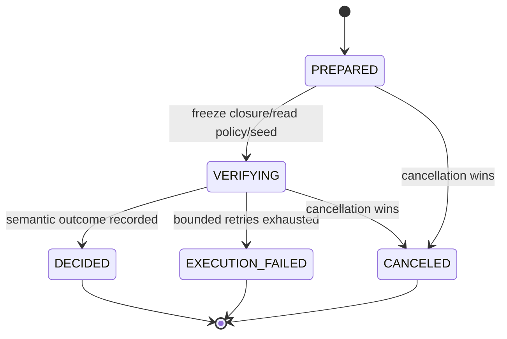

# Knowledge Admission 与 Knowledge Verifier 详细设计

| 元数据 | 值 |
|---|---|
| Document ID | DD-KNW-ADMISSION |
| Version | 0.1.0 |
| Status | Accepted |
| Document Steward | Knowledge Engine |
| Architecture Baseline | SWM-ARCH@1.2 |
| Depends On | DD-KNW-REFERENCE-CONTEXT@0.1.0、DD-KNW-SCHEMA-CORE@0.1.0、DD-KNW-CONTEXT-COMPARISON@0.1.0、DD-KNW-EVIDENCE@0.1.0、DD-KNW-ENTITY@0.1.0、DD-KNW-FACT@0.1.0、DD-KNW-INFERENCE-CONFLICT@0.1.0、DD-X-CAPABILITY-EXECUTION@0.1.0、DD-AI-MODEL-GATEWAY@0.1.0、DD-MGT-CAPABILITY-EVALUATION@0.1.0 |
| Owns Contracts | KNW-ADMISSION-CLOSURE-01、KNW-KNOWLEDGE-VERIFICATION-01、KNW-ADMISSION-DECISION-01、KNW-ADMISSION-ATTEMPT-01 |
| Design Coverage | Candidate Closure 形成、独立知识审核、准入决定与发布前有效性边界 |
| Supersedes | None |
| Rationale ADR | AD-013、AD-043、AD-066、AD-079、AD-081、AD-095、AD-109、AD-112、AD-113、AD-126、AD-128 |
| Design Validation | None |
| Conformance Cases | None |
| Capability Evaluation | None |

> 概要架构约束直接生效；本文新增的 Candidate Closure、Verification 和 Admission Decision 语义在状态进入 `Accepted` 前均为拟议设计。

## 1. 目的与范围

Knowledge Admission 回答一个严格限定的问题：平台已重建的某个候选原子闭包，是否有足够且可重放的依据，有资格在不改变语义的前提下成为正式知识。

本文定义：

- Candidate Bundle 到原子 Admission Closure 的平台重建和分区。
- 机械完整性校验与独立语义审核的职责边界。
- Entity、Fact、Inference、Conflict 和推断型 Entity 共用的准入流程。
- Admission Attempt、Decision、审核读集、幂等、重试和失效语义。
- 模型审核能力与平台不可让渡控制之间的分工。

本文不定义：

- Candidate 如何从 Artifact / Evidence 产生；由各知识对象主题定义。
- 稳定 Knowledge ID 分配、Snapshot 集合一致性、CURRENT 切换和持久事务；由 DD-KNW-SNAPSHOT-PUBLICATION 定义。
- 某次 Knowledge Update 是否已满足 Build Objective 或产品验收；这是 Application Services 的用例判断。
- 已发布 Snapshot 是否足以回答某个用户问题；这是 Knowledge Use / Sufficiency Assessment。
- 通用 Governance、人工审批流程、全局分布式锁或特定数据库实现。

## 2. 核心分界

### 2.1 六个不同判断

| 判断 | Owner | 回答的问题 |
|---|---|---|
| Candidate Conformance | Knowledge Engine / object-specific builder | “这是否是一个结构合法的候选？” |
| Verification Assessment | Knowledge Verifier | “每个必需机械/语义义务的独立审核结果是什么？” |
| Admission Decision | Admission Authority | “这个精确 Closure 是准入、拒绝、需修订还是需更多信息？” |
| Application Publication Acceptance | Application Services / Criterion Owners | “针对将要发布的精确成员集，来源、知识、Schema、资源和并发条件是否全部 PASS？” |
| Snapshot Publication | Knowledge Engine | “一组已准入闭包是否可以组成完整、引用一致的新 Snapshot 并原子发布？” |
| Post-publication Use-case / Knowledge Sufficiency | Application Services / Knowledge Use | “已发布 Snapshot 是否逐项满足原 Build Objective / Knowledge Requirement？” |

机械形状合法不等于语义可准入；准入通过不等于已发布；已发布不等于任务已满足。

### 2.2 内部组件职责

| 组件 | 负责 | 不负责 |
|---|---|---|
| Knowledge Construction | 从权威输入重建 Entity / Fact / Inference State Candidate | 审核自己的候选或写入正式知识 |
| Admission Coordinator | 聚合等价 Candidate、形成原子闭包、冻结 Read Policy / Seed，捕获并封存实际读闭包 | 补写 Candidate 语义、分配稳定 ID 或决定用例是否完成 |
| Knowledge Verifier | 独立重读依据，执行机械与语义审核，输出结构化审核结果 | 修改 Candidate、调用 Connector、发布 Snapshot 或生成用户答案 |
| Admission Authority | 验证 Verifier Strategy 结果和权威读集，形成不可变 Admission Decision | 把模型响应直接当作决定或预留可查询 Root |

以上都是 Knowledge Engine 内部职责，不引入新的顶层服务或跨进程边界。Knowledge Verifier 的“独立”指输入、执行上下文、权限、Strategy 和判断链与生成方分离，不表示必须部署为独立服务。

### 2.3 与 Publication Acceptance 的边界

Admission Batch Result 只证明 Candidate / Evidence / Dependency 的知识侧审核结果。下游 Application 用例仍须针对 exact Publication Candidate Manifest 评估来源覆盖、Schema、资源、权限和并发等 Criterion，并按 Snapshot Publication 的公开请求契约提供 PASS Acceptance Assertion。

Acceptance Assertion 不能覆盖 REJECT / REVISION_REQUIRED / MORE_INFORMATION_REQUIRED，也不能把没有语义 Decision 的 Closure 放入 Manifest。Snapshot Builder 只消费本文 Batch 与 Snapshot 公开 Build Request：opaque Build Intent / Application Attempt References、Scope、Target Snapshot Local Reference、Expected Current、Schema、Upstream Binding 和被选中 ACCEPT Decisions。Admission 不读取 Application 私有 Repository，也不拥有 Publication lifecycle。

## 3. 逻辑对象与所有权

| 对象 | Owner | 权威语义 |
|---|---|---|
| Candidate Proposal | Investigation / Construction Strategy | 不可信语义提议；不是 Candidate |
| Candidate Bundle | Knowledge Engine Candidate Area | 一次 Attempt 重建出的候选、未解析项和局部引用集合；不是原子边界 |
| Final State Candidate | Knowledge Engine | 按 Effective Identity Key 解析、聚合后等待最终审核的完整 Entity / Fact / Inference State Candidate；包括新建、替换和语义保持 Continuation |
| Admission Closure | Admission Coordinator | 必须一起审核且不可部分发布的候选原子闭包 |
| Verification Read Set | Admission Coordinator | 审核时重读的权威对象、可变条件观察和 Digest |
| Verification Assessment Proposal | Verification Strategy | 不可信的结构化审核提议；模型响应本身不是准入决定 |
| Verification Assessment | Knowledge Verifier | 平台从封存 Read Set 和经验证 Proposal 重建的每项必需义务结果 |
| Admission Decision | Admission Authority | 对一个精确 Closure Revision 和审核读集的不可变正式审核结果 |
| Admission Batch Result | Admission Coordinator | 完整列出 Bundle 内每个 Closure、未解析项和对应结果；供上层判断后续动作 |
| Publication Candidate Manifest | Snapshot Builder | 将最终入选 Closure / Continuation 与将要发布的精确 Snapshot Membership 绑定；Application Acceptance 的直接对象 |

以上对象都不是 Formal Knowledge Reference。只有成功 Snapshot 发布后才产生可用的 Entity / Fact / Inference State。

## 4. KNW-ADMISSION-CLOSURE-01

### 4.1 Candidate Envelope 与规范化

Knowledge Engine 在开始一个 Candidate Bundle 时，通过 `KNW-CANDIDATE-ENVELOPE-01` 的 `BeginCandidateBundle` 为上游已有的 `(Build Intent Reference, Application Attempt Reference)` 返回唯一不可变 Candidate Envelope。该公共 Contract 由 DD-KNW-SCHEMA-CORE 定义；Admission 只消费，不另建 Envelope 状态：

- owning Scope。
- exact target Knowledge Schema。
- Target Snapshot Local Reference。
- Expected Current 与 exact Upstream Snapshot Bindings。
- Envelope Revision / Digest。

Entity、Fact、Inference 和 Continuation Candidate 都必须显式携带同一 Envelope Reference；不存在第二套 Construction Attempt。跨 Envelope Candidate-local Reference 一律拒绝。

Admission Coordinator 按以下顺序处理：

1. 只接收 Knowledge Engine 按对象 Contract 重建的 Candidate。
2. 使用各对象唯一 Effective Identity Key 完成 Resolution。
3. 聚合命中同一已有 Root / 待创建 Key 的候选，形成 Final State Candidate。
4. 对聚合后的完整 Candidate 重跑对象级机械校验。
5. 分别构造 Hard Atomic Edge 与 Directed Publication Prerequisite Edge。
6. 只对 Hard Atomic Edge 取无向连通分量形成 Admission Closure；冻结 Substitution Manifest 和 Closure Digest。

无法合法聚合时标记构建失败，不任选一个或后写覆盖。

### 4.2 两种依赖边

Hard Atomic Edge 只用于双方共同定义、任何一方单独发布都会改变语义的关系：

- INFERRED Entity 与其唯一 ENTITY_DERIVATION Inference。
- 对象 Contract 明确声明必须共同审核 / 发布的其他双向定义关系。

普通 Candidate-local Entity 被 Fact / Inference 引用时，形成 `Entity Closure → Referencing Closure` 的 Directed Publication Prerequisite Edge，不把 Entity 及所有 Facts 合并成一个大 Closure。Publisher 选择的 Closure 集合必须 predecessor-closed：发布一个下游 Closure 时，其全部本地前置 Closure 同时被选择且 ACCEPT。

Candidate Fact / Inference 不能成为本轮 Inference 的语义 Premise；这种引用直接拒绝，不转化为原子边。跨 Scope 只允许 exact Upstream Snapshot 的 Resolved Formal Knowledge Reference。

### 4.3 原子性与失败隔离

一个 Closure 内的 Final State Candidates 只能整体 ACCEPT。不同 Closure 可以并行审核；一个失败不自动拒绝无 Hard Atomic 关系的 Closure。Batch 必须披露每个 Closure 的 Attempt 终态，上游不能静默丢弃失败 Closure 并宣称完整成功。

Publication Candidate Manifest 只能选择 ACCEPT Closure，并满足全部 Directed Publication Prerequisite。普通 Entity Closure 被 ACCEPT 后，可以支持多个彼此独立 Fact Closure；其中一个 Fact 失败不拖死其他 Fact。

### 4.4 Closure 冻结内容

每个 Admission Closure 至少固定：

- Closure / Bundle ID、Revision、Digest 和 Partition Entry。
- Candidate Envelope Reference / Digest，以及 opaque Build Intent / Application Attempt References。
- 全部 Final Entity / Fact / Inference State Candidates 与 Effective Identity Keys。
- Hard Atomic Edges、入向 / 出向 Publication Prerequisites。
- Evidence、Context、Anchor、Support / Constraint、Argument、Formal Premise / Fact Leaf、Resolution 和 Schema Decision References。
- Candidate-local Substitution Manifest、Disclosure Manifest 子集、Capability / Strategy Provenance 和 Substitution-Invariant Digest。

Final Candidate Bundle Seal 形成后，任何候选语义、Identity、Evidence、Argument、Edge 或 Digest 变化都使用新的 Application Attempt / Candidate Envelope；不在原 Attempt 形成第二个 Final Revision。若旧 Publication Request 已存在，其取消与 Outcome 由上游通过 Publisher 公共 Contract 处理，Admission 不维护 Authority Epoch 或 Gate。

### 4.5 Admission Batch Result

不可变 Batch 至少固定：

- Candidate Bundle / Final Seal、Candidate Envelope、opaque Build Intent / Application Attempt References。
- Closure Partition Manifest、全部 Hard Atomic / Directed Prerequisite Edges 和 Partition Digest。
- 每个 Closure 的 Admission Attempt Reference、唯一 terminal execution status，以及可选 Admission Decision Reference。
- 全部未解析 Mention / Identity / Proposal、构建失败、碰撞、禁止依赖及原因。
- Construction Disclosure Manifest、Batch Digest 和 `Completeness = COMPLETE | INCOMPLETE`。

每个 Closure 必须有唯一终态 Attempt；只有 `DECIDED` Attempt 有语义 Decision。EXECUTION_FAILED / CANCELED 没有 Decision，但仍被 Batch 完整列出。COMPLETE 只证明 Final Seal 的每个对象、边和问题均有唯一覆盖，不表示全部 Closure ACCEPT。

Working Bundle 的 Preview 不具有准入效力。Final Seal 后，每个 Closure 都必须建立绑定该 Seal 的正式 Attempt；旧 Working Revision 的 Decision 不可包装复用。新信息出现时关闭本 Application Attempt并创建新 Candidate Envelope，旧记录保持历史语义。

### 4.6 Construction Disclosure Manifest

Knowledge Construction 必须将生成期间已发现且与候选审核相关的不利/限制信息结构化披露，至少包含：

- 替代观察或竞争身份候选。
- Context Constraint / 不可比较结果、`KNW-REVALIDATION-SIGNAL-01`。
- 已知反例、否定观察、失败的 Argument 分支和结论限制。
- 未解析 Evidence / Formal Premise / Entity 与它们可能影响的 Candidate / Closure。
- 权威引用、稳定 Locator / Digest、关联原因和 Construction Capability Provenance。

Disclosure Manifest 进入 Candidate Bundle / Batch Digest，每个 Closure 固定它的相关子集，并作为 Verification Seed 与最终 Decision Digest 的一部分。Knowledge Verifier 仍要独立搜索授权读闭包中的反例；Manifest 不让生成方通过“没有披露”自证没有问题。它只保存可审核的结构化信号和引用，不保存模型私有 Chain-of-Thought 或调查对话。

## 5. Verification Read Set

Knowledge Verifier 不信任 Closure 中复制的实体内容或生成方摘要。Read Set 是审核期间实际读取的权威闭包，而不是审核前由 Coordinator 猜测的完整列表。其形成顺序为：

1. Admission Coordinator 冻结 `Verification Read Policy + Seed References`，包含 Closure、Construction Disclosure Manifest、允许 Scope / Repository / Purpose / Classification、最大展开边界和 Execution Envelope。
2. 所有 Verifier 权威读取只能通过受控端口执行；端口把请求、结果引用、Digest、Purpose、权限/可用性观察和时间自动追加到 Attempt-local、append-only Read Set。
3. Semantic Verification 结束后，Coordinator 封存最终 Read Set Revision / Digest。Verification Assessment 只能引用该封存集合内的权威对象和观察。
4. Admission Authority 校验 Assessment 的每个依据引用都属于封存 Read Set，再形成 Decision。封存后发现需要新权威读取时，必须创建新 Read Set Revision 并重新执行受影响审核，不在 Decision 后补录。

封存 Verification Read Set 至少包含：

- 实际重读的 Evidence Record / Snapshot、Observed Content Digest、Locator、Provenance 和当前 Verification Purpose 可复核性结果。
- Base / Upstream Snapshot、Resolved Formal Knowledge State、Context 和 Dependency Closure 的确切引用与 Digest。
- Entity / Fact / Inference Root、首次成功发布证明、Effective Identity Key 权威索引的查询结果。
- Knowledge Schema、Type / Identity / Context / Composition / Dependency Contract 以及显式兼容决定的精确版本。
- Capability Catalog Snapshot、Verification Strategy、Execution Envelope、Evaluation Activation，以及由 Application / Management 传入的 Execution Eligibility / Revocation Assessment；Knowledge Engine 不反向查询 Activation Repository。
- Construction Disclosure Manifest 及 Verifier 独立发现的反例/限制引用。
- 重读时间、权限用途、对象 Digest、可变索引观察标识、Read Set Revision 和 Digest。

不可变 Evidence / Snapshot / State 使用确切引用重放。对每个会影响发布的可变观察，Read Set 必须同时声明 `Publication Precondition Class`：

| Class | 适用条件 | 发布保证 |
|---|---|---|
| `TRANSACTIONAL` | CURRENT、canonical / alias 唯一键、本地 Membership、Decision / Manifest / Digest | 作为同一 Scope 发布事务的 CAS / 唯一约束 / 一致性校验 |
| `FENCED` | 能提供权威 Revision、Lease、Fence Token 或 monotonic Epoch 的权限、Retention、Execution Eligibility / Revocation | 只有当 Token 能在提交边界验证，或权威 Lease 保证覆盖整个提交时才可宣称失败关闭 |
| `OBSERVATIONAL` | 外部 Authority 无法提供可提交 Fence 的时效状态 | 只固定 owner、observedAt、result、freshness / risk policy；不宣称它是严格的提交时不变量 |

每个 Admission 派生 Precondition 固定 Class、Authority Owner、Revision / Token / observedAt、验证政策和 Result Digest。Class 由 Authority Owner 的版本化 Precondition Contract 与冻结 Publication Policy 唯一解析，不由 Verifier 或 Publisher 临时选择。无法提供 Fence 的外部条件不得伪装成 `FENCED`；Application Publication Policy 决定某类 OBSERVATIONAL 风险是否可接受，但正式跨 Scope 引用的 Retention 完整性不得使用 OBSERVATIONAL。Manifest 形成后新增的 Application / Management 条件由相应 Criterion Owner 在 Publication Acceptance 中分类和封存，不回写 Admission Decision。Admission 不通过持有全局锁使这些条件永久不变。

## 6. KNW-KNOWLEDGE-VERIFICATION-01

### 6.1 Verification Profile 解析

Knowledge Engine 根据 Closure 中每个 Knowledge Kind、Type / Identity Contract、Resolution Class、依赖深度和 Schema 声明的风险规则，机械解析 `Verification Profile Requirement`。混合 Closure 取所有成员的必需义务并集，不是由模型自报“低风险”或任选一个 Profile。类型、风险规则或 Profile 无法唯一解析时失败关闭。

Application Services 已在 Capability Catalog Snapshot 中为允许的 Capability Requirement 解析 `PRODUCTION Activation | exact EVALUATION_ONLY Grant`。Knowledge Engine 只使用冻结 Catalog 中恰好实现各 Profile Contract 的 Deterministic / Model-Primary / Hybrid Strategy，不反向查询 Activation Repository、不自行换模型。低风险类型可使用 Deterministic Strategy，但不免除独立审核与 Assessment。

### 6.2 两阶段审核

Knowledge Verification 包含两个不可混合的阶段：

1. `MECHANICAL_CONFORMANCE`：严格、可重放的 Contract、引用、Digest、唯一键、闭包和边界校验。
2. `SEMANTIC_VERIFICATION`：从权威读集独立核对身份、命题、支持关系、推理、Context、反例和语义范围。

对于完全由稳定 Contract 机械决定的低风险类型，第二阶段可由经评测激活的 Deterministic Verification Strategy 完成，不强制每条候选调用模型。开放语义判断通常使用 Model-Primary 或 Hybrid Strategy，但必须经过同一平台重建和决策边界。

### 6.3 通用机械义务

Admission Coordinator / Verifier 至少机械检查：

- Closure 字段、Knowledge Kind、Schema 和 Type Contract 完整，不存在未知字段、重复 Local Key 或越界引用。
- Scope、Expected Current、Upstream Snapshot、Evidence、Context 和 Formal Knowledge Reference 均为确切且相互一致的引用，不包含动态 `CURRENT`。
- 聚合使用对象 Contract 定义的完整 Effective Identity Key，候选期每个 `(Scope, Target Snapshot Local Reference, Effective Identity Key)` 只形成一个最终 State Candidate。CREATE 期不使用尚未存在的 Snapshot ID / Knowledge ID；发布后再校验 `(Scope, Snapshot ID, Knowledge ID)` 唯一 State。
- Candidate-local Reference 只能在同一 Candidate Envelope 中出现；跨 Closure 引用必须对应唯一 Directed Publication Prerequisite，并在 Batch / Manifest 中指向 predecessor Closure。每个 Closure 的本地 Substitution Manifest 和 Digest 可重算。
- Candidate Fact / Inference 没有成为 Inference 语义前提；Inference Dependency 可展平、无环、深度有界且具有非空正式 Fact Leaf。
- 本地 Entity / Premise 具有目标 Snapshot Membership / Rebinding，跨 Scope 只指向允许的确切 Upstream Snapshot。
- 跨 Schema Evidence 解释、Entity / Fact / Inference Identity Continuation 和 Formal Premise Interpretation 均具有 Schema Core 的 exact `KNW-SCHEMA-TRANSITION-PROOF-REF-01`，且 Purpose / source / target / subject 匹配并为 ELIGIBLE。
- 候选使用 Compatibility Assessment 组合 Context 时，调用方必须随 Admission Request 提交当前 Catalog / Activation、latest Evaluation Validity 与依赖 Revision；Knowledge Engine 通过 `ValidateContextAssessmentReuse` 取得 exact latest VALID Decision。仅有历史 Assessment Reference 不足以准入。
- INITIAL / UNCHANGED Candidate 绑定成功的 Schema Selection Receipt；ADOPTION Candidate 同样只按目标 Schema 审核自身，并绑定适用的 Transition Proof References。Admission 不读取 Evolution Plan、Source Inventory / Disposition、Target Obligation Satisfaction 或 Adoption Package；这些在完整 Batch 之后由 Evolution / Publisher 单向校验。Final Schema Target Validation 在 Publication Manifest 形成后执行，不是 Admission 前置。
- Capability / Strategy 实现声明的 Contract Version，来自冻结 Catalog，Execution Envelope 权限与资源未扩大。
- CREATE / LINK 唯一键、历史 Root 首次成功发布证明和连续性在审核读集中可重建。

准入时的唯一键检查是 preflight，不替代最终发布事务的唯一约束和并发复核。

### 6.4 对象语义义务

Knowledge Verifier 必须调用候选种类的已声明审核 Profile，不在本文重新发明对象语义：

- SOURCE_ANCHORED Entity：重读 Mention / Evidence / Anchor、Effective Entity Identity Key、碰撞、Continuity 和 Resolution Target。
- INFERRED Entity：同时审核 Semantic Definition、Effective Identity Key、同 Snapshot EntityDerivation、其 Fact Leaf 闭包和跨 Origin 碰撞决定；至少一个身份锚定 Fact Leaf 必须不以目标 Entity 或其历史 EntityDerivation 为身份解析前提。
- Fact：对完整 Canonical Proposition 重建 Direct Support / Composition、Coverage、Context Constraint、Observation Modality、反驳观察和 Fact / Inference 分类。
- Inference：重建正式 Premise、Premise Modality 传播、Structured Argument、Dependency / Fact Leaf Closure、Context、限制和反例。
- Conflict：额外分别证明 Target Alignment、Context Comparability 和 Semantic Incompatibility，并验证 supporting formal refs 已进入直接 Premise。

对象 Profile 的任一必要义务未闭合，整个 Closure 不能 `ACCEPT`。

### 6.5 独立性与权限

Verification Execution 必须：

- 使用独立 `KNOWLEDGE_VERIFICATION` ModelExecutionContext 和 Resource Allocation。
- 只接收平台重建的 Final State Candidate、冻结 Read Policy / Seed、Construction Disclosure Manifest 和详细设计允许的反例/限制输入；不继承生成方私有思考链、调查对话或答案文本。
- 通过 Knowledge Engine 和 Evidence Access 的受限只读端口重读权威内容；不直接访问 Source Integration、Connector、外部 Data Source 或动态 CURRENT。
- 不执行任何写入或副作用 Tool，不扩大 Scope、Purpose、Data Classification 或资源预算。
- 不使用生成 Candidate 的同一 Strategy / Execution；可以使用同一基础模型，但 Prompt / Context、输入重建、能力职责和决策记录必须隔离。

同一基础模型可用不代表任何模型都自然合格。Knowledge Verification Strategy 必须作为独立 Capability 完成 Evaluation / Activation，并评估自我认可、隐藏前提、范围扩大和漏报反例风险。

### 6.6 Verification Assessment

Verification Strategy 输出的 Proposal 必须由 Knowledge Verifier 使用封存 Read Set 重建为平台权威 `Verification Assessment`。Assessment 对 Profile 声明的每个必需 Mechanical / Semantic Obligation 恰好保存一项：

- Obligation ID / Contract Version / applicable Candidate Set。
- `PASS | FAIL | UNKNOWN | NOT_EVALUATED`。
- 封存 Read Set 内的依据 / 反例引用、Finding Class、范围和限制。
- Deterministic Check / Verification Capability / Strategy / Execution Reference。
- Assessment Item Digest。

Knowledge Verifier 必须机械证明所有必需 Obligation 均已列出，且所有依据属于同一封存 Read Set。模型漏输出项不等于 PASS；必需项 `NOT_EVALUATED` 因执行故障产生时，Attempt 以 EXECUTION_FAILED 结束而不形成语义 Decision。

Admission Authority 使用版本化、确定性 Outcome Aggregation Policy 形成 Decision：

1. 只有所有必需 Mechanical 和 Semantic Obligation 都为 PASS 才能 `ACCEPT`。
2. 任一不可修复的 Contract / Invariant / Unsupported-or-Contradicted Finding 产生 `REJECT`。
3. 没有 REJECT，但存在需要新 Evidence / Formal Knowledge / 身份区分信息才能关闭的 UNKNOWN / Gap 时产生 `MORE_INFORMATION_REQUIRED`。
4. 权威输入已足够，但 Candidate 结构/表达/闭包需重建时产生 `REVISION_REQUIRED`。
5. 同时存在多类 Finding 时按 `REJECT > MORE_INFORMATION_REQUIRED > REVISION_REQUIRED > ACCEPT` 聚合，同时保留全部结构化问题。

Finding Class 到上述类别的映射由 Verification Policy 版本化固定，不由模型临时选择。Mechanical Failure 不能被 Semantic PASS 覆盖。

### 6.7 补充信息边界

Knowledge Verifier 可以输出结构化 `Knowledge Information Requirement`，说明缺少的命题路径、Evidence 覆盖、Context、正式前提、反例或身份区分信息。它不包含 Connector 名称、Source Selector、外部查询脚本或来源调用计划。

Knowledge Construction 将其解释为知识缺口，Application Services 再决定是否发起后续调查。Verifier 不直接调用 Connector，也不能通过“补充信息”修改本次 Candidate。

## 7. KNW-ADMISSION-DECISION-01

### 7.1 结果语义

| Outcome | 精确含义 | 后续动作 |
|---|---|---|
| `ACCEPT` | Closure 在冻结读集、Contract 和审核政策下完整通过 | 可作为 Snapshot Publication 的候选输入；仍不是正式知识 |
| `REVISION_REQUIRED` | 现有权威输入可能足够，但本 Candidate 的命题、Context、Link、Argument、Resolution 或闭包表达需重建 | 生成完整 replacement Candidate Revision 和新 Attempt；不原地修改 |
| `MORE_INFORMATION_REQUIRED` | 当前权威 Evidence / Formal Knowledge 不足以判定完整候选 | 返回 Knowledge Information Requirement；是否调查由上层决定 |
| `REJECT` | Candidate 违反不变量，或在当前固定语义/依据下不成立，且不能仅靠补齐已有表达修复 | 不发布该 Closure；保留决定与 Findings |

Provider 超时、模型不可用、Evidence 读取临时故障、资源不足和平台内部错误是 `EXECUTION_FAILED`，不是上述语义 Decision。不得把执行失败降级为 ACCEPT、REJECT 或猜测结论。

### 7.2 Admission Decision 内容

每个完成的 Admission Decision 都是不可变审计记录，至少固定：

- Decision / Attempt / Closure ID 与 Revision、Outcome、Decision Time。
- Candidate Bundle ID / Revision / Digest、Final Candidate Bundle Seal、Closure Partition Entry、Candidate Envelope、opaque Build Intent / Application Attempt References、Expected Current 和 Upstream Snapshot Binding。
- 最终 Substitution-Invariant Closure Digest、每个 Final State Candidate Digest 和 Local Reference Substitution Manifest Digest。
- Construction Disclosure Manifest Digest、封存 Verification Read Set Revision / Digest、对象引用、可复核性结果与分类 Publication Preconditions。
- 平台 Verification Assessment / Aggregation Policy Digest、Mechanical / Object Profile Result、Findings、限制和 Knowledge Information Requirement（如有）。
- Knowledge Verification Capability / Contract、Strategy、Model / Tool Execution、Evaluation Activation 和完整 Execution Provenance。
- Decision Schema Version、Canonicalization Version 和 Decision Digest。

这里的 Manifest 只指 `Local Reference Substitution Manifest` 或明确命名的 Construction Disclosure Manifest。Admission Decision 形成时尚不存在 Publication Candidate Manifest，因而绝不绑定后者；Snapshot Builder 后续单向选择 ACCEPT Decision，并把该 Decision、Closure 和 Local Reference Substitution Manifest 纳入 Publication Candidate Manifest。

Admission Authority 只能从平台重建的 Verification Assessment、封存 Read Set 和确定性 Aggregation Policy 构造 Decision。模型自报的 ACCEPT、ID、Digest、Scope、Snapshot、Evidence 可用性或完成度全部无权威性。

### 7.3 ACCEPT 的精确效力

`ACCEPT` 只授权 Snapshot Publication 对该精确 Closure 执行以下动作：

- 按已绑定 Local Reference Substitution Manifest 将 Candidate-local Reference 机械替换为新分配或已有的稳定 ID。
- 使用相同 Effective Identity Key 重新规范化并证明 Substitution-Invariant Closure Digest 不变。
- 在同一 Scope 的最终发布事务中声明 Root、State、Link、唯一键和闭包关系。

它不授权发布方聚合新 Candidate、删除某个闭包成员、增删 Evidence / Argument / Context、改变 Resolution Target、选择 Conflict 赢家或扩大用例语义。任何这类变化都需要新 Candidate Revision 和新 Decision。

### 7.4 发布前有效性

Admission Decision 不原地“过期”或改写；Snapshot Publication 对它计算当次 `Publication Eligibility`。以下任一条件失配时，ACCEPT 不得用于本次发布：

- `TRANSACTIONAL` 条件中，实际 CURRENT 不再符合 `PRESENT(ref) | NO_CURRENT`，或 canonical / alias 唯一键、本地 Membership、Decision / Local Reference Substitution Manifest / Publication Candidate Manifest 提交约束失败。
- target Knowledge Schema、必需 Compatibility / Continuation Decision 或 Upstream Snapshot Binding 与决定不同。
- Closure / Candidate / Local Reference Substitution Manifest / Read Set Digest 不一致，后续 Publication Candidate Manifest 未精确选择该 Decision，或局部替换后的规范语义 Digest 改变。
- `FENCED` 条件的权威 Revision / Lease / Fence / Epoch 无法在发布边界验证，或已表明权限、Retention、Execution Eligibility / Revocation 不再允许发布。
- `OBSERVATIONAL` 条件超过冻结 Publication Policy 允许的 Freshness / Risk 范围。此类条件只表示有时间点的资格观察，不伪装为严格事务不变量。
- Application / Management 传入的 Verification Strategy / Evaluation Eligibility Assessment 显式撤销该执行，或审核政策要求使用更新决定。Knowledge Engine / Publisher 不反向读 Activation Repository；仅有新版本可用不自动否定旧决定。

发布前有效性失败不修改原 Decision。需要重新构建、重验或基于新 CURRENT 开启新 Attempt；具体决策由 Snapshot / Knowledge Update 主题定义。

## 8. Conflict、替代事实与 Schema 演进

### 8.1 不把事实差异当作准入故障

两个具有不同 Effective Fact Identity Key 的完整客观命题，可以在各自 Closure 中分别通过 Admission，即使它们的值、来源模态、时间或 Context 不同。Knowledge Verifier 不会因为“系统已存在另一个 Fact”就拒收新的可直接复核 Fact。

只有正式 Conflict Inference 能声明两个已准入 Fact 在明确对齐、Context 和规则下不兼容。Admission 审核该 Conflict Inference 本身，不选择赢家、不修改两个 Fact、不使用通用 `CONFLICTED` State 隐藏任一方。

如果两个 Candidate 实际命中同一 Effective Identity Key，却不能形成一个合法最终 State，这是 Identity / Aggregation Collision，不是 Conflict Inference；相关 Closure 不能通过。

### 8.2 Schema Evolution 不走旁路

Migration、Re-survey / Revalidation、Deprecation 或 Identity Continuation 产生的 Entity / Fact / Inference Candidate 必须经过同一 Admission 主干。Schema Evolution Strategy 可以提供候选映射和迁移依据，但不能审核自己、直接改写历史 State 或借版本变化绕过 Effective Identity Key。

### 8.3 历史正式知识不自动继承

某个 Root / State 曾在旧 Snapshot 成功发布，不自动证明它可以成为目标 Snapshot 成员。Enrichment、Replacement、历史 Root 身份延续和 Schema Migration 必须提供明确的 Target State Candidate 或下游定义的 State Continuation Candidate，并使用对象 Contract 允许的 Verification Profile。

如果命题、Context、依赖和 Schema 完全未变，对象 Contract 可以允许经独立机械重验的 Continuation Strategy；它仍需固定旧 State / Decision、当前 Evidence / Premise可用性、目标 Snapshot Binding 和新 Admission Decision，不是数据库直接复制。当前不发布 `UNVERIFIABLE / UNSUPPORTED` 等特殊正式 State：必要支持失效时不 Continuation 原 ASSERTED 成员，只产生 `KNW-REVALIDATION-SIGNAL-01`，并通过新 Snapshot 表达后续状态。

## 9. KNW-ADMISSION-ATTEMPT-01

### 9.1 生命周期

生产 Admission Request 固定 `PRODUCTION` Catalog / Activation。首次或回归评测可以用 exact `EVALUATION_ONLY` Grant 复用同一 Verification Strategy 与校验代码，但只写 Evaluation Run 隔离输出，不创建本节 Admission Attempt、Admission Decision 或可被 Publication Manifest 选择的 Result。使用模型时，只有 post-call model eligibility 通过才可继续封存相应生产 Decision / 评测输出。

- PREPARED 固定 Final Seal、Closure、Candidate Envelope、PRODUCTION Catalog / Activation、Profile / Strategy、Execution Envelope 和 Read Policy / Seed。
- VERIFYING 内部可以有界重试 Capability / Model Call，但不改变上层请求、Strategy 或总资源。
- DECIDED 唯一拥有语义 Admission Decision。
- EXECUTION_FAILED / CANCELED 是没有 Decision 的不可变终态。
- 新 Candidate、审核政策或 Strategy 产生新 Admission Attempt；不从 EXECUTION_FAILED 回退，也不维护 SUPERSEDED 状态。

取消与 Decision / execution failure 的终态 CAS 只有一方成功。DECIDED 后的迟到取消不撤销 Decision。

### 9.2 幂等与重试

Admission Request Idempotency Key 至少绑定 Candidate Envelope、Final Seal / Bundle / Closure Digests、Verification Policy / Contract、Catalog、Profile / Strategy、Read Policy / Seed 和 Execution Envelope。同 Key / Digest 返回原 Attempt / Decision；不同 Digest 冲突。

模型 / Tool 内部重试使用新的 Capability Attempt / Model Call ID，保持上层冻结输入和总预算。重试耗尽使 Admission Attempt 进入 EXECUTION_FAILED。得到 REJECT / REVISION_REQUIRED / MORE_INFORMATION_REQUIRED 后，必须修正 Candidate 或补充权威输入并创建新 Attempt；不能在同一 Attempt 换模型追求 ACCEPT。

### 9.3 并发

- 不同 Scope 和没有 Hard Atomic Edge 的 Closure 可以并行审核。
- Admission 只对身份索引作 preflight；最终唯一性与 CURRENT 由 Scope Publication 事务裁决。
- 调用超时按 Admission Idempotency Key 查询，不创建第二个 Decision。
- Batch 可以封存 EXECUTION_FAILED / CANCELED Attempt；它们没有 Decision，不能被 Manifest 选择。

## 10. AI Native Capability 与评测

### 10.1 模型适合承担

- 独立阅读非结构化 Evidence，核对命题是否完整直接表达。
- 检查 Entity 消歧、命题边界、Context 限制、隐藏前提、语义范围扩大和反例。
- 复核 Structured Argument、推理模态、Conflict 三项判断和 Semantic Entity 定义。
- 产生可操作的 Revision Finding 或 Knowledge Information Requirement。

### 10.2 平台不可让渡

- 权威引用重建、Scope / Schema / Snapshot 绑定和 Evidence 权限。
- Effective Identity Key、Candidate 聚合、局部引用图、Dependency DAG、Depth、Digest 和 Manifest。
- 结构化输出校验、决定状态机、幂等、资源上限、唯一性 preflight 和发布前复核。
- 生成/审核隔离、模型不可自报准入、ACCEPT 不等于发布的边界。

随着模型能力增强，可以减少针对特定文档、语言或业务的审核规则和 Prompt 分支；不能退化掉权威读集、稳定身份、Context、正式前提、独立决策和原子发布边界。模型退化时只能由 Application Services 为新 Attempt 解析已通过同一 Verification Capability Contract 的回退 Strategy；不在已冻结 Attempt 中换路径。

### 10.3 Capability Evaluation

Knowledge Verification 按对象 Profile 建立版本化 Capability / Evaluation Contract。评测至少覆盖：

- False Accept、False Reject、未知校准和结构化 Finding 可操作性。
- Evidence 忠实性、命题完整性、Context 扩大、来源模态偷换和 Fact / Inference 误分类。
- Entity False Merge / Split、历史 Root 误 LINK、Effective Identity Key 遗漏和局部引用替换错误。
- Inference 隐藏前提、确定性升级、Dependency 遗漏、自证和反例漏报。
- Conflict False Positive / False Negative 与“选赢家”偏置。
- 生成 Strategy 错误样例上的审核独立性，跨项目、跨模型和模型升级非回归。
- Token / 时延 / Tool 成功率、资源上限和确定性 / Model-Primary / Hybrid Strategy 的质量成本差异。

直接读取源码的高能力模型 / Agent 可以作为离线评测基线和错误发现器，不能成为生产双路径或绕过 Admission 的答案来源。

## 11. 失败、审计与敏感信息

| 失败类别 | 处理 |
|---|---|
| CLOSURE_NOT_CANONICAL / AGGREGATION_COLLISION | 不进入语义审核；重新 Resolution / Construction |
| LOCAL_REFERENCE_ESCAPE / CANDIDATE_AS_PREMISE | 拒绝相关 Closure；不通过扩大闭包绕过正式前提边界 |
| EVIDENCE_UNREADABLE / RESTRICTED | 按 Verification Policy 返回补充信息、拒绝或执行失败；不信任生成方摘要 |
| HIDDEN_PREMISE / CONTEXT_EXPANSION / MODALITY_AMPLIFICATION | 不 ACCEPT；返回精确 Finding |
| VERIFICATION_OUTPUT_INVALID | 不形成 Admission Decision；按 Capability Policy 有界重试 |
| STRATEGY / MODEL UNAVAILABLE | 当前 Attempt 为 EXECUTION_FAILED；如需回退，Application Services 使用新 Catalog / Strategy 开启新 Admission Attempt |
| EXPECTED_CURRENT / UNIQUE KEY STALE | Admission Decision 保持，Publication Eligibility 失败；开启新构建/发布 Attempt |
| ADMISSION_OUTCOME_UNKNOWN | 通过 Request Idempotency Key 查询；不另建决策 |

全流程传播 Task / Run、Build Intent、Candidate / Closure / Admission Attempt、Evidence / Formal Knowledge、Capability / Strategy / Model Call、Decision 和后续 Publication 关联。记录每阶段时延、Token / 费用、重试、读取成功率、Outcome / Finding 分类和 Digest。

Telemetry 不复制 Evidence 原文、Artifact Payload、受保护 Proposition、Secret、调查对话或模型隐藏思维链。Admission Decision 保存结构化 Findings、稳定引用和 Digest；它不是绕过 Evidence 权限的新内容副本。

## 12. 拟议不变量

1. 模型 Proposal 不是 Candidate，Candidate 不是正式知识，Admission ACCEPT 也不是 Snapshot 发布成功。
2. 所有 Candidate 先按唯一权威 Effective Identity Key 解析和聚合，再对最终 State Candidate 执行完整审核。
3. 只有共同定义关系形成 Hard Atomic Closure；普通 Entity→Fact 使用有向 Publication Prerequisite，Manifest 必须 predecessor-closed。
4. Candidate Fact / Inference 永远不能作为本轮 Inference 语义前提；闭包原子性不会改变这一边界。
5. Knowledge Verifier 从权威 Repository 独立重读依据，不信任生成方摘要，不访问 Connector，不修改 Candidate。
6. 机械完整性和语义准入是两个阶段；开放语义可使用模型，平台仍重建所有受保护字段和 Decision。
7. 生成 Strategy 不审核自己的 Candidate；同一基础模型可用，但执行上下文、Strategy、权限和决策链隔离。
8. 每个 Admission Decision 绑定精确 Closure Revision、Substitution-Invariant Digest、Local Reference Substitution Manifest、Read Set、Expected Current、Schema、Upstream 和 Verification Capability Provenance；它不绑定之后才形成的 Publication Candidate Manifest。
9. 发布方只能按已审核 Local Reference Substitution Manifest 机械替换 ID 并重验语义 Digest，不能在准入后改写闭包。
10. 身份唯一性和 CURRENT 在 Admission 中只作 preflight，最终一致性由每个 Scope 的 Snapshot Publication 提交时复核；不引入全局准入锁。
11. 可直接复核的替代 Fact 可分别准入；只有 Conflict Inference 表达已证明的不兼容，Admission 不选赢家。
12. Revision / More Information / Reject 与执行失败分离；任何失败都不能降级准入门禁。
13. 独立 Closure 可并行审核，但 Batch Result 必须披露所有失败和未解析项，不得通过静默丢弃伪造完整成功。
14. Schema Evolution 产生的候选走同一 Admission 主干，迁移 Strategy 不能自证或改写历史 State。
15. Admission Batch Result 必须完整覆盖该 Application Attempt 唯一 Final Candidate Bundle Seal；Seal 后任何语义变化创建新 Candidate Envelope / Application Attempt，旧 Decision 不改写。
16. 审核期间所有权威读取自动进入 append-only Read Set；只有封存后的完整读闭包和平台 Assessment 能支持 Decision。
17. Publication Acceptance 绑定精确 Publication Candidate Manifest；Admission ACCEPT、Application PASS 和最终 Publication 三者互不替代。
18. Working Bundle 的增量审核只有 Preview 效力；Final Bundle 的每个 Closure 必须有唯一终态 Admission Attempt，只有 DECIDED Attempt 具有语义 Decision。
19. State Continuation Candidate 不在 Admission 主干之外；它与新建/替换 Candidate 同样受最终 Bundle、Closure、Batch 和 Publication 门禁约束。

## 13. 验证义务与下游追溯

当前无需 Design Validation Demo 决定 Candidate / Formal Knowledge 分界、原子 Closure、生成/审核隔离、Decision 绑定或 ACCEPT / Publication 分离；这些均可由已接受的架构不变量和对象 Contract 推导。

进入实现前至少建立以下 Contract Conformance：

- 等价 Candidate 聚合后必须重验，不能沿用分支初审结果。
- Candidate 输入顺序不影响 Effective Identity Resolution、聚合结果、Closure 分区和规范 Digest。
- Batch Result 对 Final Candidate Bundle Seal 中每个 Candidate、未解析项、构建失败和 Disclosure 恰好覆盖；Working Bundle 的 Preview 不能复用为最终 Batch 的准入结果。
- State Continuation Candidate 与新建/替换 Candidate 一样进入 Final Bundle、Closure Partition 和 COMPLETE Batch；Batch 外 Continuation Decision 不能进入 Manifest。
- 每个 Application Attempt 只能封存一个 Final Candidate Bundle Seal；Seal 后新信息形成新 Application Attempt。旧 Publication Request 已存在时，上游必须先通过 Publisher Cancel / Outcome 解析收口。
- Candidate-local / Stable ID 替换前后的 Substitution-Invariant Closure Digest 一致，且 Manifest 复用完整 Effective Identity Key。
- Candidate 语义 Premise、跨 Attempt 局部引用、动态 CURRENT 和跨 Scope 写入被失败关闭。
- 生成与 Verification ModelExecutionContext / Strategy / Tool 权限隔离，Verifier 无 Connector 和写权限。
- 审核新发现的 Root / Evidence / Context / 反例自动进入 append-only Read Set，封存后新读取强制重审；Assessment 不能引用集合外依据。
- 必需 Assessment Obligation 的 UNKNOWN / NOT_EVALUATED 不能聚合为 ACCEPT，Mechanical FAIL 不能被模型 PASS 覆盖。
- Admission Request 幂等、执行失败不产生 Decision，已 DECIDED Request 不重新抽样。
- 取消与 Decision 竞态只能有一个持久终态，且取消不伪造语义审核结果。
- Hard Atomic Closure 与 Directed Prerequisite 分区稳定；一个 Fact Closure 失败不拖死共享 Entity 的其他独立 Fact，Batch 仍完整披露。
- Publication Acceptance 只能绑定精确 Publication Candidate Manifest，替换 Closure / Continuation / Membership 使原 Acceptance 不可用。
- `TRANSACTIONAL / FENCED / OBSERVATIONAL` Precondition 分类正确；无 Fence 的外部状态不被宣称为严格提交不变量。

Knowledge Verification 的具体 Model-Primary / Hybrid Strategy 必须通过 Capability Evaluation。只有当真实候选表明某个审核输入边界或原子分区无法从现有 Contract 判定，且该选择会改变正式语义时，才登记有界 `DVR-*` Demo。Demo 仅回答已登记问题，不成为生产双路径。

下游详细设计必须复用：

- DD-KNW-SNAPSHOT-PUBLICATION：消费精确 ACCEPT Decision，组装完整 Snapshot，重验 Publication Preconditions 并完成 Scope 级原子发布。
- DD-APP-KNOWLEDGE-UPDATE：编排补充信息、replacement Candidate、Admission Batch Result 和发布后用例结果。
- DD-KNW-SCHEMA-EVOLUTION：使用同一 Admission 主干审核 Migration / Revalidation / Deprecation 候选。
- DD-KNW-PERSISTENCE：持久 Attempt / Decision / Read Set Digest，并使审计 Projection 可重建。
