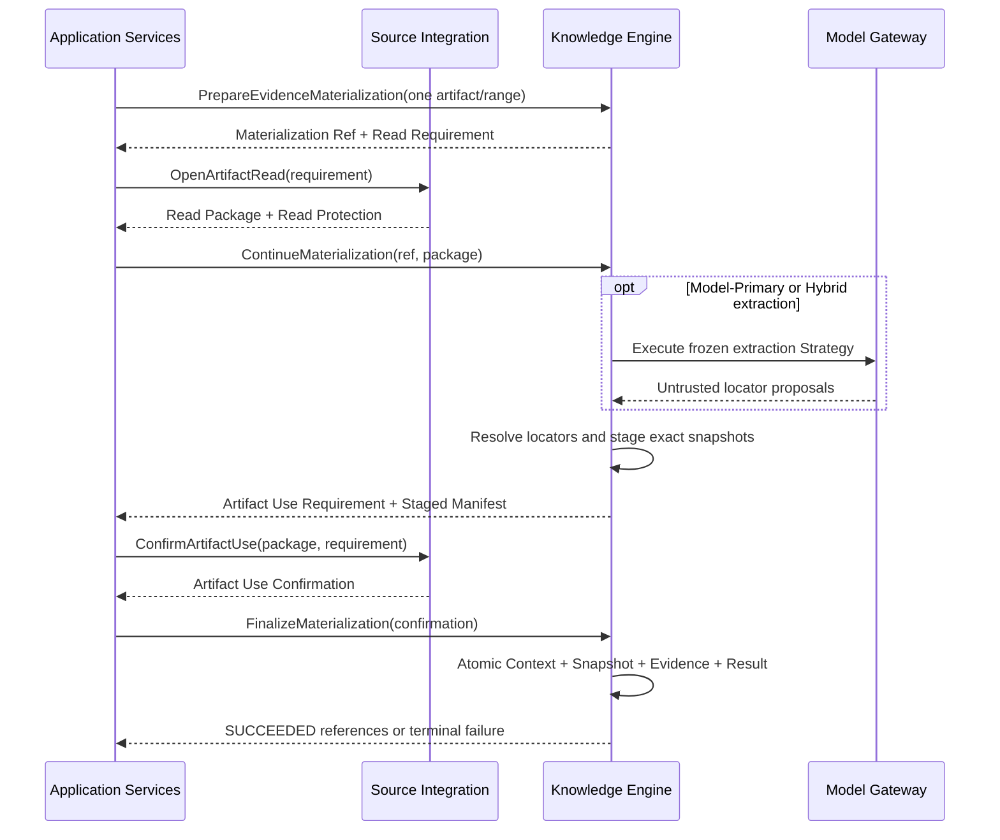

# Evidence 详细设计

| 元数据 | 值 |
|---|---|
| Document ID | DD-KNW-EVIDENCE |
| Version | 0.1.0 |
| Status | Accepted |
| Document Steward | Knowledge Engine |
| Architecture Baseline | SWM-ARCH@1.2 |
| Depends On | DD-KNW-REFERENCE-CONTEXT@0.1.0、DD-KNW-SCHEMA-CORE@0.1.0、DD-X-CAPABILITY-EXECUTION@0.1.0、DD-AI-MODEL-GATEWAY@0.1.0、DD-MGT-CAPABILITY-EVALUATION@0.1.0、DD-SRC-SOURCE-ARTIFACT@0.1.0 |
| Owns Contracts | KNW-EVIDENCE-01、KNW-EVIDENCE-LOCATOR-01、KNW-EVIDENCE-MATERIALIZATION-01、KNW-EVIDENCE-ACCESS-01 |
| Supersedes | None |
| Rationale ADR | AD-026、AD-027、AD-029、AD-091、AD-095、AD-108 |
| Design Validation | None |
| Conformance Cases | None |
| Capability Evaluation | None |

> 概要架构约束直接生效；本文新增的 Evidence Record、Locator、Materialization 和读取语义在状态进入 `Accepted` 前均为拟议设计。

## 1. 目的与范围

Evidence 是 Artifact 与正式知识之间的可复核观察边界。它固定“来源在明确条件和位置上呈现了什么”，使 Entity 身份和 Fact Candidate 可以引用确切来源内容，而不把模型解释、执行状态或来源全文隐式升级为知识。

本文定义：

- Evidence Proposal 与平台构造的 Evidence Record 的边界。
- 一个 Artifact、一个 Locator 和一个来源上下文的单一来源约束。
- Evidence Materialization、身份、去重、最小快照和授权读取。
- Source / Derived Artifact 成为 Evidence 输入的机械条件。
- 模型提议、确定性重建、Context 收窄和保留协调。

本文不定义：

- Entity Mention 如何解析为稳定 Entity。
- Fact 命题、FactEvidenceLink 的支持/反驳关系和多个 Evidence 如何共同作用。
- Inference、知识准入、Snapshot 发布或响应引用。
- 某类代码、数据库、文档或日志的具体 Locator 字段和抽取 Prompt。

## 2. Evidence 的认知边界

### 2.1 Evidence 不是结论

Evidence 保存来源观察，不表达平台最终相信什么。以下内容属于不同对象：

| 内容 | 正确归属 |
|---|---|
| 文件片段、结构化值、日志事件、Trace Span 或封闭查询观察 | Evidence 的 Observed Content |
| “这段代码属于某个正式 Entity” | Entity Identity Candidate |
| “服务 A 调用了服务 B” | Fact Candidate |
| “该调用是为了实现退款业务” | Inference Candidate |
| Tool 成功、扫描范围、预算耗尽或分页失败 | Source Operation Result |

Evidence 中存在但正式命题没有声明的语义，不会自动成为知识，也不能在答案阶段借 Evidence 原文扩张 Fact 或 Inference。

### 2.2 单一来源

- 一条 Evidence 恰好引用一个 Source Artifact 或 Derived Artifact，并在其中使用一个版本化 Locator。
- Locator 选择一个语义上连贯且有界的记录、节点、值或区域；不能把互相分离的多个位置拼成一条 Evidence。
- 多个 Artifact 呈现同一命题时分别形成多个 Evidence；增强、反驳和来源独立性在下游 Fact 关联中判断。
- 相同文本、相同 Digest 或同一 Artifact 中的多个切片都不自动表示来源独立。
- Evidence 不保存多个 Artifact 的“综合摘要”；多来源综合只能帮助发现 Candidate，不能成为单条 Evidence。

### 2.3 Evidence 没有全局极性或置信度

Evidence 本身不标记 `TRUE`、`FALSE`、`SUPPORTS` 或全局 Confidence。同一来源观察对不同命题可能具有不同作用；支持、反驳、限制适用范围及证明强度都属于具体 Candidate / Fact 与 Evidence 之间的关系，由后续主题拥有。

当一个 Evidence 直接呈现了与现有命题不兼容的替代观察时，Knowledge Construction 应优先提出由该 Evidence 正向支持的替代 Fact Candidate，而不是只把它作为原 Fact 的“负面附件”。

## 3. 逻辑对象与所有权

| 对象 | Owner | 生命周期与权威性质 |
|---|---|---|
| Evidence Proposal | Investigation / Extraction Strategy 的临时输出 | 不可信；不是 Evidence，也不能持久引用 |
| Validated Observation | Knowledge Engine 的瞬时重建结果 | 已通过 Artifact、Locator、Digest 和 Context 机械校验，但尚未取得稳定 Evidence 身份 |
| Evidence Record | Knowledge Engine | 不可变、可复用、可审计；不是正式知识或 Snapshot 成员 |
| Evidence Snapshot | Knowledge Engine | Evidence 可独立复核所需的最小精确内容；不是摘要 |
| Evidence Materialization Record | Knowledge Engine | 不可变记录一次 Strategy / Proposal 如何重建或复用 Evidence；多个记录可以指向同一 Evidence |
| Artifact / Source Context / Lineage | Source Integration | Evidence 只消费授权 Read Package，不取得写入权 |
| Entity / Fact / Inference Candidate | Knowledge Engine | 引用 Evidence；不能反向改写它 |

Application Services 只协调 Source Integration 与 Knowledge Engine：先由 Knowledge Engine 准备 Materialization 与 Artifact Read Requirement，再由 Source Integration 展开并授权读取闭包，最后协调 Artifact Use Confirmation。Application Services 不解析 Lineage 或 Payload；Knowledge Engine 不直接访问 Data Source、Artifact Repository 或 Source Operation Result。

## 4. KNW-EVIDENCE-01：Evidence Record

### 4.1 Evidence Reference

Evidence 不是 Formal Knowledge Reference。`Evidence Reference` 至少固定：

- owning KnowledgeScope ID。
- 不可变 Evidence ID。
- Knowledge Schema Reference。

Evidence ID 只能在 owning Scope 与固定 Schema 下解释。它不包含 `CURRENT`、Snapshot、显示名称或默认 Scope。Snapshot 中的 Fact 可以引用 Evidence，但 Evidence 不因此成为 Snapshot 成员。

### 4.2 Record 内容

Evidence Record 至少固定：

| 语义 | 约束 |
|---|---|
| Evidence Reference | Scope、Evidence ID 和 Knowledge Schema |
| Artifact Reference | 恰好一个不可变 Artifact；记录 Class、Kind 和 Payload Schema Version |
| Canonical Locator | KNW-EVIDENCE-LOCATOR-01 的确切 Locator 与 Contract Version |
| Observed Content Descriptor | 内容类型、编码、规范长度和 Digest；精确内容只保存在受控 Evidence Snapshot，不内联于不可变 Record |
| Observed Content Digest | 只对按 Payload / Evidence Representation 规范化后的精确内容计算 |
| Observation Digest | 对 Content Digest、Artifact、Locator Contract / Canonical Locator 和解释 Schema 的完整观察闭包计算 |
| Source Context Reference | Source Artifact 的 Context；合格 Derived Artifact 解析到唯一 Source Root 的 Context |
| KnowledgeContext Reference | 在 owning Scope / Schema 下保留 Source Context 并合法收窄后的 Context |
| Provenance Closure | Source Root、Lineage Range Mapping、Transformation 机械性质和验证引用 |
| Creation Materialization Reference | 指向首次成功创建该 Evidence 的 Materialization Record；不参与 Evidence 语义身份 |
| Data Classification | 继承且不能弱于 Artifact / Payload 分类 |
| Evidence Snapshot Reference | 指向当前以 `NO_PHYSICAL_CLEANUP` 保存的最小精确内容；Record 只保存引用和 Digest |

Evidence Record 不包含 Entity ID、Fact 命题、FactEvidenceLink 极性、来源权威等级、独立性分数或答案文本。这些都是相对于下游用途的判断。

Capability / Strategy、Parser、实际模型指纹、Proposal 和每次复用结果保存在独立 Materialization Record。多个 Strategy 找到同一 Artifact / Locator / Context 时复用同一 Evidence，而不会因为模型或 Prompt 不同复制来源观察。

### 4.3 身份与去重

Evidence Logical Key 至少包含：

- owning Scope 与 Knowledge Schema Reference。
- Artifact ID、Artifact Kind / Schema Version。
- Locator Contract Version 与规范化 Locator。
- Observed Content Digest 与 Observation Digest。
- KnowledgeContext Reference 与 Evidence Representation Version。

相同 Logical Key 并发创建执行原子 get-or-create。不同 Artifact 即使内容相同也保留不同 Evidence；同一 Artifact 的等价 Locator 在相同 Contract Version 下复用同一 Evidence。Locator Canonicalization 或 Evidence Representation 发生不兼容变化时创建新身份，不能重算旧 ID。

Evidence Record 一旦创建不可修改。新的来源 Revision、时间窗、Artifact、Context 或内容产生新 Evidence；它们不会把旧 Evidence 改写为“错误”，旧 Evidence 仍表示其原观察条件下来源呈现的内容。

## 5. KNW-EVIDENCE-LOCATOR-01

### 5.1 Locator Contract

每种受支持的 Artifact Kind / Payload Schema 必须绑定一个版本化 Locator Contract，至少定义：

- Locator 的结构、边界、规范化和等价规则。
- 如何在冻结 Payload 上确定性解析唯一有界内容。
- 内容编码、换行、排序、类型和 Canonical Digest 规则。
- Locator 失效、越界、歧义、截断和 Schema 不支持的失败语义。
- 对 Derived Artifact 如何沿 Lineage Range Mapping 回到唯一 Source Root。

Locator 可以包含来源原生路径和一个结构化范围，例如文件路径与语法节点、JSON Pointer、表/主键/列、文档 Block、日志 Event ID、Trace/Span ID。它不能只依赖可漂移的显示行号、全文搜索排名或模型生成名称；必要时同时保存内容锚点与 Digest。

### 5.2 一个 Locator 的边界

一个 Locator 可以选择一个完整结构节点及其嵌套内容，但不能表达若干不连续位置的任意并集。需要两个独立位置共同支持命题时创建两条 Evidence，即使它们属于同一 Artifact；下游仍须识别它们具有相同 Provenance Root，不能按数量误判为独立佐证。

### 5.3 Artifact 输入资格

Knowledge Engine 只依据 Source Integration 提供的机械属性计算输入资格：

- Source Artifact 可以直接进入 Locator 校验。
- Derived Artifact 必须具有唯一 Source Root、完整无环 Lineage、逐位置可逆 Range Mapping，以及当前有效的 Transformation Contract / Conformance Reference。
- `LOSSLESS` 与经验证的 `LOCATOR_PRESERVING` 只表示可能合格；本次 Locator 仍须实际映射并重读 Source Root 内容。
- `SEMANTIC_TRANSFORMING`、`AGGREGATING`、多 Source Root、映射不完整或仅由 Strategy 自报语义保持的 Derived Artifact 不合格。

模型生成的摘要、解释或结构化关系不能因为保留了 Lineage 就成为 Evidence。模型可以从这些材料定位原始 Source Artifact，再由平台在原始或合格的 Locator-preserving Artifact 上重建 Evidence。

### 5.4 零项观察

普通空搜索、没有命中或执行成功状态不是 Evidence。只有 Source Integration 已固化的 Query Observation Artifact 才能被定位，其 Observed Content 必须完整保留确切查询、封闭范围、读取一致性、分页终态、返回数量、观察时间和 Provider 完整性能力引用。

由此形成的 Evidence 只表达“该来源在这些条件下返回零项”。它能否支持一个有界否定 Fact，取决于 Fact 命题是否严格落在该封闭范围内；不能外推为跨版本、跨环境、跨数据源或全局不存在。

## 6. KNW-EVIDENCE-MATERIALIZATION-01

### 6.1 身份、输入与状态

`Evidence Materialization Reference` 至少固定 owning Scope、Materialization ID、Attempt ID、目标 Knowledge Schema 与 Request Digest。一次 Materialization 只处理一个目标 Artifact 和一个目标 Range；可以从该连续范围形成一条或多条各自具有独立 Locator 的 Evidence。跨 Artifact 调查必须创建多个 Materialization。

准备请求不可变地固定：

- 幂等键、Target Artifact Envelope / Reference 与目标 Range。
- Capability Catalog Snapshot、Execution Envelope、Purpose、Data Classification 和 Resource Allocation。
- Evidence Representation、Locator Contract 与 Context Canonicalization Version。

`PrepareEvidenceMaterialization` 不读取 Payload。Knowledge Engine 根据 Artifact Kind 返回绑定 Materialization Reference / Request Digest 的 `Artifact Read Requirement`；Source Artifact 通常请求 `SELF_RANGE`，合格 Derived Artifact 请求 `LINEAGE_REPLAY_CLOSURE`。Application Services 只转交公开 Contract，Source Integration 负责授权、展开 Closure 并返回完整 Artifact Read Package。

Materialization State 采用：

`PREPARED → READING → VALIDATED → PENDING_CONFIRMATION → SUCCEEDED`

任何非终态可在权威原因下终止为 `FAILED | CANCELLED`。最终 ACID 事务直接把 exact `PENDING_CONFIRMATION` 原子推进为 `SUCCEEDED`；事务回滚时仍保持 PENDING_CONFIRMATION，可用完全相同的 Finalize 重试。调用超时只返回 `OUTCOME_UNKNOWN` 视图，调用方随后查询同一 Attempt；它不是持久状态。Materialization Result 终态不可变，进行中记录不是 Evidence。

### 6.2 Proposal 与平台重建

Application Services 将完整 Artifact Read Package 交给 `ContinueEvidenceMaterialization`。Package 必须覆盖 Read Requirement；Derived Artifact Package 还必须包含 Source Integration 展开的父 Range、唯一 Source Root、Lineage Mapping、Closure Digest 与有效 Read Protection。Read Protection 是 `NOT_REQUIRED_NO_EVICTION` 判别值，或 `MANAGED_EVICTION` 下的 exact Local Read Guard / Revision；Knowledge Engine 不自行选择 Retention Strategy。

模型或确定性 Strategy 可以提出一个或多个 Evidence Proposal。Proposal 只能引用本 Materialization 的目标 Artifact，并声明局部 Key、Locator、Observation Kind、可选 Context Term Proposal 与下游 Candidate 线索。Proposal 中的 Quote、Digest、Source Context、Lineage、Scope、Evidence ID、权限和模型自评均不可信。

Knowledge Engine 对每个 Proposal 机械执行：

1. 校验 Package、Materialization、Request Digest、Artifact / Range、Purpose、Closure 与分类一致。
2. 根据 Artifact Class 计算输入资格；Derived Artifact 必须满足唯一 Source Root、完整无环 Lineage 与可逆 Range Mapping。
3. 按已注册 Locator Contract 规范化 Locator，并在 Package 内容中解析唯一有界观察。
4. 对 Derived Artifact 沿 Package 内授权 Mapping 回读唯一 Source Root，校验 Range、Content Digest 与 Transformation 机械性质。
5. 从实际内容生成 Observed Content Descriptor / Digest、Observation Digest 与加密的最小 Evidence Snapshot；不接受 Proposal 自报 Quote。
6. 从 Source Context 构造 KnowledgeContext；仅在直接可复核内容能够证明收窄时接受局部 OBSERVED Context Term。
7. 形成 Validated Observation、预期 Evidence Logical Key 和覆盖 Locator、内容、Snapshot、Context Basis 的 `Staged Materialization Manifest`。

Context Term 使用的 `Evidence Locator Basis` 是 KNW-OBSERVED-BASIS-01 的 `OBSERVED_CONTENT_LOCATOR` 实例，固定 Basis / Contract Version、Artifact / Payload Schema、Locator Contract Version、Canonical Locator、Observed Content / Observation Closure Digest、Source Context、唯一 Source Root 与 Lineage Closure Digest。

缺少版本闭包、定位歧义或快照不足时不创建该 Evidence。一个 Candidate 声明为必要的 Evidence 必须全部成功，不能用部分成功替代。

### 6.3 使用确认与最终事务

当前正式 Evidence 一律自包含最低复核内容，`External Artifact Retention Dependency Strategy = DISABLED`。Source Payload 的 Read Protection 只保护本次 Materialization 一致性，不转化为长期 Hold；`NO_EVICTION` 不创建 Guard Record，`MANAGED_EVICTION` 的 Local Read Guard 只覆盖本次读取。

`ContinueEvidenceMaterialization` 返回 Artifact Use Requirement、原 Artifact Read Requirement、Logical Read Key、确切 Read Attempt / Package / Read Protection、Closure Digest、Staged Materialization Manifest ID / Digest、Snapshot Digest 和有效分类。Application Services 在同一 Materialization 中调用 Source Integration 的 `ConfirmArtifactUse`，取得绑定这些直接输入、Purpose、Classification 与 Content Digest 的一次性 Artifact Use Confirmation。`MANAGED_EVICTION` 的 Guard 过期时当前 Materialization Attempt 终止为 `FAILED(LOCAL_READ_GUARD_EXPIRED)`；调用方必须从 Prepare 开始创建新 Materialization Attempt，旧 Read Attempt、Package 和 Staged Manifest 均不可复用。`NO_EVICTION` 没有 Guard 过期语义，但仍须重验 exact Package / Closure / `NOT_REQUIRED_NO_EVICTION` 并完成 Use Confirmation，不能跳过握手。

Knowledge Engine 收到 `FinalizeEvidenceMaterialization` 后，先确定性验证 Read / Use Requirement、Logical Read Key、Read Attempt、Package / Read Protection、Closure、Staged Manifest、Purpose、Classification、Content Digest 与 Use Confirmation 的直接绑定。验证通过后在一个权威 ACID 事务中锁定 exact `PENDING_CONFIRMATION` Attempt，并：

- 创建或复用 KnowledgeContext。
- 持久化不可变的最小精确 Evidence Snapshot。
- 原子 get-or-create Evidence Record。
- 写入 Proposal Local Key 到 Evidence Reference 的映射。
- 把 Attempt 原子推进为 `SUCCEEDED`，并提交不可变 Evidence Materialization Receipt。

Receipt 至少固定签发 Authority、Materialization / Attempt / Request、Staged Manifest、Use Confirmation、最终 Evidence References、Snapshot / Observation Digests 与事务 Commit Digest。Receipt、Evidence、Snapshot、映射和成功 Result 同事务写入；通用调用结果、日志、模型输出或孤立 Evidence Reference 不能替代 Receipt。

同一 Evidence 已存在时复用不可变 Record，不修改旧内容。相同幂等键和 Request Digest 返回同一终态；相同键对应不同 Digest 时失败。响应丢失后先查询：SUCCEEDED 返回原 Receipt，PENDING_CONFIRMATION 可重放完全相同的 Finalize，FAILED / CANCELLED 返回原终态。单体当前只支持同一持久历史内的数据库事务恢复；若持久历史无法连续证明，Knowledge Store 进入隔离，本流程不签发跨代恢复证明。

Use Confirmation 只证明本次读取符合来源授权，不证明 Fact 成立。授权在 Confirmation 前撤销则本轮失败；Confirmation 后发生的授权变化不伪装为本地事务失败，而由后续知识准入和使用权限重新判断。无法保存足够自包含快照时返回 `EVIDENCE_SNAPSHOT_INSUFFICIENT`，不允许以未来仍能读取 Source Payload 为假设发布正式知识。

### 6.4 主时序

箭头只表示公开调用方向。Application Services 不解释 Lineage 或 Payload；Knowledge Engine 不访问 Data Source 或 Source Operation Result；Source Integration 不拥有 Evidence。

## 7. 模型 Strategy 与确定性控制

### 7.1 模型适合承担

- 从大型或非结构化 Artifact 中寻找相关区域。
- 根据构建目标提出 Locator、Entity Mention 和 Fact / Inference 线索。
- 对文档、日志和混合格式进行语义导航与歧义消解。
- 在证据不足或 Locator 不稳定时提出补充来源信息需求。

### 7.2 平台不可让渡

- 单个 Target Artifact / Range、读取闭包、权限和数据分类。
- Locator 解析、Quote / 类型化值提取、Digest 和 Source Root 回放。
- Scope、Schema、Source Context、KnowledgeContext 与稳定 Evidence ID。
- Derived Artifact 输入资格、Lineage 完整性和 Evidence Snapshot。
- Candidate 是否获得直接支持、知识准入和 Snapshot 发布。

Evidence Extraction Capability 由 Knowledge Engine 拥有 Contract 和 Evaluation Contract。Application Services 在进入 Knowledge Engine 前固定 Capability Catalog：生产调用携带 exact Activation，首次 / 回归评测携带 exact EVALUATION_ONLY Grant。Knowledge Engine 校验并执行自身 Strategy，需要模型时只通过 Model Gateway。确定性、Model-Primary 和 Hybrid Strategy 都产生相同 Proposal Contract，并经过相同平台重建。

只有 `PRODUCTION` Catalog 且 post-call model eligibility 通过时才能提交 Evidence Materialization、Evidence Record / Snapshot。`EVALUATION_ONLY` 复用同一读取、抽取和校验路径，但只返回隔离 Evaluation Output，不创建可被 Entity / Fact / Admission 消费的 Evidence Reference。

模型升级可以替换定位和理解 Strategy，却不能删除上述稳定边界。若更强模型能直接理解原始 Artifact，应减少脆弱的专用抽取规则和预物化 Derived Artifact，而不是取消 Locator、Context、Digest、准入或独立审核。

## 8. Evidence Snapshot、读取与生命周期

### 8.1 最小精确快照

Evidence Snapshot 与不可变 Evidence Record 物理/逻辑隔离，并至少能够在不依赖模型记忆的情况下复核 Observed Content。Snapshot 保存：

- 精确字节、文本或规范类型化值，或依法受限时保存经批准的最小可复核表示。
- Artifact / Locator / Payload Schema 与 Canonical Digest。
- Source Context、Source Root 和必要 Lineage Range Mapping。
- 数据分类、加密和保留政策引用。

模型摘要、脱离原文的向量、搜索索引和自然语言解释不能替代 Evidence Snapshot。只保存 Digest 而原始内容不可再获得，也不足以独立复核。

Evidence Record 只保存 Descriptor、Digest 和 Snapshot Reference。当前 Knowledge Store 对已提交 Evidence Snapshot 采用 `NO_PHYSICAL_CLEANUP`，不定义删除内容、归档恢复或加密擦除状态机；分类和保留政策随 Snapshot 落地，访问权限可独立收紧。真实出现法定删除或容量清理需求时，必须先专题定义不可变 Record、引用完整性、擦除证明和下游失效语义，再启用物理清理。

### 8.2 KNW-EVIDENCE-ACCESS-01

Evidence 内容按用途授权：

| 用途 | 默认读取面 |
|---|---|
| Knowledge Construction | 在冻结 Scope / Schema 和数据政策内读取精确内容 |
| Knowledge Verification | 从权威 Evidence Repository 独立重读，不接受生成方摘要 |
| Dispute / Audit | 按专门权限读取精确快照和 Provenance |
| Answer Review | 仅当 Review Contract 明确需要时在隔离上下文读取；不得传入 Answer 生成上下文 |
| Normal Knowledge Use / Semantic View | 只返回 Evidence Reference 和必要来源定位，不返回 Quote / Payload |

Evidence Reference 不是读取凭证。每次读取重新校验调用主体、用途、owning Scope / Schema、Data Classification 和调用方提供的用途授权证明：

- Construction / Verification 使用 Materialization、Candidate 或 Verification Execution Context。
- Dispute / Audit 与 Answer Review 使用各自隔离的授权 Execution Context。
- 已发布知识的追溯读取可以使用 Snapshot Read Session 或 Resolved Formal Knowledge 关联。

Evidence Repository 不主动查询 Snapshot 状态，也不要求尚未发布的 Construction / Admission 提供 Snapshot 关联。Telemetry 不复制 Observed Content。

### 8.3 生命周期

Evidence Record 只有创建成功或没有创建，不存在“未就绪 Evidence”，也没有表示“世界真相”的可变 `VALID/INVALID` 状态。Materialization Result 只使用本设计定义的 Attempt 状态与终态；当前没有独立的外部 Artifact 保留生命周期。已创建 Evidence 的当前可复核性单独计算：

- `READABLE`：最小快照在当前用途下可读。
- `UNAVAILABLE`：存储故障或完整性校验失败使最小内容不可获得。
- `RESTRICTED`：内容存在，但当前调用无权读取。

新的代码、日志或文档不会使旧 Evidence 自身失真，只会产生新 Evidence，并可能触发依赖它的 Fact 重验证。访问政策变化可以使内容 `RESTRICTED`；存储完整性故障可以使其 `UNAVAILABLE`，且必须失败关闭。未来物理删除能力启用后，后续 Fact 与 Snapshot 主题必须消费其明确失效结果，不能静默继续宣称可复核。

## 9. 多 Evidence 与下游边界

Evidence Repository 向下游暴露 Source Root、DataSource / Binding、Source-Native Identity、Observation、Lineage 和 Acquisition Closure，使 Fact 主题能够判断：

- 多条 Evidence 是否来自同一个 Artifact、同一次 Observation 或同一 Source Root。
- 内容是否只是同一来源的重复复制、Derived 分段或索引命中。
- 各 Evidence 的 Context 是否相同、可比较或未知。
- 一个 Evidence 是否只覆盖命题的一部分。

Evidence 数量本身不构成增强。FactEvidenceLink、支持/反驳、覆盖完整性、来源独立性、权威性和冲突处理全部由 Fact / Admission 主题定义；Evidence 只提供不可丢失的判断输入。

## 10. 失败、重试、幂等与并发

| 类别 | 处理 |
|---|---|
| ARTIFACT_NOT_ALLOWED | 拒绝 Proposal；不得从其他历史 Artifact 猜测替换 |
| ARTIFACT_READ_REVOKED | 不读取或继续构造 Evidence；当前 Attempt 失败，重新创建 Materialization |
| ARTIFACT_PAYLOAD_UNAVAILABLE | 新 Evidence 创建失败；不能把不可读当作空内容 |
| LINEAGE_READ_CLOSURE_INCOMPLETE | 不尝试由 Knowledge Engine 补读；Application Services 获取完整新 Package 或失败 |
| ARTIFACT_SCHEMA_UNSUPPORTED | 保留 Artifact；不使用通用 JSON 或模型猜测 Locator |
| DERIVED_PROVENANCE_INELIGIBLE | 拒绝该 Evidence Proposal；可以返回原始 Source Root 定位需求 |
| LOCATOR_INVALID / OUT_OF_BOUNDS / AMBIGUOUS | 拒绝；模型修正必须提交完整 replacement Proposal |
| OBSERVATION_DIGEST_MISMATCH | 隔离输入并审计；不能使用 Proposal Quote 覆盖实际内容 |
| SOURCE_CONTEXT_UNRESOLVABLE | Evidence 不创建；不补默认 Context |
| CONTEXT_REFINEMENT_UNPROVEN | 保留 Source Context，拒绝局部正式 Context Term；原始内容仍可形成 Evidence |
| EVIDENCE_SNAPSHOT_FAILED / INSUFFICIENT | 不创建 Evidence；未来可读取 Source Payload 的假设不能替代最低精确快照 |
| ARTIFACT_USE_UNCONFIRMED | 不执行 Finalize；Read Package 或 Read Protection 单独不能授权持久化 |
| LOCAL_READ_GUARD_EXPIRED | 当前 Materialization FAILED；新 Attempt 从 Prepare / Open / Continue 全链重做 |
| MATERIALIZATION_BINDING_MISMATCH | Requirement、Package、Confirmation 或 Request Digest 串用；失败关闭并审计 |
| MATERIALIZATION_OUTCOME_UNKNOWN | 保留暂存状态；按 Materialization Reference 查询或幂等重放 Finalize |
| AUTHORITY_REPOSITORY_UNAVAILABLE / INTEGRITY_FAILURE | 当前 Materialization 失败并由部署 fail-stop；不写同库自证状态，不为旧请求构造跨代成功证明 |
| STRATEGY_FAILED / MODEL_UNAVAILABLE | 不产生伪 Proposal；按 Capability Policy 有界重试或失败 |

- Materialization Reference 固定 Scope、Materialization / Attempt ID、Schema 和 Request Digest；同一幂等键与等价 Request 返回同一逻辑 State / Result。
- 每次模型或抽取重试使用新 Capability Attempt 并计入资源；replacement Proposal 不修改旧 Proposal。
- Evidence get-or-create 在 owning Scope 内使用 Logical Key 原子去重；不同并发请求不会创建两个稳定身份。
- Materialization Record 逐次保存 Strategy / Proposal / 结果；Evidence 语义身份不包含发现 Strategy。
- 最终事务同时提交成功 Materialization Record / Result、复用映射、Evidence Record、Evidence Snapshot 和必要 KnowledgeContext 引用；失败不暴露半成品 Evidence。
- Artifact Use Confirmation 通过 Application Services 协调，不与 Knowledge Engine 事务合并；一次性 Use Confirmation 固定本轮实际使用的授权 Package。
- 当前只支持同一持久历史内的本地事务重试与恢复；不传播存储换代字段，也不构造外部保留依赖。

## 11. 可观测性、资源与敏感信息

- 传播 Task / Run、Materialization / Attempt / Request Digest、Evidence、Artifact Closure、Capability、Strategy、Model Call、Read Protection 和 Use Confirmation 关联。
- 记录 Proposal 数、Locator 校验失败、Derived 回放失败、Snapshot 字节、去重、延迟、Token、成本和重试。
- Evidence Snapshot 继承最高适用数据分类，并按最小必要原则持久化；Secret、Credential 和连接信息永不进入 Evidence。
- 送入模型的 Artifact 切片必须通过 Model Gateway 数据门禁；模型输出日志不得复制受保护 Quote。
- Telemetry、评测分数和审核状态不是 Evidence，也不能被用作 Fact 的来源观察。

## 12. 拟议不变量

1. Evidence 只表达来源在明确 Context 和 Locator 下呈现的内容，不表达平台最终结论。
2. 一条 Evidence 恰好引用一个 Artifact 和一个有界 Locator；不能混合多个 Artifact。
3. Evidence Proposal 是不可信输入；Quote、Digest、Context、Lineage、Scope 和稳定 ID 由平台重建。
4. Source Operation Result、Agent Working State、模型解释和 Telemetry 不能成为 Evidence。
5. Derived Artifact 只有在唯一 Source Root、Locator 可逆、Lineage 完整且 Transformation 机械性质已验证时才可能形成 Evidence。
6. 模型摘要、语义重写和多源聚合不能直接成为 Fact Evidence。
7. Evidence 保留 Source Context，只能用直接可复核内容合法收窄，不能覆盖或扩大来源条件。
8. Evidence 没有脱离具体命题的全局支持极性、置信度或独立性分数。
9. 多条 Evidence 的数量不自动增强 Fact；来源独立、命题覆盖和支持关系由下游判断。
10. 零项 Evidence 只证明封闭观察本身，不能扩张为全局不存在。
11. Evidence Record 不可变；新来源观察产生新 Evidence，不改写旧记录。
12. 每条 Evidence 都必须具有可独立复核的最小精确快照；当前正式知识不依赖外部 Artifact Payload 长期在线。
13. Evidence 不是 Snapshot 正式知识成员，也不是 Formal Knowledge Reference。
14. Knowledge Engine 不直接访问 Data Source、Artifact Repository 或 Source Operation Result。
15. 正常 Knowledge Use 和答案生成不能通过 Evidence Quote 建立隐性直接源码回答路径。
16. Derived Artifact Materialization 必须使用 Source Integration 授权并展开的完整 Lineage Read Closure，Application Services 和 Knowledge Engine 都不自行补读父项。
17. Evidence 只在一次性 Artifact Use Confirmation 绑定当前 Materialization、Package、Read Protection、Closure、用途和内容摘要后提交；Read Package、`NOT_REQUIRED_NO_EVICTION` 或 Guard 单独都不足以授权持久化。
18. 不可变 Evidence Record 不内联精确内容；当前不可变 Evidence Snapshot 是唯一精确内容副本并采用 `NO_PHYSICAL_CLEANUP`。
19. Finalize 在同一 ACID 事务内把 PENDING_CONFIRMATION 直接推进为 SUCCEEDED；回滚不留下 COMMITTING 或半成品 Evidence。
20. 无法连续证明 Knowledge Store 持久历史时停止提交并隔离，不声称支持跨代恢复。
21. Source Payload 淘汰后，已提交 Evidence 仍能仅凭自身 Snapshot、Context 与 Provenance 复核。

## 13. 验证义务与下游追溯

当前无需 Design Validation Demo 决定 Evidence 的单 Artifact、Locator、平台重建和最小快照边界；这些约束可由认知责任和一致性推演确定。

进入具体 Artifact Kind 实现前必须建立 Contract Conformance：

- Locator 的唯一解析、规范化、越界、歧义和 Digest。
- Derived Lineage Range Mapping、唯一 Source Root 和回放。
- Lineage Read Closure、`NO_EVICTION` Read Protection / `MANAGED_EVICTION` Local Read Guard、Use Confirmation、Snapshot 持久化、权限撤回和幂等创建。
- Materialization / Attempt / Request Digest 与 Requirement、Package、Use Confirmation 的防串用绑定。
- Finalize 响应丢失、事务回滚与同一持久历史内恢复均不产生半成品 Evidence。
- Query Observation 的封闭范围、分页终态和零项表示。

模型或 Hybrid Evidence Extraction Strategy 必须建立 Capability Evaluation，至少评估 Locator precision / recall、关键 Evidence 覆盖、非法 Locator 率、Quote 幻觉率、Context 扩张率、成本和模型变化后的退化。直接来源调查 Agent 可以作为独立评测基线，但不能成为生产运行旁路。

只有出现以下实质不确定性且静态分析不足时才建立 `DVR-*`：

- 某类信息载体无法构造稳定、可回放的 Locator。
- 数据政策禁止保存最低复核快照，确实需要长期依赖外部 Payload，因而会改变跨模块一致性契约。
- 某类模型加工能否满足 Locator-preserving 的机械边界无法通过 Contract 和 Conformance 判定。

下游主题必须遵守：

- DD-KNW-ENTITY：Evidence 如何支持 Source-anchored Entity Mention 与身份解析。
- DD-KNW-FACT：FactEvidenceLink、命题直接性、多 Evidence、反驳和上下文范围。
- DD-KNW-ADMISSION：Knowledge Verifier 如何从权威 Repository 重读 Evidence 并作准入判断。
- DD-KNW-SNAPSHOT-PUBLICATION：Evidence 自包含声明、追溯依赖和发布门禁。
