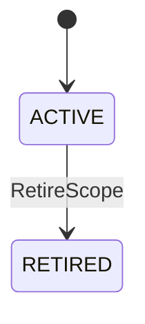

# KnowledgeScope 详细设计

| 元数据 | 值 |
|---|---|
| Document ID | DD-KNW-KNOWLEDGE-SCOPE |
| Version | 0.1.0 |
| Status | Accepted |
| Document Steward | Knowledge Engine |
| Architecture Baseline | SWM-ARCH@1.2 |
| Depends On | None |
| Owns Contracts | KNW-SCOPE-01、KNW-SCOPE-MANAGEMENT-01、KNW-SCOPE-STATE-01、KNW-SCOPE-STATE-ASSERTION-01 |
| Supersedes | `DD-MGT-SCOPE-BINDING@0.1.0` 中 KnowledgeScope 的定义、状态与管理语义 |
| Rationale ADR | AD-011、AD-012、AD-013、AD-079、AD-111、AD-122、AD-135 |
| Design Validation | None |
| Conformance Cases | None |
| Capability Evaluation | None |

> KnowledgeScope 是 Knowledge Engine 的权威对象。Application Services 可以协调管理用例，但不能分配 Scope 身份、直接写 Scope 状态或重新解释其生命周期。

## 1. 目的与范围

本文定义 KnowledgeScope 的稳定身份、类型、生命周期和公开管理契约，使正式知识归属、Snapshot 发布、并发控制和逻辑分片使用同一个明确边界。

本文不定义：

- DataSource、DataSourceBinding、Selector、Connector 或 Artifact；它们由 Source Integration 拥有。
- 管理入口、跨模块组合步骤和用户响应；它们由 Application Services 协调。
- Snapshot 成员、发布事务、跨 Scope Snapshot 依赖和 Schema；它们由各自 Knowledge Engine 主题定义。
- 租户、安全域、物理数据库分片或服务部署。

## 2. KNW-SCOPE-01

KnowledgeScope 至少固定：

| 语义 | 约束 |
|---|---|
| Scope ID | 平台分配的全局稳定、不透明身份；显示名称、代码路径和系统地址不得充当身份 |
| Scope Type | `SYSTEM`、`SHARED_COMPONENT` 或 `BUSINESS_DOMAIN`；创建后不可原地改变 |
| Display Metadata | 可修订的人类可读名称、说明和标签；不参与正式知识身份判断 |
| Lifecycle State | `ACTIVE` 或 `RETIRED` |
| Definition Revision | 每次可观察定义变化产生的新修订，用于并发控制和审计 |
| Created / Retired Record | 创建者、时间、原因及适用的管理命令引用 |

Scope Type 表达知识的长期归属：

| Scope Type | 归属内容 |
|---|---|
| `SYSTEM` | 一个独立软件系统及其本地技术实体和知识 |
| `SHARED_COMPONENT` | 公共 Jar、SDK、共享工程等独立组件定义 |
| `BUSINESS_DOMAIN` | 跨系统 Business Entity 和业务语义关系 |

共享组件定义属于 Shared Component Scope；组件在宿主系统产生的日志、DB 和运行观察属于宿主 System Scope。Business Domain Scope 通过跨 Scope 正式知识引用多个系统，不吸收或复制系统技术知识。

每个正式 Entity、Fact 和 Inference 只有一个 owning KnowledgeScope。跨 Scope 引用不转移所有权，也不能把多个 Scope 合并为全局发布单元。

## 3. 所有权与协作边界

| 对象或决定 | Owner | 其他职责 |
|---|---|---|
| Scope ID、Type、Definition Revision 与 Lifecycle State | Knowledge Engine | Application Services 只能调用公开契约 |
| DataSource、Binding 与 Selector | Source Integration | 只保存 Scope Reference，不写 Scope |
| 管理用例、幂等命令与组合结果 | Application Services | 不复制 Scope 状态 |
| Snapshot、CURRENT 与发布资格 | Knowledge Engine 的 Snapshot / Publication 主题 | 只引用 exact Scope State / Revision |
| Scope 的物理分片映射 | Persistence / Deployment Strategy | 不改变 Scope 身份与发布语义 |

Scope 是逻辑权威与发布边界，不是权限边界。企业级租户与安全隔离可以使用 Scope 作为策略输入，但不能以安全策略反向改变 Scope 的知识语义。

## 4. KNW-SCOPE-MANAGEMENT-01

Knowledge Engine 提供以下语义操作：

- `CreateScope`：校验 Scope Type，分配 Scope ID，形成 `ACTIVE` Scope 和初始 Definition Revision。
- `GetScope / ListScopes`：按稳定身份和显式条件读取；显示名称不是唯一查询键。
- `UpdateScopeMetadata`：只修订 Display Metadata，并以 Expected Definition Revision 执行并发校验。
- `RetireScope`：在没有尚未收口的 Scope 内发布事务时进入 `RETIRED`；已有正式知识、Snapshot 和历史引用继续可读。

创建 Scope 不要求已有 DataSource、Binding 或 CURRENT Snapshot。退休 Scope：

- 拒绝新的 Knowledge Update、Schema Adoption 和 Snapshot Publication。
- 不级联修改 Source Integration 的 Binding，也不删除历史对象。
- 不使既有跨 Scope Snapshot 引用静默重绑或失效；调用方必须按原 Snapshot 和保留策略读取。
- 不能恢复为 `ACTIVE`。需要表达新的长期知识归属时创建新的 Scope 身份，不能复用退休 ID。

每个写操作携带 Owner Idempotency Key、Expected Definition Revision（创建除外）、Actor、Reason 和最小 Request Context。相同 Key 与等价命令返回同一逻辑结果；不同命令复用 Key 必须失败。调用方使用 Capability Execution 时可以附加 opaque Execution Envelope Reference，但 Scope Contract 不依赖或解析它。

### 4.1 KNW-SCOPE-STATE-ASSERTION-01

跨所有者用例需要证明 Scope 在某一时点允许指定用途时，Application Services 调用 `ReadScopeStateAssertion`。请求固定 Scope ID、可选 Expected Definition Revision、版本化 Purpose（例如 `BIND_CONFIGURATION`、`SOURCE_EXECUTION`、`KNOWLEDGE_UPDATE` 或 `SNAPSHOT_PUBLICATION`）、Caller / Request Reference 和 Classification。

Knowledge Engine 从权威 Scope 状态重建不可变 Assertion，至少包含：

- Assertion ID / Contract Version / Digest 和请求 Reference。
- exact Scope ID、Scope Type、Definition Revision 与 Lifecycle State。
- Purpose，以及按本主题生命周期规则得到的 `ELIGIBLE | INELIGIBLE`；拒绝时包含稳定原因。
- Read Revision / Time 和最小 Classification；不包含 DataSource、Binding、权限或下游执行决定。

Assertion 是绑定 exact Definition Revision 的时点证明，不是长期租约、权限凭证或跨模块锁。消费者必须校验 Scope、Purpose、Revision 和 Digest，并在自己的提交或分派边界按其 Contract 决定是否重读；Scope Revision 已推进时旧 Assertion 不能用于新的执行。Source Integration 可以消费 Assertion 验证 Binding 配置和来源执行资格，但不能据此推进 Scope 状态或绕过 Knowledge Engine 在 Snapshot 发布前的最终重验。

## 5. KNW-SCOPE-STATE-01

状态变化只影响后续权威操作，不原地修改已经发布的 Entity、Fact、Inference 或 Snapshot。Scope Retirement 与正在执行的来源操作之间不建立跨模块锁：

1. Application Services 在创建 Build Intent 前读取 Scope 状态与 Definition Revision。
2. 已启动 Attempt 在发布前由 Knowledge Engine 重读 Scope 当前状态。
3. Scope 已退休时发布失败关闭，原 CURRENT 保持不变；已经取得的 Artifact 仍按其来源保留策略处理，但不能据此发布新的 Scope Snapshot。

## 6. 失败、并发与恢复

| 类别 | 含义 | 默认处理 |
|---|---|---|
| `INVALID_SCOPE_TYPE` | Scope Type 不受支持或试图原地改型 | 修正命令，不重试 |
| `SCOPE_NOT_FOUND` | Scope Reference 不存在 | 终止当前操作 |
| `SCOPE_RETIRED` | 当前用途要求 ACTIVE Scope | 失败关闭，不自动创建替代 Scope |
| `SCOPE_ASSERTION_PURPOSE_INVALID` | Purpose 不受支持或与请求用途不一致 | 不签发可用 Assertion；修正请求 |
| `REVISION_CONFLICT` | Expected Definition Revision 已陈旧 | 重新读取后由调用方决策 |
| `PUBLICATION_IN_PROGRESS` | 退休与已进入提交边界的发布冲突 | 先解析原发布 Outcome，再重试退休 |
| `IDEMPOTENCY_MISMATCH` | 同一 Key 对应不同命令 | 拒绝并审计 |

Scope 身份和退休 Tombstone 必须持久化。恢复只能重放同一命令或解析未决提交，不能通过分配新 ID 掩盖未知 Outcome。

## 7. 可观测性与敏感信息

- 记录 Scope ID、命令、前后 Definition Revision、Actor、结果、原因和延迟。
- Scope Metadata 按数据分类最小披露；不得放入凭据、Artifact Payload 或模型私有输入。
- Scope 管理事件不是 Artifact、Evidence 或正式知识。

## 8. 拟议不变量与验证义务

1. Knowledge Engine 是 KnowledgeScope 身份和状态的唯一逻辑写者。
2. Scope Type 创建后不可原地改变，`RETIRED` 不可恢复。
3. Scope Retirement 不删除或改写既有正式知识和 Snapshot。
4. DataSourceBinding 只能引用 Scope，不能拥有或推进 Scope 状态。
5. KnowledgeScope 是单 Scope Snapshot 的发布、并发和逻辑分片边界，不是全局锁、租户或物理分库。
6. 不存在跨 Scope 原子发布；跨 Scope 通过固定 Snapshot 依赖受控收敛。
7. Scope State Assertion 只证明 exact Definition Revision 的生命周期资格，不授予来源权限，也不替代执行或发布边界的当前状态重验。

这些语义可以由静态契约、Repository 并发测试和 Snapshot Publication Conformance Case 验证，当前不存在需要 Demo 决策的算法性不确定性。
