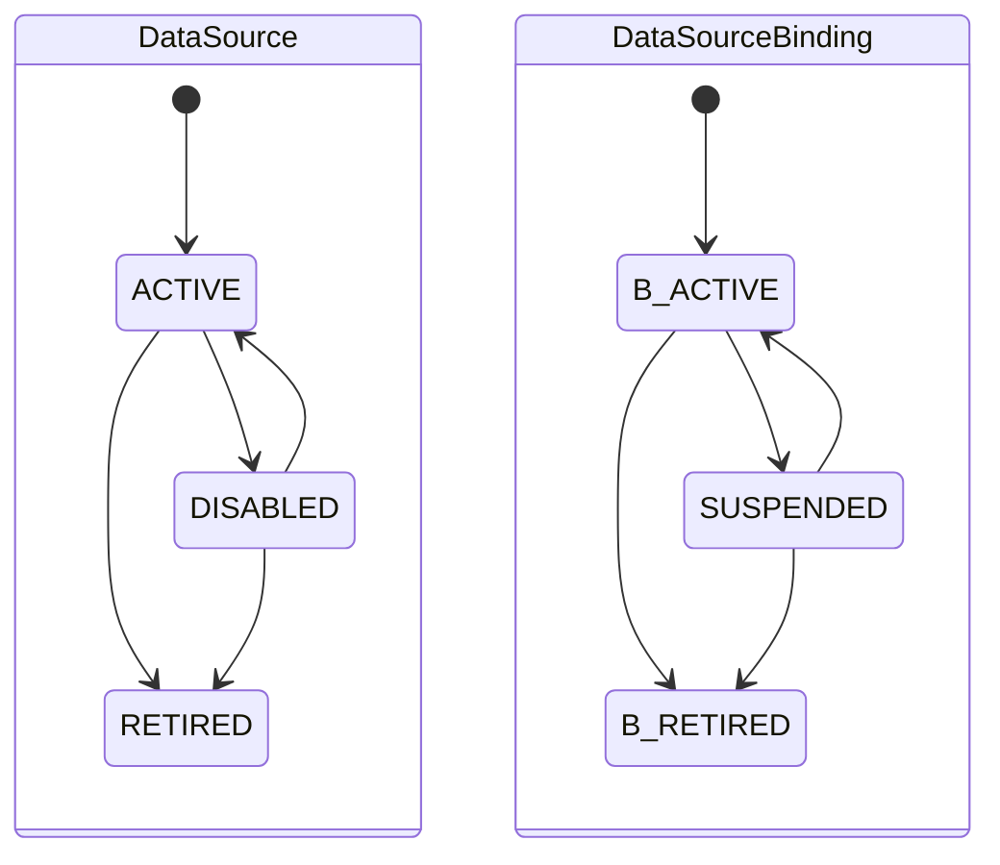

# DataSource 与 DataSourceBinding 详细设计

| 元数据 | 值 |
|---|---|
| Document ID | DD-SRC-DATA-SOURCE |
| Version | 0.1.0 |
| Status | Accepted |
| Document Steward | Source Integration / Connector Configuration |
| Architecture Baseline | SWM-ARCH@1.2 |
| Depends On | DD-KNW-KNOWLEDGE-SCOPE@0.1.0 |
| Conditional Depends On | DD-X-CAPABILITY-EXECUTION@0.1.0、DD-AI-MODEL-GATEWAY@0.1.0、DD-MGT-CAPABILITY-EVALUATION@0.1.0（仅模型辅助 Binding Proposal） |
| Owns Contracts | SRC-DATA-SOURCE-PROVIDER-01、SRC-DATA-SOURCE-01、SRC-DATA-SOURCE-BINDING-01、SRC-BINDING-ELIGIBILITY-01、SRC-BINDING-PROPOSAL-01 |
| Supersedes | `DD-MGT-SCOPE-BINDING@0.1.0` 中 DataSource、DataSourceBinding、Selector 与配置资格语义 |
| Rationale ADR | AD-011、AD-012、AD-013、AD-079、AD-111、AD-122、AD-125、AD-135 |
| Design Validation | None |
| Conformance Cases | None |
| Capability Evaluation | 仅模型辅助 Binding Proposal 使用模型时适用 |

> 本主题定义 Source Integration 的稳定来源配置和绑定边界，不执行外部 I/O、不生成 Artifact，也不拥有 KnowledgeScope。

## 1. 目的与范围

本文使 DataSource 与 DataSourceBinding 可以独立注册、修订、停用和退休，并为后续 Source Operation 提供可重验的 Provider、Selector、配置和控制状态。

本文不定义 Connector Tool、来源读取、Artifact、Lineage、KnowledgeContext、正式知识或跨模块管理组合流程。基础配置使用确定性 Provider Contract 即可成立；模型只可作为可选 Binding Proposal Strategy。

## 2. 所有权与协作边界

| 对象或决定 | Owner |
|---|---|
| DataSource、DataSourceBinding、Selector 规范形式与控制状态 | Source Integration / Connector Configuration |
| KnowledgeScope 身份与状态 | Knowledge Engine；本主题只保存 exact Reference / observed Revision |
| Connector Tool、Source Operation、Artifact 与 Lineage | DD-SRC-SOURCE-ARTIFACT |
| 跨对象 Management Command / Attempt / Result | DD-APP-MANAGEMENT |
| Secret 值 | 外部 Secret Facility；DataSource 只保存 Reference |

模块化单体可以共用数据库产品，但其他主题不能直接写 DataSource / Binding 表。Scope Retirement 不跨 Owner 级联修改 Binding；执行和发布分别重验各自权威状态。

## 3. SRC-DATA-SOURCE-PROVIDER-01

每种来源类型注册一个版本化 DataSource Provider Contract，至少定义：

- Provider Type / Contract Version 与兼容范围。
- Configuration Schema、Secret Requirement 和规范化规则。
- Identity Strategy：产生 Identity Domain、Canonical Source Target 和 Identity Strategy Version。
- Selector / Context Constraint 的语法、规范化、等价、包含和可执行性判断。
- Provider Configuration 的可修订字段、敏感信息分类和生命周期约束。
- 后续 Connector Provider Contract Reference；基础配置主题不要求相应 Connector Tool 已可执行。

Provider Contract 可以在没有外部连接的情况下验证纯结构规则；确实需要远程探测时，必须通过 DD-SRC-SOURCE-ARTIFACT 的受控 Source Operation 完成，不能在配置验证器中暗藏外部读取。Provider 不解释 Entity、Fact、跨来源版本关系或用户 Need。

## 4. DataSource 与 DataSourceBinding

### 4.1 SRC-DATA-SOURCE-01

DataSource 是一个 Connector Provider 可以识别和访问的外部来源根对象，不表示 KnowledgeScope，也不表示一次读取结果：

| 语义 | 约束 |
|---|---|
| Source ID | Source Integration 分配的稳定、不透明身份 |
| Provider Type | 解释配置、身份、Selector 与 Tool 的 Provider；创建后不可原地改变 |
| Identity Domain | Provider Identity Strategy 生成的租户、账号或安全身份域；不包含凭据值 |
| Canonical Source Target | Provider 规范化后的来源根，例如仓库、数据库实例、日志服务或文档空间 |
| Identity Strategy Version | 冻结 Identity Domain 与 Canonical Source Target 的解释规则 |
| Provider Configuration | Provider 所有的版本化非敏感配置 |
| Secret Reference | 指向外部凭据的间接引用 |
| Lifecycle State | `ACTIVE | DISABLED | RETIRED` |
| Definition Revision | DataSource 定义并发版本；不等于外部内容 Revision |

`Provider Type + Identity Strategy Version + Identity Domain + Canonical Source Target` 构成永久逻辑唯一键。退休 Tombstone 继续占用该键；临时不可用使用 `DISABLED`，不能通过重新注册新 ID 绕过历史身份。

Git Commit、数据库观察时间、日志时间窗、部署版本和文档 Revision 属于 Source Operation / Source Context / Artifact，不得写成 DataSource Definition Revision。

Source Integration 提供：

- `RegisterDataSource`：由 Provider 验证并规范化来源根，创建或返回等价 DataSource。
- `ReviseDataSource`：以 Expected Definition Revision 更新 Provider Configuration 或 Secret Reference。
- `DisableDataSource / EnableDataSource`：控制新的来源操作，不改写历史 Artifact。
- `RetireDataSource`：永久阻止未来使用；必须先在 Source Integration 自身事务内退休全部未退休 Binding。
- `GetDataSource / ListDataSources`：按稳定身份和显式条件读取，并最小披露 Secret Reference。

### 4.2 SRC-DATA-SOURCE-BINDING-01

DataSourceBinding 声明某个 KnowledgeScope 可以从一个 DataSource 的哪个范围取得信息：

| 语义 | 约束 |
|---|---|
| Binding ID | Source Integration 分配的稳定、不透明身份 |
| Scope Reference | exact KnowledgeScope ID；创建时记录观察到的 Scope Definition Revision，但不复制 Scope 状态 |
| Source Reference | exact、未 RETIRED 的 DataSource |
| Selector | Provider 解释、规范化和验证的单一来源内部选择条件 |
| Context Constraint / Hint | Constraint 是 Provider 可执行条件；Hint 只是非权威语境提示 |
| Provider Contract Version | 冻结 Selector 的解释契约 |
| Lifecycle State | `ACTIVE | SUSPENDED | RETIRED` |
| Definition Revision | Binding 定义并发版本 |

同一 DataSource 可以服务多个 Scope；同一 Scope 也可以对同一 DataSource 建立多个语义不同或互不重叠的 Selector。Provider 必须产生可比较的规范形式；同一 Scope、Source、Provider Contract Version 和等价有效范围不能同时存在多个 ACTIVE Binding。

Selector 只限定单个来源内部的访问范围，不负责：

- 按 Entity、业务概念或 Fact 动态过滤来源。
- 建立 Git、DB、Log、Trace 或发布版本之间的硬映射。
- 证明 Artifact 属于某个 Entity 或支持某个 Fact。
- 创建跨 Scope Snapshot 依赖或转移正式知识所有权。

Source Integration 提供：

- `BindSourceToScope`、`ReviseBinding`、`SuspendBinding / ResumeBinding`、`RetireBinding`。
- `GetBinding / ListBindings`：按 Scope 或 Source 查询，但不执行来源读取。
- 所有写操作校验 Owner Idempotency Key 和 Expected Definition Revision。

`BindSourceToScope` 必须消费 Knowledge Engine 签发的 exact `KNW-SCOPE-STATE-ASSERTION-01`，其 Purpose 为 `BIND_CONFIGURATION`，并校验 Scope ID、Definition Revision、Digest 和 `ELIGIBLE`。Binding 保存该次 observed Scope Definition Revision / Assertion Reference 供审计，但不把 Assertion 变成长期资格；Scope 后续变化不触发跨 Owner 级联写。

Binding ACTIVE 只表示本地管理关系可供选择，不证明 Scope 当前 ACTIVE、Secret 可用、来源可达、存在 Artifact 或知识已经构建。Scope Retirement 不跨 Owner 级联写 Binding；后续执行资格与 Snapshot 发布门禁分别失败关闭。

### 4.3 SRC-BINDING-ELIGIBILITY-01

`ResolveBindingForExecution` 固定 exact Binding Definition Revision，并校验：

- DataSource / Binding 当前控制状态。
- Provider Contract、Selector 和目标 Tool 兼容性。
- Secret、访问授权、Classification 和 Control Fence。
- 调用方提供的 `KNW-SCOPE-STATE-ASSERTION-01` 是否绑定 exact Scope / Definition Revision、Purpose = `SOURCE_EXECUTION`、Digest 有效且 Outcome 为 `ELIGIBLE`。

`ResolveBindingForExecution` 返回不可变 Binding Eligibility Assertion，固定上述 Revision、规范化 Selector / Context Constraint、Provider Contract、Configuration Fingerprint、Control Fence、Secret / Permission Reference、exact Scope State Assertion Reference / Digest 与 Result Digest。它只证明该时点的配置资格，不授予长期调用权。

DD-SRC-SOURCE-ARTIFACT 在每次外部调用真正分派前，必须在 Source Integration 自身事务内使用本 Contract 重验 DataSource / Binding Revision、控制状态、Secret / 权限和 Control Fence，并把 exact Assertion / Revision 固定进本次 Execution Grant。撤权前已越过 dispatch fence 的调用可以解析真实 Outcome，但其 Artifact 必须记录 Grant 与最新 Fence 的关系，供 Knowledge Update 和 Publication Policy 再判定。

Source Integration 不锁定 Knowledge Engine 的 Scope 状态。Application Services 在 Build Intent 前读取 Scope；Knowledge Engine 在发布前再次重验。该协作关闭退休竞态，但不创建跨所有者事务。

### 4.4 SRC-BINDING-PROPOSAL-01

Provider 可以根据显式可见的来源元数据提出 Binding Proposal；启用经过评测的模型 Strategy 后，也可以由模型辅助形成。Proposal 至少固定目标 Scope、Source、Provider Contract、建议 Selector、依据和 Authorized Input Manifest Reference。

Proposal 始终不可信且不持有 Binding ID：

1. Provider 确定性规范化并验证 Selector。
2. Application Services 校验调用方权限、Scope 与管理任务边界。
3. Source Integration 重新校验 Source、Provider、Selector 和唯一性。
4. 只有显式管理命令被授权并成功执行后才形成正式 Binding。

模型不能分配身份、扩大来源权限、绕过 Provider 校验或直接写 Binding。

### 4.5 生命周期与不变量

DataSource Definition Revision、Binding Definition Revision 和外部内容 Revision 不得混用。任何管理状态变化都不能原地修改 Artifact、Evidence、正式知识或 CURRENT Snapshot。逻辑唯一性由 Source Integration Repository 原子保证，不能只依赖调用前查询或 Application Idempotency Key。

## 5. 失败、并发与恢复

| 类别 | 语义 |
|---|---|
| `PROVIDER_CONTRACT_UNAVAILABLE` | exact Provider Contract 不存在或不兼容 |
| `DATASOURCE_IDENTITY_CONFLICT` | 永久唯一键与现有 ACTIVE / DISABLED / RETIRED 对象冲突 |
| `SELECTOR_INVALID` | Selector 无法规范化、越界或不可执行 |
| `REVISION_CONFLICT` | Expected Definition Revision 已陈旧 |
| `CONTROL_STATE_DENIED` | DataSource / Binding 状态不允许当前管理或执行用途 |
| `SCOPE_ASSERTION_INVALID` | `KNW-SCOPE-STATE-ASSERTION-01` 缺失，或 Scope / Revision / Purpose / Digest / Eligibility 失配 |
| `IDEMPOTENCY_MISMATCH` | 同一 Key 对应不同命令 |

所有写操作由 Source Integration Repository 原子保证逻辑唯一性和 Expected Revision。恢复重放同一 Owner Idempotency Key；未知 Outcome 不通过创建新 Source ID / Binding ID 规避。

## 6. 可观测性与敏感信息

记录 Provider Contract、Source / Binding、Definition Revision、Selector Digest、Control Fence、命令结果和失败分类。Telemetry、模型输入和 Result 不包含 Secret 值或未授权 Provider Configuration；Binding Proposal 的模型调用只记录受控引用和 Digest。

## 7. 拟议不变量与验证义务

1. DataSource、Binding 和 KnowledgeScope 是三个独立稳定身份。
2. DataSource 永久唯一键和 Binding 有效选择唯一性由 Source Integration 原子保证。
3. Selector 只限定单个 DataSource 内部范围，不承担跨来源映射或正式知识判断。
4. Definition Revision 与外部内容 Revision 不混用。
5. ACTIVE Binding 不证明 Scope ACTIVE、来源可达、存在 Artifact 或知识已构建。
6. Scope Retirement 不级联写 Binding；执行和发布通过 exact Revision / Assertion 关闭竞态。
7. Provider / 模型 Proposal 不分配身份、不扩大权限，也不直接写正式 Binding。
8. 基础配置 Contract 不依赖模型、Connector Tool 或 Artifact Processing 即可实现。
9. Binding 配置与执行只消费 Knowledge Engine 的 exact Scope State Assertion；该 Assertion 不转移 Scope 所有权，也不替代发布前重验。

进入实现前至少验证永久唯一键并发、退休 Tombstone、Selector 等价 / 包含、Scope 退休竞态、Secret 撤权、Binding Proposal 越权和 Owner 幂等恢复。Provider 的真实 Identity / Selector 适配使用 Contract Conformance；只有来源自身无法提供稳定身份或包含关系且会迫使修改公共 Contract 时才启动 Design Validation Demo。
