# Iteration 001 JWT Capability Run Harness 001

| 元数据 | 值 |
|---|---|
| Record ID | `SWM-IMP-JWT-CAPABILITY-HARNESS-001` |
| Date | 2026-08-06 |
| Status | `CODING PLAN @7 CC / WORLD / CROSS-MODEL COMPARISON / JWT CE PASS — ACTIVATION NOT RUN` |
| Scenario | `H-04 JWT Commit Impact` |
| Provider | `VOLCENGINE_ARK / glm-5-2-260617` |
| Production Authorization | `NONE`；仍需产品Holdout和另行显式激活 |

## 1. 已实现结果

`validation/jwt_iteration_001/`现提供一条可执行、失败关闭的评测链：

```mermaid
flowchart LR
    CC["Ark Live CC"] --> DA["Direct Agent"]
    DA --> OD["私有 Draft + 独立复核 Oracle"]
    OD --> RC["Sanitized Run Configuration"]
    RC --> WM["七角色 World Model Run"]
    WM --> CR["Independent cross-model Review Attestation"]
    CR --> CP["Local obligation Comparison"]
    CP --> CE["SQLite CE Result + Validity"]
    CE -->|"仅 PASS 且显式命令"| AC["Scoped Strategy Activation"]
```



- Direct Agent只可选择`RESOLVE / COMPARE / READ / SEARCH / FINISH`，平台执行冻结Local Git边界内的动作；无效或重复提议形成不可被Claim引用的`DENIED`反馈并在预算内纠正，变更集外真实读取、预算耗尽和Provider Outcome未知仍失败关闭。
- Direct Draft保存Prompt、预算、请求身份、Usage、Action Trace、原始Git Observation、Answer和逐Claim Oracle候选，文件权限为`0600`。
- Oracle Operator与独立Reviewer身份必须不同。封存后Oracle与World Model Runtime目录必须物理分离；Runtime配置只含Oracle Ref与Digest，不含Answer或Claim正文。
- World Model真实调用七个角色：`INVESTIGATION_PLANNER`、`FACT_PROPOSER`、`KNOWLEDGE_REVIEWER`、`INFERENCE_PROPOSER`、`SUFFICIENCY_REVIEWER`、`ANSWER_GENERATOR`、`ANSWER_REVIEWER`。
- Planner至少完成Boundary Resolve与Compare后才能关闭来源；Entity、Fact、Inference形成三阶段Snapshot。Inference及其后四个角色无法接收`SOURCE_OBSERVATION`或`BUILD_TARGET`。
- Sufficiency必须逐一覆盖六个Need下的全部Obligation和Joint Constraint。Answer的Claim必须把所有Obligation恰好覆盖一次；有依据的内容绑定Formal Ref，缺口只能按`KNOWLEDGE_GAP`披露。
- 只有独立Answer Review通过才能形成`DELIVERED`。之后不同模型来源的Evaluator重读源码并出具闭合Review Attestation；本地Comparator按`obligation_id`执行missing/extra/duplicate、结构字段、语义、条件、限制、事实错误和辅助分数复验，不要求两侧`semantic_key`或Claim分组相同。
- Comparator PASS才能作为CE Case的PASS Evidence。CE Authority在SQLite中封存Definition、Run、Attempt、Result与单调Validity；只有PASS创建`CAPABILITY_EVALUATION`资格。
- 激活入口与开发、运行、比较、CE登记相互独立。它重验数据库当前资格、CE Definition Implementation Digest、Run Configuration Digest和Activation Scope，不会被前序命令自动调用。

### 1.1 0R-B当前真实执行证据

Coding Plan @7 `CC-ARK-CHAT-NO-TOOLS-001`已真实执行并由当前加载器复验：Run ID为`ccrun_25bcd3f2fbf040ff957dabe02bf7ea63`，12 / 12 Case PASS，Result Digest为`sha256:91ccfbb2d084ee41888833d7519d1867cd96c91b22d5bed279032e76d5a0a5ac`。两次请求聚合Usage为Input 327 / Output 77 tokens；请求别名为`glm-5-2-260617`，实际响应身份均为`glm-5.2`。

旧在线推理Endpoint上的@5 CC继续作为历史证据，但因Endpoint、Adapter、Fixture和配置指纹变化不可加载。当前不可变CC Result中的`production_eligible=false`和`CAPABILITY_EVALUATION_NOT_RUN`仍是正确的CC阶段快照，因为CC本身不证明JWT业务能力；后续CE资格由独立Registration表示，不回写历史CC文件。

### 1.2 0R-C当前Oracle与运行配置

当前Direct Oracle为`oracle_249409ecf7d84da7b1a6cc85f21b89b8`，Oracle Digest为`sha256:dc72745c3a1a8ce84754a3cefbae180f5e44796ef6406c6f0f7f3b2358693b56`。它包含6条material Claim并覆盖21 / 21 Obligation，Direct执行者为`ark-glm-5-2-direct-generator-coding-plan-20260806`，独立源码复核者为`codex-source-reviewer-20260806`。复核从冻结Git对象重读唯一父提交、完整变更文件集和统一diff，不把模型自身输出当作复核依据。

最终隔离Run Configuration为`jwtrun_11fa390ceb7545f4b7d951973729dd85`，Configuration Digest为`sha256:8e9a547c3869d7429ce0ad0b8524c551a9fb54da3051ad532a7a6ce2c69d8a86`。Runtime只持有Oracle Ref与Digest，明确记录`oracle_content_available_to_runtime=false`，不含Direct Answer或Claim正文。

### 1.3 0R-D当前World结果

最终七角色World运行已经完成。Result ID为`jwtrun_715915f2629b4656aee9c31b6127bef0`，Result Digest为`sha256:86ce8ebec0c93cb011015a23e3e893a64a603aa94874053ae6dd047d134b7fd4`，状态为`PASS / DELIVERED`。运行预算计数31次模型调用、3个Source Tool Step，只读取1个精确文件窗口；Usage完整，为Input 210874 / Output 34286 tokens。

World形成21条Answer Claim并通过独立Answer Review。逐Obligation评估为21项`SATISFIED`。其中`JWT-N04-O02`只陈述源码可证明的两个分支：`verify=false`返回`null`，验证或解析异常被catch并返回`null`；同时保留“每种非法输入具体落入哪个Hutool路径仍未知”的限制，不把未知运行时映射伪装成源码事实。

运行中有4次Provider已知完成的输出被本地closed Schema或语义复验拒绝，均在新物理调用中安全恢复；产物只保存拒绝摘要、Digest、Usage和错误，不保存被拒绝正文。网络Outcome未知仍会中止整个运行，不进入此类恢复。

### 1.4 当前跨模型比较与CE边界

Direct和World答案均由`VOLCENGINE_ARK / glm-5.2`生成，因此不再把两侧答案发送给火山自评。Codex以`OPENAI_CODEX`来源重读冻结Git对象，出具21项Review Attestation；本地Comparator验证闭合字段、依赖Digest、义务集合和Evaluator来源不同于两个Generator。最终Comparison `jwtcmp_3218ad611ea24c98b1930b92d0cd5f0a`为PASS，20项等价、1项World更好，Direct 9 / World 10。

CE Authority已登记`evaluation_run_094afa178f7e4a17916d6ecdaf0d2e72`，结论PASS并签发`CAPABILITY_EVALUATION`，登记时为`VALID`。比较和CE均未自动触发Activation；产品Holdout与任何真实Scope激活仍为`NOT_RUN`。

## 2. 命名规则与含义

| 名称 | 含义 |
|---|---|
| `WP` | Work Package，实施工作包；例如`WP-7`是质量与产品门禁，不表示完成百分比。 |
| `0R-B…0R-E` | WP-0 Re-entry后的Live再准入阶段：Adapter CC、Oracle冻结、完整JWT Run、生产激活再准入。 |
| `CC` | Contract Conformance，证明Adapter机械边界合规；不证明业务回答能力。 |
| `CE` | Capability Evaluation，证明exact Model / Prompt / Tool / Strategy是否达到业务门槛；不与CC共用结论。 |
| `JWT` | JSON Web Token；这里只是H-04验证场景前缀，不是系统认证模块。 |
| `Direct Agent` | 评测系统外、可直接使用受限Local Git Observation的对照调查模型。它不进入生产回答路径。 |
| `Direct Oracle Draft` | Direct Agent未被独立核对的私有候选结果，不能直接用于CE。 |
| `Direct Oracle` | 不同Reviewer完成核对后封存的Answer与逐Claim评分依据；World Model运行时不可读取。 |
| `Run Configuration` | 在World Model运行前冻结的Requirement、角色输入矩阵、Prompt/Schema摘要、预算、来源边界、Harness摘要及不透明Oracle绑定。 |
| `ccrun_*` | 一次CC真实运行的不可变ID；后缀不表示Case数量、重试次数或PASS次数。 |
| `oracle_*` | 一份经独立复核后密封的Direct Oracle ID；World Runtime只能持有其Ref和Digest。 |
| `jwtrun_*` | JWT Run Configuration或World执行的ID；配置与执行是不同对象，必须同时核对其Digest和Reference。 |
| `jwtcmp_*` | 跨模型逐Obligation比较ID；每次封存不可覆盖。 |
| `evaluation_run_*` | CE Authority中的评测运行ID；PASS与FAIL迭代分别保留。 |
| `Authorized Input` | 某一次角色调用被允许看到的精确输入项；历史项会深拷贝冻结并带Digest，后续状态不能改写。 |
| `Observation` | 平台执行一个受限Git动作后产生的原始结果、Locator与字节摘要。 |
| `Formal Ref` | Entity、Fact或Inference在某个Snapshot中的稳定正式引用。 |
| `Snapshot` | 不可变正式知识成员集合；本Run依次形成`ENTITY / FACT / INFERENCE`三阶段。 |
| `semantic_key` | 单侧答案内部的Claim语义身份；跨侧比较不要求相同。 |
| `obligation_id` | Direct与World跨分组对齐的冻结验收义务身份；missing / extra / duplicate按它计算。 |
| `Review Attestation` | 不同模型来源Evaluator逐Obligation给出的闭合、Digest绑定评审声明。 |
| `Claim Conservation` | Direct与World对全部注册Obligation双向守恒：missing / extra / duplicate均为0，关键Typed Field与语义均保持。 |
| `Validity` | CE Result当前是否可用于新激活；只能由`VALID`单调进入`STALE/REVOKED`，且本实现不会超过Ark CC有效期。 |
| `Qualification` | CE PASS与最新Validity、Capability、Strategy绑定后的证明；类型必须为`CAPABILITY_EVALUATION`。 |
| `Activation Scope` | Strategy生效的显式范围，例如`environment=acceptance`；不同Scope是独立激活根。 |
| `OUTCOME_PENDING` | 外部调用已分派但结果无法证明；不得转写成FAIL、零Usage或PASS，必须处理原物理Attempt。 |
| `failed_model_calls` | Provider结果已知但因closed Schema或语义不一致被本地拒绝的sanitized调用摘要；允许在预算内用新物理调用恢复，不得与网络Outcome未知混同。 |

稳定编号使用大写领域前缀、连字符和三位序号，例如`CC-ARK-CHAT-NO-TOOLS-001`、`CE-JWT-CLAIM-CONSERVATION-001`。Python模块、函数和CLI参数使用小写`snake_case`或小写连字符；Schema与Prompt引用使用`@N`显式版本，例如当前Direct Draft与Prompt均为`@2`。编号表示身份和版本空间，不表示运行次数或成功次数。

## 3. 完整Live执行顺序

以下命令只有在最终代码稳定、`ARK_API_KEY`已由本地Secret机制注入后执行。Oracle、Runtime、Comparison和CE目录必须分开；命令不会输出API Key，但私有结果仍应保存在受控目录。

```bash
# 0R-B：两次真实调用，12项Ark Adapter Conformance
PYTHONPATH=src:. python3 -m software_world_model.interface.provider_cli conformance \
  --result-directory ./var/conformance \
  --operator cc-operator

# 0R-C：同题Direct Agent；输出未复核Draft
PYTHONPATH=src:. python3 -m validation.jwt_iteration_001.cli run-direct \
  --cc-result ./var/conformance/<CC-result.json> \
  --repository ./validation-projects/mall \
  --result-directory ./var/direct-draft \
  --timeout-milliseconds 180000

# 独立Reviewer逐Claim核对后才可执行；operator与reviewer必须不同
PYTHONPATH=src:. python3 -m validation.jwt_iteration_001.cli seal-oracle \
  --draft ./var/direct-draft/<draft.json> \
  --cc-result ./var/conformance/<CC-result.json> \
  --result-directory ./var/oracle \
  --operator direct-run-operator \
  --reviewer independent-oracle-reviewer

# 冻结不含Oracle正文的World Model Run Configuration
PYTHONPATH=src:. python3 -m validation.jwt_iteration_001.cli freeze-run \
  --oracle ./var/oracle/<oracle.json> \
  --cc-result ./var/conformance/<CC-result.json> \
  --repository ./validation-projects/mall \
  --result-directory ./var/run-config \
  --runtime-directory ./var/world-runtime \
  --operator world-run-operator

# 0R-D：七角色World Model运行
PYTHONPATH=src:. python3 -m validation.jwt_iteration_001.cli run-world \
  --run-configuration ./var/run-config/<run-config.json> \
  --cc-result ./var/conformance/<CC-result.json> \
  --repository ./validation-projects/mall \
  --runtime-directory ./var/world-runtime \
  --result-directory ./var/world-runtime/results

# Delivery之后由不同模型来源的Evaluator重读源码并离线形成Review Attestation。
# compare只在本地验证Attestation和两侧产物，不调用火山或发送Oracle正文。
PYTHONPATH=src:. python3 -m validation.jwt_iteration_001.cli compare \
  --oracle ./var/oracle/<oracle.json> \
  --run-configuration ./var/run-config/<run-config.json> \
  --world-result ./var/world-runtime/results/<world-result.json> \
  --review-attestation ./var/review/<review-attestation.json> \
  --cc-result ./var/conformance/<CC-result.json> \
  --result-directory ./var/comparison

# 把比较结论写入CE Authority；FAIL不会签发Qualification
PYTHONPATH=src:. python3 -m validation.jwt_iteration_001.cli record-ce \
  --oracle ./var/oracle/<oracle.json> \
  --run-configuration ./var/run-config/<run-config.json> \
  --world-result ./var/world-runtime/results/<world-result.json> \
  --comparison ./var/comparison/<comparison.json> \
  --cc-result ./var/conformance/<CC-result.json> \
  --database ./var/evaluation/authority.sqlite3 \
  --result-directory ./var/evaluation/evidence \
  --actor evaluation-authority
```

只有人工确认真实CE Registration为`PASS / VALID`后，才考虑显式激活。建议先使用`acceptance`Scope；不要把测试Fixture的资格解释为真实生产资格。

```bash
PYTHONPATH=src:. python3 -m validation.jwt_iteration_001.cli activate \
  --cc-result ./var/conformance/<CC-result.json> \
  --registration ./var/evaluation/evidence/<registration.json> \
  --run-configuration ./var/run-config/<run-config.json> \
  --database ./var/evaluation/authority.sqlite3 \
  --result-directory ./var/evaluation/activation \
  --environment acceptance \
  --actor activation-authority \
  --reason "JWT capability evaluation accepted" \
  --idempotency-key activate-jwt-acceptance-001
```

## 4. 已验证与未执行

2026-08-06实际验证：

- 当前生产测试：`253 / 253`，`OK`；除模型接口地址边界、结构化规范化、远端断开分类、专项直接回答与系统回答恢复、角色输入授权、跨来源拒绝、直接回答声明对齐和比较产物篡改外，还覆盖通用需求、来源、事实、充分性、任一提示词候选召回、需求、来源、事实与回答契约的有限修正、停止动作授权版本回显、重复正文去重、答案草稿与答案复核的失败关闭边界、模型调用恢复、知识缺口更新后的全量重评、六职责完整评估、逐任务产品对照、未见项目清单封存与仓库漂移检测、运行组件与评估全部依赖绑定，以及能力评估与独立产品验收必须同时有效的启动门禁。当前通用方案已取得真实能力评估和Codex独立复核结论；产品未见项目验收尚未完成。
- 历史Demo：`121 / 121`，`OK`；它仍不等价于当前生产实现或Live CE。
- Python编译检查：`src/`、`validation/`与`tests/`通过。
- JWT端到端Fixture实际经过Direct边界、Oracle隔离、七角色、三Snapshot、来源关闭、Answer Review、Claim Comparison、CE PASS资格和显式acceptance激活。
- 当前@7真实方舟12 Case CC已PASS，并已通过当前代码的资格加载器复验。
- 真实Direct Agent已生成当前私有Oracle：6条Claim、21 / 21 Obligation覆盖；Codex已按用户指定从冻结Git对象独立复核并密封，隔离Run Configuration已冻结。
- 当前@7最终七角色World Run已完成：`PASS / DELIVERED`，21条Claim、21项Obligation满足，Answer Review为`APPROVED`。
- 跨模型Comparison已PASS：双方生成来源均为火山，Codex为独立Evaluator；20项等价、1项World更好，Direct 9 / World 10。
- 真实CE Registration已PASS并签发有时效的`CAPABILITY_EVALUATION`；生产激活没有执行。

尚未完成：产品Holdout和任何真实Scope激活。当前产品状态仍是`LIVE GATES PARTIALLY PASSED`，不能宣称Iteration 001产品验收完成；若CE Validity过期或依赖Digest变化，必须先重验。
