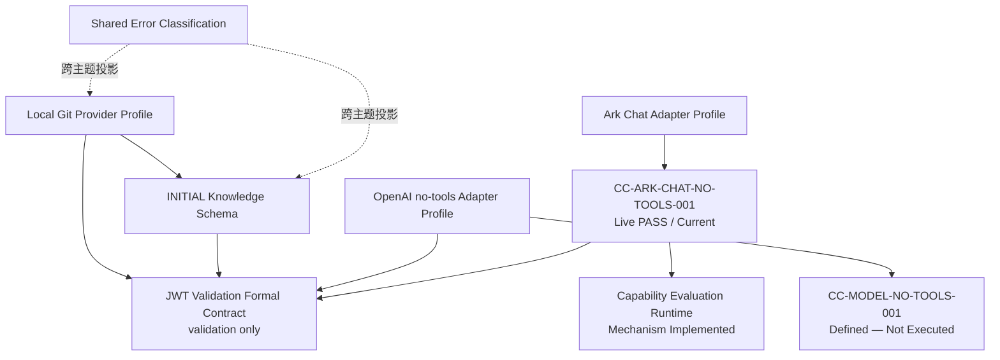

# Iteration 001 实施契约索引

> 本目录只保存首个纵向切片在编码前选择并冻结的实施契约。一般架构与跨迭代语义仍由 Accepted 详细设计拥有。

入口：

- [Iteration 001 实施计划](Implementation_Plan_Iteration_001.md)
- [实施准备暂停记录 001](Implementation_Readiness_Hold_001.md)
- [离线开发再准入记录 001](Implementation_Development_Reentry_001.md)
- [离线实现结果 001](Offline_Implementation_Result_001.md)
- [配置前功能验收 001](Preconfiguration_Functional_Acceptance_001.md)
- [通用模型任务运行链路实施记录 001](General_Model_Task_Runtime_001.md)
- [本机浏览器聊天体验说明 001](Browser_Chat_Experience_001.md)
- [真实模型Provider配置记录 001](Live_Provider_Configuration_001.md)
- [Capability Evaluation Runtime 001](Capability_Evaluation_Runtime_001.md)
- [新一轮未见项目验收输入 002](Product_Holdout_Suite_002.md)
- [JWT Capability Run Harness 001](JWT_Capability_Run_Harness_001.md)
- [JWT Capability Run Result 001](JWT_Capability_Run_Result_001.md)
- [Implementation Baseline Manifest](Implementation_Baseline_Manifest_Iteration_001_Revision_002.md)
- [Design Baseline Manifest](../../detailed-design/governance/Design_Baseline_Manifest_Iteration_001_Revision_002.md)

## 契约与状态

| 产物 | 当前状态 | 作用 |
|---|---|---|
| [Local Git Provider Profile](contracts/ITER-001-Local-Git-Provider-Profile.md) | Frozen for Iteration 001 | 固定 Repository Identity、Source Context、Tool、Artifact / Payload 和解析边界 |
| [INITIAL Knowledge Schema](contracts/ITER-001-Initial-Knowledge-Schema.md) | Frozen for Iteration 001 | 固定首轮 Entity、Fact、Inference、Evidence、Admission 与 Snapshot 语义 |
| [Shared Error Classification](contracts/ITER-001-Shared-Error-Classification.md) | Frozen for Iteration 001 | 统一跨 Owner 错误投影、Outcome、Recovery 和 Exposure |
| [OpenAI no-tools Adapter Profile](contracts/ITER-001-OpenAI-No-Tools-Adapter-Profile.md) | Selected — Conformance Required | 选择无 Provider Tool、无会话、Manifest 输入闭包的 Adapter 方式 |
| [Volcengine Ark no-tools Adapter Profile](contracts/ITER-001-Volcengine-Ark-No-Tools-Adapter-Profile.md) | Implemented — Live Conformance PASS | 固定Chat Completions Envelope、响应、身份和失效边界 |
| [Volcengine Ark Provider Configuration](Live_Provider_Configuration_001.md) | Coding Plan @8 CC PASS | 记录OpenAI-compatible Chat Completions适配、Endpoint、Model、Secret Reference和命名边界 |
| [Capability Evaluation Runtime](Capability_Evaluation_Runtime_001.md) | Mechanism + JWT Bridge Implemented — JWT CE PASS | 保存Definition、Run、Case、Result、Validity和Activation资格链 |
| [新一轮未见项目验收输入](Product_Holdout_Suite_002.md) | PASS — 两个项目六个问题均不低于直接源码答案 | 固定未见工程、问题、相同资源限制、独立评审和防篡改边界 |
| [通用任务能力评估执行手册](General_Capability_Evaluation_Harness_001.md) | 当前六类职责真实执行与Codex独立复核通过 | 固定能力输入、密封真实输出、Codex独立复核、登记有时效资格 |
| [本机浏览器聊天体验说明](Browser_Chat_Experience_001.md) | READY — 本机体验已启用 / 生产未启用 | 普通用户页面、项目连接、上下文追问、启动方式和无认证边界 |
| [JWT Capability Run Harness](JWT_Capability_Run_Harness_001.md) | CC / World / Cross-model Comparison / CE PASS — Activation Not Run | Direct Oracle、七角色、Snapshot、跨模型比较、CE登记、命名和执行手册 |
| [JWT Capability Run Result](JWT_Capability_Run_Result_001.md) | Current Evidence Record — JWT CE PASS | 固定当前CC、Oracle、Run Configuration、World、Comparison、CE和剩余门禁 |
| [JWT Validation Formal Contract](contracts/ITER-001-JWT-Validation-Formal-Contract.md) | Frozen for JWT Demo Harness — Runtime Conformance Pending | 只为H-04架构验证切片闭合validation-only类型、授权输入、逐Need充分性和Answer Review |

当前实施状态为`模型接口符合性 PASS / 通用能力评估 PASS / 六题产品验收 PASS / 本机浏览器体验 READY / 生产启用未执行`。`SWM-IBM-ITER-001-REV-002`和`SWM-IMP-READINESS-HOLD-001`继续作为冻结历史依据；方舟配置是基线后的可追溯配置记录，不反向改写已冻结OpenAI Responses Profile。直接答案与本系统答案都由火山生成，比较由Codex重读源码后独立出具；两类证明都有时效，本机体验启用不等于生产启用。

Provider Revision 002、Foundational Software Semantics Rule Pack和Schema Revision 002已经标记为`Withdrawn Draft`。它们保留用于追溯此前的形式化尝试，但不是当前JWT切片或生产实现的依赖。

## 依赖关系

Schema 通过 exact Profile Contract Digest 单向依赖 Local Git Profile。文档中的导航反向链接不进入规范摘要，不构成契约循环。

## 状态解释

- `Frozen for Iteration 001`：本轮编码必须遵守，规范变化需要新版本和新 Manifest。
- `Selected — Conformance Required`：已选实现方式，但尚未证明真实 Adapter / Provider 合规。
- Fixture 定义、运行结果和模型 Capability Evaluation 分别管理，不能把文档冻结写成测试通过。

no-tools Fixture 位于 [conformance/](conformance/README.md)。
