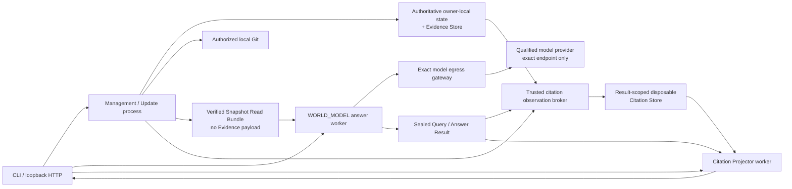

# 部署视图

参考部署将管理/更新、回答、模型网关、来源观察和引用投影划分为逻辑边界；可以在模块化单体或多个受控 workload 中实现，
但必须保持 Owner、授权、证据和事务边界。候选或本机体验入口只能使用明确的 loopback 与候选边界，不得把一次运行、启动器或
历史运行结果预先声称为生产启用。具体语言、存储、启动器和运行验证属于运行与实施文档。

当前 HTTP 入口没有认证，因此只能绑定回环地址；开放网络、多人租户、外部数据库、高可用、备份恢复和生产身份治理都需要独立部署设计与授权。当前文档没有授予生产启用。

任何受控入口在监听或外调前都必须验证候选版本、授权边界、资格、独立验证输入和披露范围；漂移时拒绝启动。每个用户问题必须
拥有独立的 request/run identity，不得隐藏重试、跨请求复用来源权限或把迟到结果覆盖到另一交互。引用展示必须由独立投影按
result/seal/projection identity 重新绑定和验签。具体启动器步骤、验证套件和收据字段属于运行实现。

同进程不是安全依据。Answer worker 只能获得当前 Package 和 exact Read Bundle；来源工作树、权威数据库、完整 Evidence Store
和不相关的 Citation Store 不得进入其数据读取能力。Citation Projector 只能获得 Package、sealed Result 和精确绑定的临时引用存储；
权威知识只能由受控 Broker 通过窄 Knowledge Port 提供。运行时库、输出根和其他必要系统资源必须与产品输入分开列举、固定和审计，
并如实记录实际能力边界。

网络默认拒绝，只允许浏览器、回答、引用投影和精确模型网关之间声明的最小通信边界；Answer 不得直连来源、公网或 Citation
Projector，Projector 不得连接模型、Query 或 Update，网关负责 endpoint 校验和凭据注入。任何 OS capability sandbox、descriptor
继承、地址过滤或隔离机制都只是实现选择；部署结果必须准确记录实际机制、可证明范围和拒绝/允许审计，不能把端口规则描述为
精确地址防火墙，也不能把能力拒绝描述成未执行的更强隔离。

浏览器分别读取 Answer Result 与 Citation Projector 展示，不构成两个 worker 之间的回传通道。模型、来源、文件系统、网络、Provider 响应和用户输入仍按不可信边界处理。
