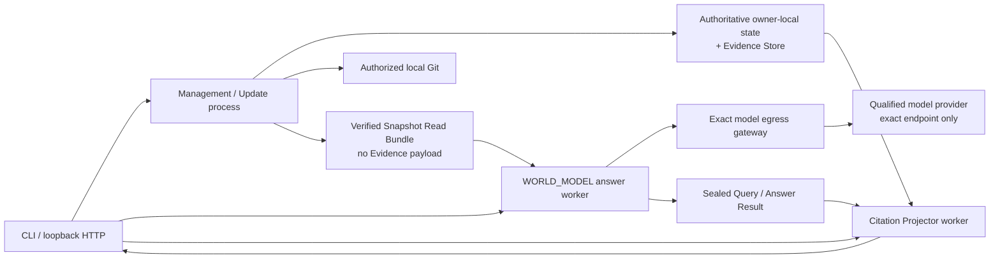

# 部署视图

现有 Direct Investigation 与管理实现是 Python 模块化单体：Interface、Application、Source Integration、Knowledge Engine、Model Gateway 与各自 SQLite Repository 在同一进程部署，但保持逻辑 Owner 和事务边界。新的 `WORLD_MODEL` 路径在进入产品验收前必须增加两个文件与网络能力隔离的 worker，以及评测环境拥有的模型出口网关；这不是 Production Activation。

当前 HTTP 入口没有认证，因此只能绑定回环地址；开放网络、多人租户、外部数据库、高可用、备份恢复和生产身份治理都需要独立部署设计与授权。当前文档没有授予生产启用。

同进程不是安全依据。`WORLD_MODEL` answer worker 的文件视图只能包含 package 与 exact Read Bundle；目标来源、原工作树、权威/旧数据库和 Evidence Store 必须不可见。网络默认拒绝，通信白名单固定为 `Browser → Answer`、`Browser → Citation Projector`、`Answer → exact model egress gateway`、`gateway → Manifest 固定的 Provider scheme/host/port/path`；G2/G3a 没有模型分派时不提供 gateway route。Answer 不能直连 DNS、公网、Source remote 或 Citation Projector；Citation Projector 不能出网，也不能连接模型、Query、Update 或 Answer。网关负责 endpoint 校验与 credential 注入，Answer 不能持有可绕过网关的网络凭据。文件和网络拒绝/允许操作都必须进入评测审计。

浏览器分别读取 Answer Result 与 Citation Projector 展示，不构成两个 worker 之间的回传通道。模型、来源、文件系统、网络、Provider 响应和用户输入仍按不可信边界处理。
