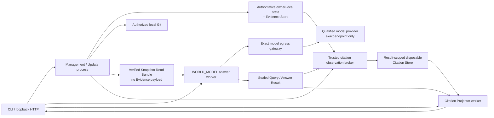

# 部署视图

现有 Direct Investigation 与管理实现是 Python 模块化单体：Interface、Application、Source Integration、Knowledge Engine、Model Gateway 与各自 SQLite Repository 在同一进程部署，但保持逻辑 Owner 和事务边界。本机 `EVALUATION_ONLY` 的 `WORLD_MODEL` 入口由独立 loopback application 与 trusted launcher 组成；launcher 为每个问题启动文件与网络能力隔离的 Answer、Gateway 和 Citation Projector workload，并复用 accepted package、no-payload Read Bundle 与密封 Citation Store。这条已实现的评测路径不是 Production Activation，也不能被旧 `http_api` 进程替代。

当前 HTTP 入口没有认证，因此只能绑定回环地址；开放网络、多人租户、外部数据库、高可用、备份恢复和生产身份治理都需要独立部署设计与授权。当前文档没有授予生产启用。

交互 launcher 启动时必须重新验证 accepted product commit/tree、prepared registry、batch/evaluation digest、protected stage manifest 和本机 OS isolation preflight；任一漂移都拒绝监听。每个 HTTP question 使用新的私有 run root 和 request identity，最多进行一次 Provider dispatch、没有隐藏重试；HTTP adapter 不接收 repository path，也没有 Direct fallback。Citation 必须由独立 GET 按 request/result/seal/projection digest 重新绑定和验签。

同进程不是安全依据。`WORLD_MODEL` answer worker 的应用/产品输入只能包含 package 与 exact Read Bundle；目标来源、原工作树、权威/旧数据库、完整 Evidence Store 和 Citation Store 均不得落入其递归数据读取 capability。进程启动所必需的解释器、系统运行库、设备/时区文件、canonical ancestor directory traversal 和独立输出根必须与产品输入分开列举、固定并审计，不能借 runtime allow root 带入任何受限产品数据。若本机 capability sandbox 的 exact ancestor read 会允许直接条目名枚举，必须显式记录该名称披露与“不开放子文件内容”的边界，不能声称路径不可见。Projector 的应用输入只包含 package、sealed Result 与和该 Result 精确绑定的 disposable Citation Store；权威数据库和完整 Evidence Store 只由 trusted broker 在另一受控边界通过窄 Knowledge Port 读取，不直接开放给 Projector。

网络默认拒绝，通信白名单固定为 `Browser → Answer`、`Browser → Citation Projector`、`Answer → exact model egress gateway`、`gateway → Manifest 固定的 Provider scheme/host/port/path`；G2/G3a 没有模型分派时不提供 gateway route。Answer 不能直连 DNS、公网、Source remote 或 Citation Projector；Citation Projector 不能出网，也不能连接模型、Query、Update 或 Answer。网关负责 endpoint 校验与 credential 注入，Answer 不能持有可绕过网关的网络凭据。若目标 OS capability filter 只能把公网 TCP 收窄到端口、不能收窄到单一数值地址，Gateway supervisor 可以先按固定 hostname 做带外解析和匿名 TCP connect；trusted evaluator 另建立 exact `0600` AF_UNIX listener，再向 sandboxed Gateway child 继承这两个 descriptor。supervisor 不得获得 credential、发送请求正文或读取 Provider 响应。连接收据必须如实记录 peer 是标准 public unicast 还是 executor 提供的 synthetic external address，不能把后者误报成公网 IP；Provider 身份仍由 child 重新验证 peer、TLS hostname/certificate 和 exact scheme/Host/port/path，不能只靠地址 scope 推断。若 macOS Seatbelt 对继承 TCP 收发要求 `remote tcp "*:443"`，child 必须同时用 `syscall-unix` firewall 拒绝 `SYS_socket`/`SYS_socketpair`/`SYS_socket_delegate`，使其只能使用继承 descriptor 而不能创建新 DNS/AF_UNIX/INET/INET6 socket。该部署只对 digest-sealed 闭合 workload 形成“不能创建新 socket”的 OS 证据，不是抵抗任意 native code execution 的 exact destination firewall；Darwin `disconnectx`/`connectx` 可重定向既有 descriptor。正常 workload 还必须禁止 fork、绑定 exact package/runtime digest，并审计 `connect`/`bind` 为零；需要抵抗任意 native code execution 时必须换用 VM/container/per-process network namespace 或等价的 exact destination enforcement。Result 必须记录 supervisor connect、listener handoff、child inherited connected-state/TLS、new-socket denial 和 Provider dispatch，不能把 remote-port 规则描述成 endpoint allowlist 或 OS 原生 remote-IP filter。文件和网络拒绝/允许操作都必须进入评测审计。平台可以用 mount namespace、VM/container 或等价的 OS capability sandbox 实现；Result 必须准确报告实际机制和可证明范围，不能把 capability denial 记成未执行的 namespace/unmount 事实。

浏览器分别读取 Answer Result 与 Citation Projector 展示，不构成两个 worker 之间的回传通道。模型、来源、文件系统、网络、Provider 响应和用户输入仍按不可信边界处理。
