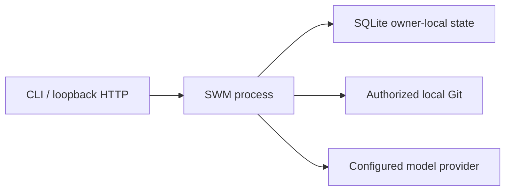

# 部署视图

当前实现是 Python 模块化单体：Interface、Application、Source Integration、Knowledge Engine、Model Gateway 与各自 SQLite Repository 在同一进程部署，但保持逻辑 Owner 和事务边界。

当前 HTTP 入口没有认证，因此只能绑定回环地址；开放网络、多人租户、外部数据库、高可用、备份恢复和生产身份治理都需要独立部署设计与授权。当前文档没有授予生产启用。

同进程不是安全依据。模型、来源、文件系统、网络、Provider 响应和用户输入仍按不可信边界处理。
