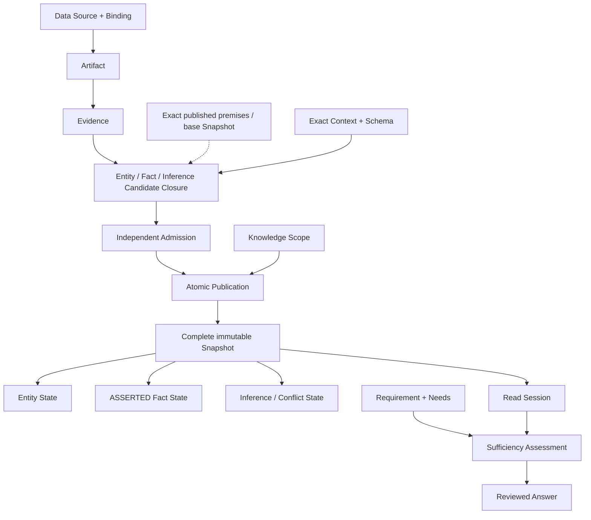

# 顶层领域模型

该图同时表达正式知识生命周期与读取边界。Evidence 不直接产生正式 Entity / Fact / Inference；Candidate 必须经过独立 Admission 和整体 Publication 才能在 Snapshot 中可见。Candidate 内的 Inference 只能使用 exact Snapshot 中已发布的正式前提；同批 Candidate 之间的局部引用不会获得正式前提资格。

## 概念边界

- **Artifact** 是来源的中立、可追溯观察载体，不是知识结论。
- **Evidence** 是 Artifact 中有界且可定位的观察，不表达全局真假。
- **Entity** 提供稳定身份；属性和关系由 Fact 或 Inference 表达。
- **Fact** 是在明确 Context 中由直接 Evidence 完整支持的命题。
- **Inference** 从已发布前提形成受控结论；Conflict 证明语义不兼容但不擅自选赢家。
- **Snapshot** 是单一 Scope 下完整、不可变、原子发布的正式知识状态。
- **Requirement** 固定任务语义；Sufficiency 必须逐 Need 从同一 Read Session 重建。

Knowledge Scope 保留三类稳定归属边界：

- **System Scope** 拥有单个软件系统的本地技术实体与知识。
- **Shared Component Scope** 拥有公共组件定义与静态知识；该组件在宿主系统中的运行观察仍归宿主 System Scope。
- **Business Domain Scope** 拥有跨系统 Business Entity 与业务语义；它通过对 exact upstream Snapshot 的 Fact / Inference 引用关联多个 System Scope，不复制或改变技术对象的归属。

Semantic View 是可能的只读组织方式，不拥有知识、不改变充分性。目前其专门契约未被接受，不属于当前系统能力；实现不得假设它已启用。
