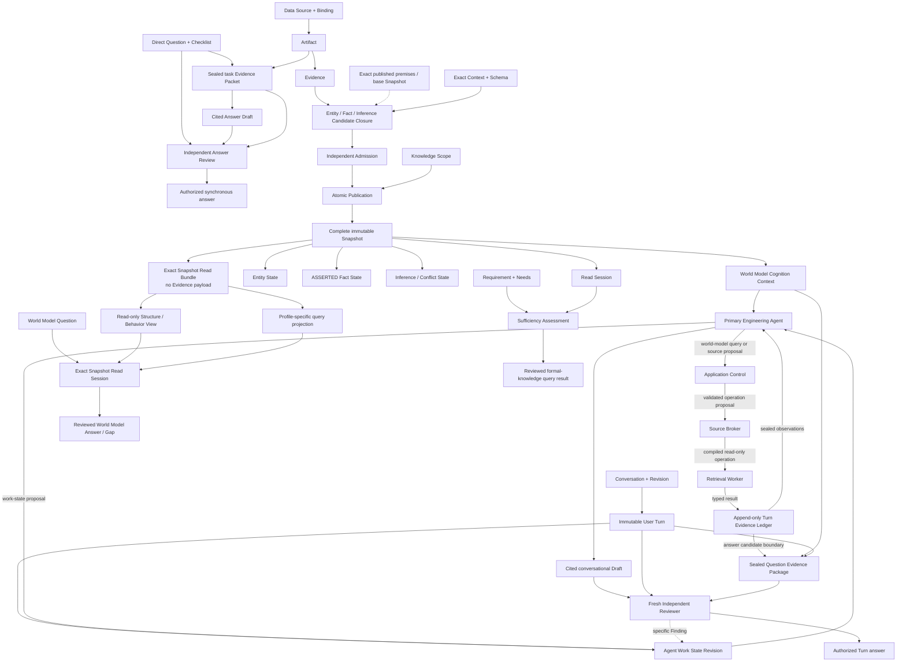

# 顶层领域模型

> 本文件是架构基线的领域投影。它描述对象边界，不决定默认 Chat 的认知路线；顶层关系以 [Software World Model 架构基线](architecture-baseline.md) 为准。

该图表达四条不同边界：Direct Investigation 把 Artifact 内容密封为只对当前问题有效的 Evidence Packet；Knowledge Update 把受审核
Candidate 原子发布为 Snapshot；World Model Query 只读 exact Snapshot/View 并返回受支持答案或 Knowledge Gap；Engineering
Conversation 由主工程 Agent 在 Application-owned Conversation/Work State 中使用 World Model Cognition 和 Broker/Worker 受控工具，
根据 Observation 重规划，并为每个候选答案密封 Question Evidence Package、独立审核。四者不能静默互换。Candidate 内的 Inference
只能使用 exact Snapshot 中已发布的正式前提；对话工作状态和同批 Candidate 的局部引用都不会获得正式知识资格。

## 概念边界

- **Artifact** 是来源的中立、可追溯观察载体，不是知识结论。
- **Evidence** 是 Artifact 中有界且可定位的观察，不表达全局真假。
- **Evidence Packet** 是绑定原问题、检查清单、exact Target、来源操作和 Artifact 内容的不可变任务输入；它没有跨任务正式知识资格。
- **World Model Cognition Context** 是从独立于模型会话/隐藏状态的 exact Snapshot / Read Set 为当前任务形成的只读认知投影，包含实体、关系、行为、约束、状态、证据、Coverage、Conflict 与 Unknown；手册或地图只是它的展示子集。
- **Conversation / Turn** 是有序、不可变的用户和系统交互历史及其 Revision；它保存语义连续性，但不自动成为软件事实或答案证据。
- **Agent Work State** 是 Application-owned 的当前目标、指代、约束、假设、计划、子任务、Observation、缺口和完成判断 Revision；它可恢复
  Agent 工作，但不是正式知识，也不允许隐藏 rationale 取得权威。
- **Evidence Ledger** 是当前 Turn 的 append-only 记录，按顺序绑定 Agent Tool Proposal、Broker Decision、World Model/Source
  Operation/Result、失败、Coverage 和资源收据；它允许同一主 Agent 基于已密封前缀继续，但本身不赋予条目真值。
- **Question Evidence Package** 是每个候选答案从 current Turn、World Model Cognition Context 和完整 Ledger 密封的唯一证据与边界集合；
  `support/citation` 仅含 admissible entries 并独占肯定 Claim/Citation 支持权，`boundary/audit` 强制保留 Gap/Failure/Partial/Conflict/
  Unknown 等非支持记录；seal 证明身份、完整性、顺序、来源和版本，不使其中内容自动为真，也不赋予 Fact/Snapshot 资格。
- **Answer Draft / Review Finding** 分别是主 Agent 综合形成的可引用自然答案和独立 Reviewer 针对正确性、完整性、Citation 或 Unknown
  边界的具体审核意见。可信 Application 把 Finding 路由为同包修订或新证据 Attempt；新 Package 必须产生新 Draft 和 fresh Review，只有
  finding-free 的当前 Review 才可授权。
- **Entity** 提供稳定身份；属性和关系由 Fact 或 Inference 表达。
- **Fact** 是在明确 Context 中由直接 Evidence 完整支持的命题。
- **Inference** 从已发布前提形成受控结论；Conflict 证明语义不兼容但不擅自选赢家。
- **Snapshot** 是单一 Scope 下完整、不可变、原子发布的正式知识状态。
- **Structure / Behavior / Profile-specific Query Projection** 是 exact Snapshot 中 typed Entity/Fact 的可重建只读组织，不创建知识；其中
  Profile-specific Query Projection 只是特定语言或任务的查询组织，不是新的 Semantic View，也不增加软件世界模型的认知维度。具体 Profile
  的查询输入、完整性及结果 Contract 由相应详细契约定义，不能改变该只读、无权威的边界。
- **Requirement** 固定任务语义；Sufficiency 必须逐 Need 从同一 Read Session 重建。

Knowledge Scope 保留三类稳定归属边界：

- **System Scope** 拥有单个软件系统的本地技术实体与知识。
- **Shared Component Scope** 拥有公共组件定义与静态知识；该组件在宿主系统中的运行观察仍归宿主 System Scope。
- **Business Domain Scope** 拥有跨系统 Business Entity 与业务语义；它通过对 exact upstream Snapshot 的 Fact / Inference 引用关联多个 System Scope，不复制或改变技术对象的归属。

## 实现与运行记录

原文中的具体配置、局部实现状态和运行记录已原样归位至项目路径 `docs/project/implementation-reference/domain-implementation-status.md`。
这些记录不能覆盖架构基线、证明当前代码已满足本契约，或恢复被用户暂停的开发。
