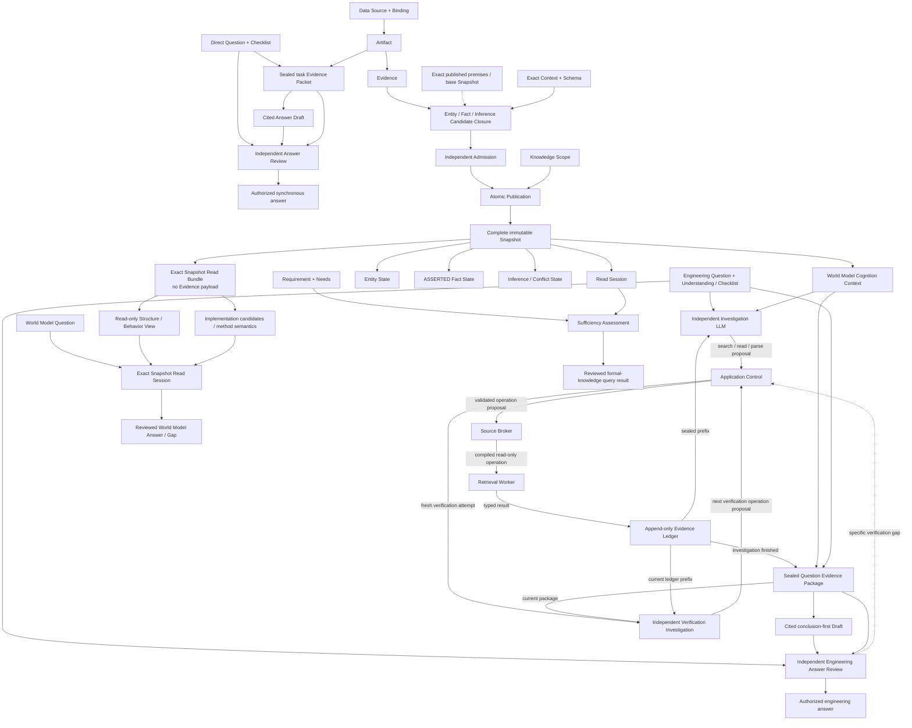

# 顶层领域模型

该图表达四条不同边界：Direct Investigation 把 Artifact 内容密封为只对当前问题有效的 Evidence Packet；Knowledge Update 把受审核 Candidate 原子发布为 Snapshot；World Model Query 只读 exact Snapshot/View 并返回受支持答案或 Knowledge Gap；Engineering Question Answering 从 exact Snapshot 投影 World Model Cognition Context，独立 Investigation LLM 根据 append-only Ledger 的每一步发现自适应提议调查，Source Broker/Worker 受控执行，调查结束后才密封 Question Evidence Package。四者不能静默互换。Candidate 内的 Inference 只能使用 exact Snapshot 中已发布的正式前提；同批 Candidate 之间的局部引用不会获得正式前提资格。

## 概念边界

- **Artifact** 是来源的中立、可追溯观察载体，不是知识结论。
- **Evidence** 是 Artifact 中有界且可定位的观察，不表达全局真假。
- **Evidence Packet** 是绑定原问题、检查清单、exact Target、来源操作和 Artifact 内容的不可变任务输入；它没有跨任务正式知识资格。
- **World Model Cognition Context** 是从独立于模型会话/隐藏状态的 exact Snapshot / Read Set 为当前任务形成的只读认知投影，包含实体、关系、行为、约束、状态、证据、Coverage、Conflict 与 Unknown；手册或地图只是它的展示子集。
- **Evidence Ledger** 是 `ENGINEERING_QA` 调查的 append-only 记录，按顺序绑定模型 Proposal、Broker Decision、Source Operation/Result、失败、Coverage 和资源收据；它允许后续调查基于已密封前缀继续，但本身不赋予条目真值。
- **Question Evidence Package** 是调查结束后从原问题、World Model Cognition Context 和完整 Ledger 密封的本题唯一证据与边界集合；`support/citation` 仅含 admissible entries 并独占肯定 Claim/Citation 支持权，`boundary/audit` 强制保留 Gap/Failure/Partial/Conflict/Unknown 等非支持记录；seal 证明身份、完整性、顺序、来源和版本，不使其中内容自动为真，也不赋予 Fact/Snapshot 资格。
- **Answer Draft / Review Finding** 分别是可引用自然答案和独立审核意见；只有空 Finding 的 APPROVED Draft 可被授权。
- **Entity** 提供稳定身份；属性和关系由 Fact 或 Inference 表达。
- **Fact** 是在明确 Context 中由直接 Evidence 完整支持的命题。
- **Inference** 从已发布前提形成受控结论；Conflict 证明语义不兼容但不擅自选赢家。
- **Snapshot** 是单一 Scope 下完整、不可变、原子发布的正式知识状态。
- **Structure / Behavior / Implementation Query** 是 exact Snapshot 中 typed Entity/Fact 的可重建只读组织，不创建知识；Java
  Implementation Query 只能读取 `JAVA_SOURCE_SEMANTICS@1` 的 no-payload atoms 与 per-method completeness。
- **Requirement** 固定任务语义；Sufficiency 必须逐 Need 从同一 Read Session 重建。

Knowledge Scope 保留三类稳定归属边界：

- **System Scope** 拥有单个软件系统的本地技术实体与知识。
- **Shared Component Scope** 拥有公共组件定义与静态知识；该组件在宿主系统中的运行观察仍归宿主 System Scope。
- **Business Domain Scope** 拥有跨系统 Business Entity 与业务语义；它通过对 exact upstream Snapshot 的 Fact / Inference 引用关联多个 System Scope，不复制或改变技术对象的归属。

Structure View、`JAVA_STATIC_CALL_GRAPH@1` 的最小 Behavior View 与 `JAVA_SOURCE_SEMANTICS@1` 的通用查询 Contract 已接受为规范；
后者尚不代表实现或 Product Validation 已完成。它们都不拥有知识、不改变充分性。完整运行时 Behavior、Business、History 和
其他语言尚未接受，不能从当前子集推导其存在。
