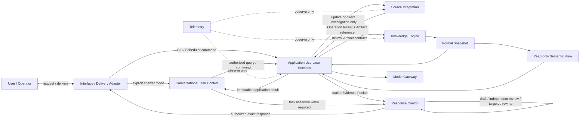

# 架构概览

Software World Model 平台负责构建和使用“软件世界模型”；平台本身不是某个世界模型。一个世界模型由 Knowledge Scope、精确 Context、Schema 和不可变 Snapshot 确定。平台通过 Knowledge Engine 拥有正式知识记录及其生命周期的权威，但平台运行状态不因此成为软件世界的业务命题。

系统采用 AI-native、可信控制的模块化单体：模型负责适合生成式推理的 Proposal 和 Review；平台负责身份、权限、上下文、准入、发布、一致性、恢复和最终放行。

## 外部边界

- 软件来源、模型 Provider、交付 Adapter 和 Telemetry Backend 都是不可信外部边界。
- 来源访问必须由 Source Integration 执行；模型不能直接执行来源或平台工具，只能提交由平台重新授权的结构化 Proposal。
- Provider 响应只能形成 Proposal 或评测输入，必须由领域所有者校验。
- Direct Investigation 的 Evidence Packet 是任务级固定输入，不是正式知识；World Model Query 的答案 worker 只读取 exact Snapshot/Read Set 的 no-payload Read Bundle 和只读 View。Citation Projector 在结果密封后以独立进程展示 Evidence observation，不得回流。两种回答结果必须显式区分，不能静默回退。
- 当前系统规范不等于部署授权；任何环境启用都需要与 exact subject 匹配的独立证据和显式授权。

## 演进方式

扩展优先沿现有 Owner、Port 和 Contract 增加 Strategy。Direct Investigation 与 World Model Query 是 Application 内两个显式用例；Semantic View 是可重建的只读组织层，不新增知识权威。正式知识由独立 Knowledge Update 构建，不能依赖提问触发。只有出现新的权威状态、事务边界或安全边界时，才新增顶层组件。
