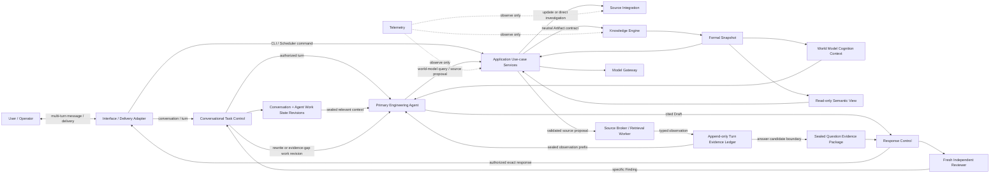

# 架构概览

> 本文件是 `SYS-ARCH-BASELINE` 的兼容性投影，不拥有独立的顶层架构语义。`semantic_owner` 和 `authority_scope` 是机器可读的范围标记；架构讨论和变更以 [Software World Model 架构基线](architecture-baseline.md) 为准。

Software World Model 平台负责构建和使用“软件世界模型”；平台本身不是某个世界模型。一个世界模型由 Knowledge Scope、精确 Context、Schema 和不可变 Snapshot 确定，是软件系统持久、版本化、可验证、可更新的外部认知模型。它为 AI 提供实体、关系、行为、约束、状态、来源、Coverage、Conflict 与 Unknown 组成的系统认知；手册、地图、摘要或 locator 只是可重建投影。平台通过 Knowledge Engine 拥有正式知识记录及其生命周期的权威，但平台运行状态不因此成为软件世界的业务命题。

系统采用 AI-native、可信控制的模块化单体：主工程 Agent 负责目标理解、假设、计划、工具选择、观察后重规划和答案综合，独立 Reviewer 负责
Review，具体实现可以由任一合格模型策略提供；平台负责身份、权限、对话和工作状态、工具执行、证据、准入、发布、一致性、恢复和最终放行。
Agent 的认知控制不等于系统权威。

## 外部边界

- 软件来源、模型 Provider、交付 Adapter 和 Telemetry Backend 都是不可信外部边界。
- 来源访问必须由 Source Integration 的 Broker/Worker 边界执行；主工程 Agent 只能提交由平台重新授权、编译的结构化 Proposal，Reviewer
  不能执行任何来源或平台工具。
- Provider 响应只能形成 Proposal 或受控验证输入，必须由领域所有者校验。
- Direct Investigation 的 Evidence Packet 是任务级固定输入，不是正式知识；World Model Query 的答案 worker 只读取 exact Snapshot/Read Set
  的 no-payload Read Bundle 和只读 View。默认 Engineering Conversation 从 exact Snapshot 形成 World Model Cognition，并由同一逻辑主工程
  Agent 持续理解对话、查询认知、经 Broker/Worker 在 exact revision 受控取证、观察后重规划和综合回答。每个候选答案仍密封含
  `support/citation` 与 `boundary/audit` 分区的 Question Evidence Package；Reviewer 只读当前 Turn、受信对话上下文、Package 与 Draft，
  具体 Finding 返回主 Agent 新工作 Revision。Citation 展示不得回流答案链。显式用例身份不能静默切换。
- 当前系统规范不等于部署授权；任何环境启用都需要与 exact subject 匹配的独立证据和显式授权。

## 演进方式

扩展优先沿现有 Owner、Port 和 Contract 增加 Strategy。Direct Investigation、World Model Query 与 Engineering Conversation 可以作为
显式安全/兼容 Profile，但默认 Engineering Conversation 由同一主 Agent 自适应组合世界模型和源码；它不受固定先后或静默模式切换约束。
World Model Cognition Context、Semantic View 和用户手册均是 exact Snapshot 的只读投影；Conversation/Agent Work State 是应用级可恢复
工作记录，不是正式知识；Source Broker、Retrieval Worker 与当前回合 Evidence 是受限调查边界。正式知识由独立 Knowledge Update 构建，
冲突可以通过最小 Knowledge Maintenance Task 异步驱动更新。只有出现新的权威状态、事务边界或安全边界时，才新增顶层组件。
