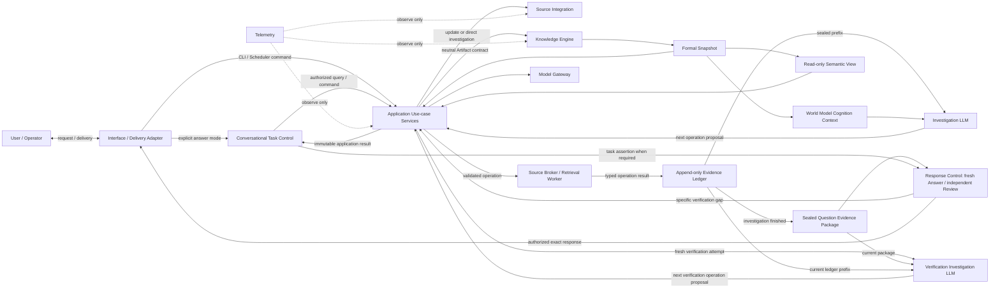

# 架构概览

Software World Model 平台负责构建和使用“软件世界模型”；平台本身不是某个世界模型。一个世界模型由 Knowledge Scope、精确 Context、Schema 和不可变 Snapshot 确定，是软件系统持久、版本化、可验证、可更新的外部认知模型。它为 AI 提供实体、关系、行为、约束、状态、来源、Coverage、Conflict 与 Unknown 组成的系统认知；手册、地图、摘要或 locator 只是可重建投影。平台通过 Knowledge Engine 拥有正式知识记录及其生命周期的权威，但平台运行状态不因此成为软件世界的业务命题。

系统采用 AI-native、可信控制的模块化单体：模型负责适合生成式推理的 Proposal 和 Review；平台负责身份、权限、上下文、准入、发布、一致性、恢复和最终放行。

## 外部边界

- 软件来源、模型 Provider、交付 Adapter 和 Telemetry Backend 都是不可信外部边界。
- 来源访问必须由 Source Integration 的 Broker/Worker 边界执行；Investigation 或 Reviewer 模型不能直接执行来源或平台工具，只能提交由平台重新授权、编译的结构化 Proposal。
- Provider 响应只能形成 Proposal 或评测输入，必须由领域所有者校验。
- Direct Investigation 的 Evidence Packet 是任务级固定输入，不是正式知识；World Model Query 的答案 worker 只读取 exact Snapshot/Read Set 的 no-payload Read Bundle 和只读 View。Engineering Question Answering 先从 exact Snapshot 形成 World Model Cognition Context，再由独立 Investigation LLM 基于 append-only Evidence Ledger 自适应提议调查，Broker/Worker 在 exact revision 受控执行；调查结束后才密封含 `support/citation` 与 `boundary/audit` 分区的 Question Evidence Package。Answer/Reviewer 都只读当前固定包；Reviewer 只提出具体 Verification gap，新的独立 Verification Investigation 在全新上下文读取 gap + current Package/Ledger，再经 Application/Broker/Worker 多步形成新 Ledger/Package。Citation 展示不得回流答案链。三种回答结果必须显式区分，不能静默切换。
- 当前系统规范不等于部署授权；任何环境启用都需要与 exact subject 匹配的独立证据和显式授权。

## 演进方式

扩展优先沿现有 Owner、Port 和 Contract 增加 Strategy。Direct Investigation、World Model Query 与 Engineering Question Answering 是 Application 内三个显式用例；World Model Cognition Context、Semantic View 和用户手册均是 exact Snapshot 的只读投影；Source Broker、Retrieval Worker 与 Evidence Ledger 是受限调查和审计边界，都不新增正式知识权威。正式知识由独立 Knowledge Update 构建，不能依赖提问触发；Engineering QA 后的知识沉淀只能在 Delivery 之后异步提议。只有出现新的权威状态、事务边界或安全边界时，才新增顶层组件。
