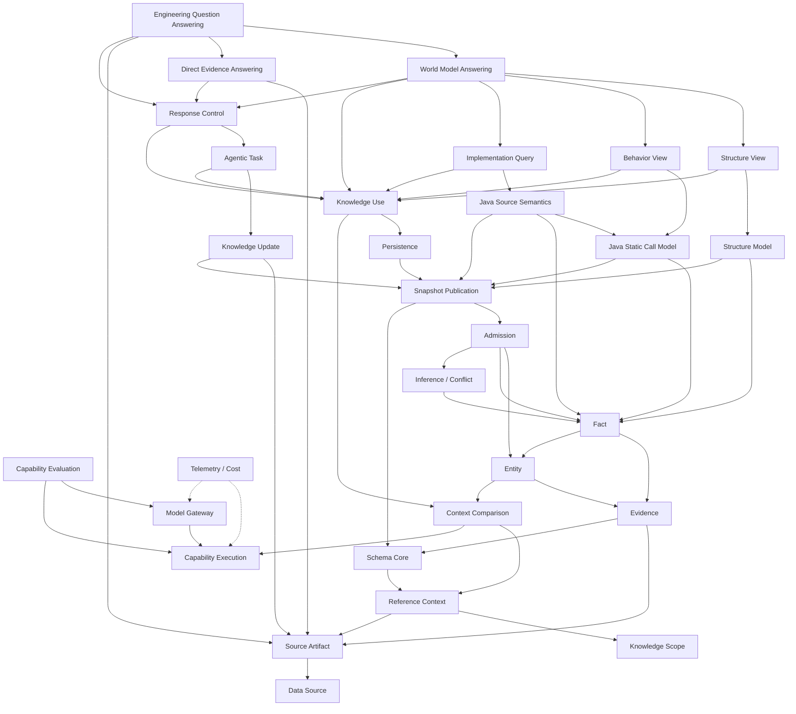

# 系统契约

Contract 只保留跨模块或跨迭代不能自由改变的语义。判断一段内容是否应留在这里：删除后若两种实现都能通过局部测试，但其中一种会破坏跨 Owner 权限、外部可观察行为、安全、不可逆数据或并发一致性，则它属于 Contract；否则由代码、类型、Schema 和测试决定。

## 当前 Contract

| 域 | 文档 |
|---|---|
| Source | [Data Source](source/data-source.md)、[Source Artifact](source/source-artifact.md) |
| Knowledge | [Knowledge Scope](knowledge/knowledge-scope.md)、[Reference Context](knowledge/reference-context.md)、[Schema Core](knowledge/schema-core.md)、[Context Comparison](knowledge/context-comparison.md)、[Evidence](knowledge/evidence.md)、[Entity](knowledge/entity.md)、[Fact](knowledge/fact.md)、[Inference & Conflict](knowledge/inference-conflict.md)、[Admission](knowledge/admission.md)、[Snapshot Publication](knowledge/snapshot-publication.md)、[Persistence](knowledge/persistence.md)、[Structure Model](knowledge/structure-model.md)、[Java Static Call Model](knowledge/java-static-call-model.md)、[Java Source Semantics](knowledge/java-source-semantics.md) |
| Application | [Management](application/management.md)、[Knowledge Update](application/knowledge-update.md)、[Knowledge Use](application/knowledge-use.md)、[Structure View](application/structure-view.md)、[Java Static Call Behavior View](application/behavior-view.md)、[Java Implementation Query](application/implementation-query.md)、[World Model Answering](application/world-model-answering.md)、[Direct Evidence Answering](application/evidence-answering.md)、[Engineering Question Answering](application/engineering-question-answering.md)、[Agentic Task](application/agentic-task.md)、[Response Control](application/response-control.md) |
| AI | [Model Gateway](ai/model-gateway.md)、[Capability Evaluation](ai/capability-evaluation.md) |
| Cross-cutting | [Capability Execution](cross-cutting/capability-execution.md)、[Telemetry & Cost](cross-cutting/telemetry-cost.md) |

当前系统不支持跨 Schema Adoption。专门 Semantic View 中接受了 Maven Structure View 与
`JAVA_STATIC_CALL_GRAPH@1` 的最小 Behavior View；完整 Behavior、Business、History 和其他语言仍不得从这两个子集推导。

## 依赖主干

箭头固定表示“左侧 Contract `depends_on` 右侧 Contract”，与 front matter 和生成的依赖图使用同一方向；它不是运行时数据流。

图只表示规范依赖，不表示开发顺序或生产完成度。
